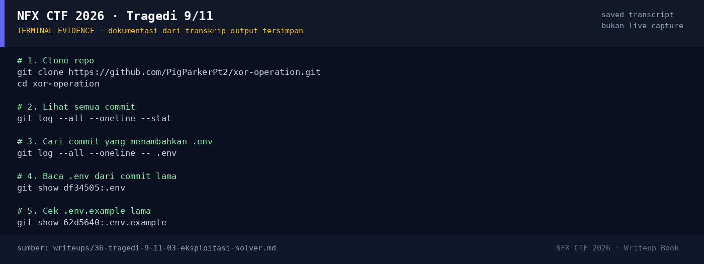

# Tragedi 9/11

Track Umum / Extend · OsintHard380 poinVERIFIED

| Field | Nilai |
|---|---|
| Event | `umum_Extend` |
| Kategori | `Osint` |
| Difficulty | `Hard` |
| Poin | `380` |
| Author | `salep88` |
| Solves | `7` |
| Tools | curl, python3, git |
| Flag | `NFX{OS1NT_DU4R_D34_D0R}` |
| Status | `VERIFIED` |

[← Kembali ke Index](index.md)

## TL;DR

- Video challenge adalah rekaman 9/11 berdurasi **58,5 detik**, 1920×1080,
  H.264 + AAC. Ini video “shop owner saves woman's life from wall of dust
  on 9/11”.
- Video itu dibagikan di **r/PublicFreakout** oleh **u/PigParkerPt2** pada
  11 September 2021. Username ini menjadi pivot.
- Di GitHub ada user **PigParkerPt2** dengan repo **`xor-operation`**.
- Repo saat ini terlihat “bersih”, tetapi **history git** menyimpan
  commit `df34505` yang menambahkan `.env` berisi flag.
- Commit `ea765a9` menghapus `.env`, tetapi objek commit lama tetap ada.
- Flag: `NFX{OS1NT_DU4R_D34_D0R}`.

Pratinjau evidence. Buka halaman <a href="36-tragedi-9-11-05-bukti-evidence.html">Evidence / Bukti</a> untuk semua screenshot dan transkrip.

## Navigasi Halaman

<a class="nx-page-card" href="36-tragedi-9-11-01-recon.html"><b>Recon</b>Enumerasi target dan bukti awal</a>
<a class="nx-page-card" href="36-tragedi-9-11-02-analisis.html"><b>Analisis</b>Membaca alur dan akar masalah</a>
<a class="nx-page-card" href="36-tragedi-9-11-03-eksploitasi-solver.html"><b>Eksploitasi / Solver</b>Langkah exploit dan solver</a>
<a class="nx-page-card" href="36-tragedi-9-11-04-flag.html"><b>Flag</b>Flag dan verifikasi platform</a>
<a class="nx-page-card" href="36-tragedi-9-11-05-bukti-evidence.html"><b>Bukti / Evidence</b>Screenshot, transkrip, dan artefak</a>
<a class="nx-page-card" href="36-tragedi-9-11-06-referensi.html"><b>Referensi</b>Sumber dan bacaan lanjutan</a>

