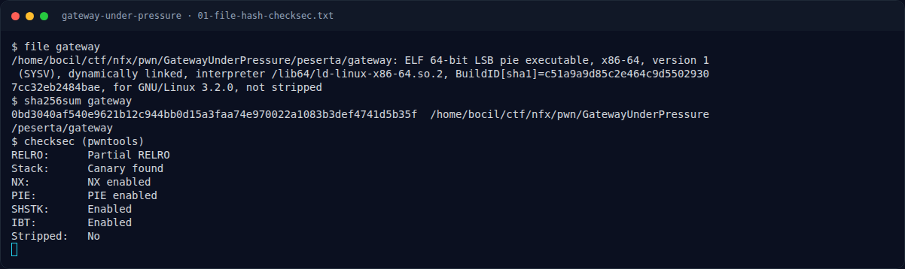

# Gateway Under Pressure — Recon

[← Overview](37-gateway-under-pressure.md) · [Index](index.md)

## 1.1 Deskripsi challenge

> **Author: Amablex**
>
> Sebuah perusahaan menggunakan gateway untuk menangani komunikasi antara pengguna eksternal dan infrastruktur internal. Audit menemukan bahwa salah satu komponen memiliki kelemahan saat memproses data masuk. Kamu diberikan binary simulasi komponen tersebut. Analisis bagaimana kesalahan pengelolaan memori dapat memengaruhi alur eksekusi, lalu buktikan bahwa fungsi yang tidak tersedia pada alur normal dapat dicapai.

Petunjuk "fungsi yang tidak tersedia pada alur normal" sangat sesuai dengan fungsi `release_gateway()` yang ada di symbol table tetapi tidak dipanggil dari `main()`.

## 1.2 File yang diberikan

| File | Ukuran | SHA-256 |
|---|---|---|
| `pwn/GatewayUnderPressure/peserta/gateway` | 16.976 B | `0bd3040af540e9621b12c944bb0d15a3faa74e970022a1083b3def4741d5b35f` |

Tidak ada libc/loader tambahan; binary memakai glibc host. Service asli terdaftar sebagai `NFX/PWNNXCTF-2026/GatewayUnderPressure` (TCP) di `pwn/SERVICES.md`, tetapi pada saat penulisan berstatus **stopped**; analisis dilakukan pada binary yang diberikan.

## 1.3 Environment

- Linux x86-64, glibc 2.39 (host).
- Tools: `file`, `sha256sum`, `strings`, `objdump`, `nm`, `pwntools`.
- Menjalankan lokal:
  ```bash
  cd pwn/GatewayUnderPressure/peserta
  ./gateway
  ```

### Evidence langkah ini



*Terminal evidence — `01-file-hash-checksec.txt` (arsip transkrip sesi solve).*
