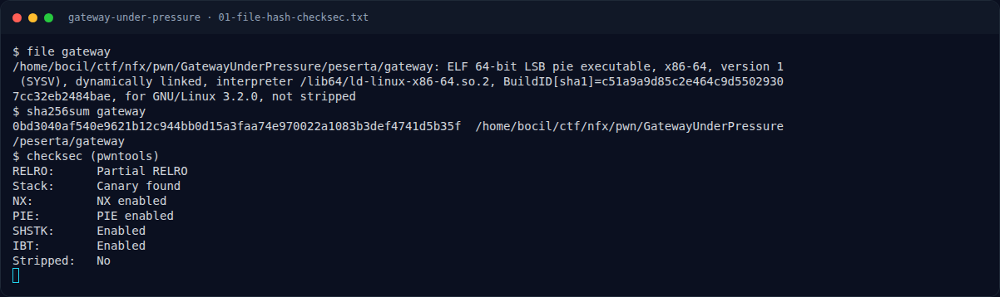
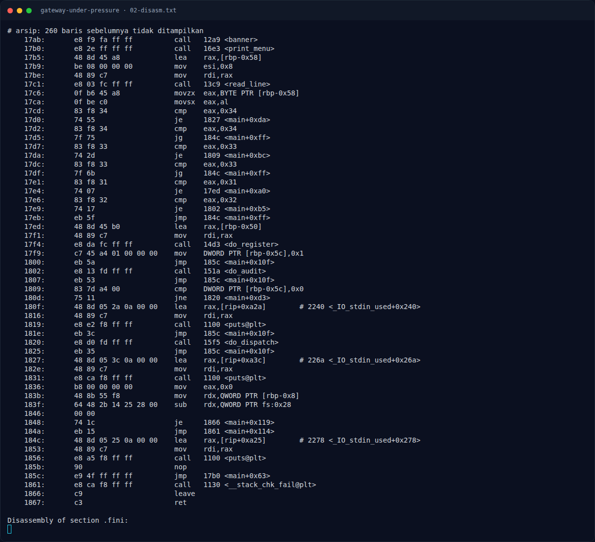

# Gateway Under Pressure — Triage awal

[← Overview](37-gateway-under-pressure.md) · [Index](index.md)

> **Langkah 2/8 — Triage awal.** strings langsung menunjukkan fungsi win dan path flag:
>
> **Titik penting:** file gateway · checksec (pwntools)
>
> **Berikutnya:** [`do_audit()` — arbitrary-length stack read](37-gateway-under-pressure-03-do-audit-arbitrary-length-stack-read.md)

## 1.4 Triage awal

```text
$ file gateway
gateway: ELF 64-bit LSB pie executable, x86-64, version 1 (SYSV),
dynamically linked, interpreter /lib64/ld-linux-x86-64.so.2,
BuildID[sha1]=c51a9a9d85c2e464c9d55029307cc32eb2484bae,
for GNU/Linux 3.2.0, not stripped

$ checksec (pwntools)
RELRO:      Partial RELRO
Stack:      Canary found
NX:         NX enabled
PIE:        PIE enabled
SHSTK:      Enabled
IBT:        Enabled
Stripped:   No
```

`strings` langsung menunjukkan fungsi win dan path flag:

```text
=== NX GATEWAY SERVICE ===
node: gw-edge-01  |  build: 2025.11
flag.txt
[!] flag.txt tidak ditemukan di direktori kerja
FLAG: %s
session token :
[+] sesi terdaftar, dispatch diizinkan.
audit length (max %d) :
[!] audit length tidak valid
[+] audit selesai (%ld byte)
dispatch length (max %d) :
dispatch payload :
[+] dispatch diterima (%ld byte)
[1] Register session
[2] Audit memory
[3] Dispatch request
[4] Exit
[!] sesi belum terdaftar, pakai [1] dulu.
```

Symbol table:

```text
00000000000012e1 t release_gateway
00000000000013c9 t read_line
000000000000145f t read_exact
00000000000014d3 t do_register
000000000000151a t do_audit
00000000000015f5 t do_dispatch
000000000000174d T main
```

**Temuan:** `release_gateway()` adalah target ret2win; `do_audit()` dan `do_dispatch()` adalah kandidat bug.

### Evidence langkah ini



*Terminal evidence — `01-file-hash-checksec.txt` (arsip transkrip sesi solve).*



*Terminal evidence — `02-disasm.txt` (arsip transkrip sesi solve).*

**Berkas mentah langkah ini:**

- [`01-file-hash-checksec.txt`](assets/gateway-under-pressure/01-file-hash-checksec.txt)
- [`02-disasm.txt`](assets/gateway-under-pressure/02-disasm.txt)
