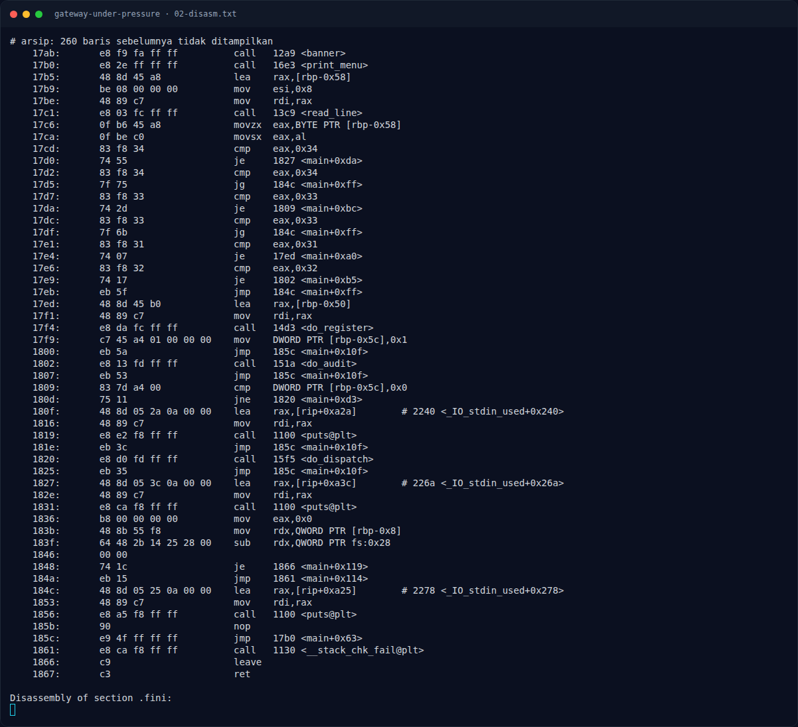
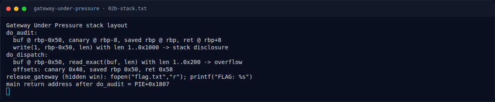

# Gateway Under Pressure — `do_audit()` — arbitrary-length stack read

[← Overview](37-gateway-under-pressure.md) · [Index](index.md)

> **Langkah 3/8 — `do_audit()` — arbitrary-length stack read.** Buffer hanya 0x50 byte (dari rbp-0x50 sampai rbp), tetapi write() membaca sampai 0x1000 byte.
>
> **Titik penting:** Buffer hanya 0x50 byte (dari rbp-0x50 sampai rbp), tetapi write() membaca sampai 0x1000 byte.
>
> **Berikutnya:** [Analisis](37-gateway-under-pressure-04-analisis.md)

## 2.1 `do_audit()` — arbitrary-length stack read

```asm
151a: do_audit:
151e: push rbp
151f: mov  rbp, rsp
1522: add  rsp, 0xffffffffffffff80     # frame 0x80
1526: mov  rax, fs:0x28
152f: mov  [rbp-0x8], rax              # canary @ rbp-8
...
154e: lea  rax, [rbp-0x70]             # input length buffer
155a: call read_line
156d: call __isoc23_strtol
1575: mov  [rbp-0x78], rax             # len
1579: cmp  QWORD PTR [rbp-0x78], 0x0
157e: jle  reject
1580: cmp  QWORD PTR [rbp-0x78], 0x1000
1588: jle  ok
...
159b: mov  rdx, [rbp-0x78]             # len (1..0x1000)
159f: lea  rax, [rbp-0x50]             # buf @ rbp-0x50
15a3: mov  rsi, rax
15a6: mov  edi, 1                      # stdout
15ab: call write                       # write(1, rbp-0x50, len)
```

Buffer hanya `0x50` byte (dari `rbp-0x50` sampai `rbp`), tetapi `write()` membaca sampai `0x1000` byte. Ini membocorkan:

| Offset dari buf | Isi |
|---|---|
| `0x00..0x47` | isi buffer (tidak diinisialisasi) |
| `0x48..0x4f` | **stack canary** (`rbp-8`) |
| `0x50..0x57` | saved RBP |
| `0x58..0x5f` | **return address ke `main+0xba`** (instruksi setelah `call do_audit`) |

### Evidence langkah ini



*Terminal evidence — `02-disasm.txt` (arsip transkrip sesi solve).*



*Terminal evidence — `02b-stack.txt` (arsip transkrip sesi solve).*

**Berkas mentah langkah ini:**

- [`02-disasm.txt`](assets/gateway-under-pressure/02-disasm.txt)
- [`02b-stack.txt`](assets/gateway-under-pressure/02b-stack.txt)
