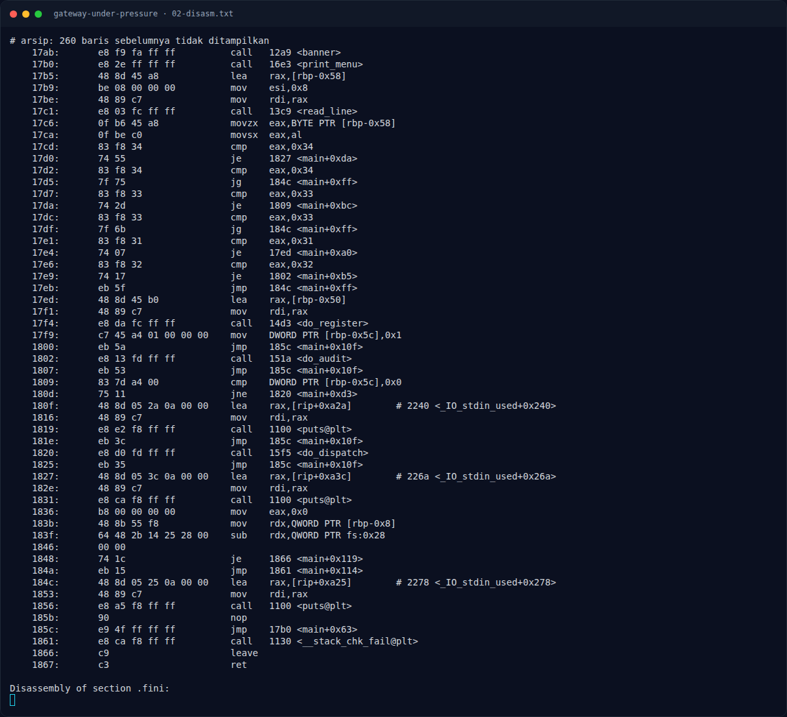
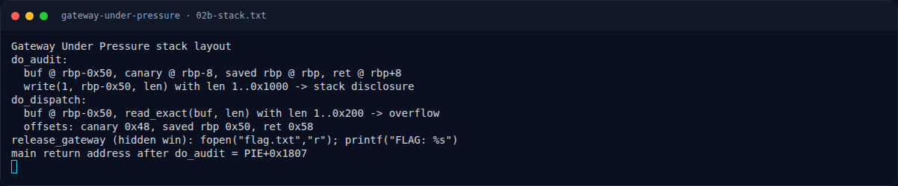

# Gateway Under Pressure — Analisis

[← Overview](37-gateway-under-pressure.md) · [Index](index.md)

> **Langkah 4/8 — Analisis.** readexact membaca persis len byte (loop sampai terpenuhi) ke buffer 0x50.
>
> **Titik penting:** readexact membaca persis len byte (loop sampai terpenuhi) ke buffer 0x50.
>
> **Berikutnya:** [Eksploitasi](37-gateway-under-pressure-05-eksploitasi.md)

## 2.2 `do_dispatch()` — stack overflow

```asm
15f5: do_dispatch:
15fd: add  rsp, 0xffffffffffffff80
1601: mov  rax, fs:0x28
160a: mov  [rbp-0x8], rax              # canary @ rbp-8
...
1610: lea  rax, [rip+0xb30]            # "dispatch length (max %d)"
1624: call printf
1629: lea  rax, [rbp-0x70]
1635: call read_line                    # parse length
164b: call __isoc23_strtol
1650: mov  [rbp-0x78], rax
1654: cmp  QWORD PTR [rbp-0x78], 0x0
1659: jle  reject
165b: cmp  QWORD PTR [rbp-0x78], 0x200
1663: jle  ok
...
168a: mov  rdx, [rbp-0x78]             # len 1..0x200
168e: lea  rax, [rbp-0x50]             # buf @ rbp-0x50
1698: call read_exact                   # read_exact(buf, len)
```

`read_exact` membaca persis `len` byte (loop sampai terpenuhi) ke buffer `0x50`. Offset klasik:

```text
buf              rbp-0x50
canary           rbp-0x08   -> 0x48
saved rbp        rbp         -> 0x50
saved rip        rbp+0x08    -> 0x58
```

## 2.3 `release_gateway()` — hidden win

```asm
12e1: release_gateway:
...
12ff: lea rdx, [rip+0xd47]      # "r"
1306: lea rax, [rip+0xd42]      # "flag.txt"
1313: call fopen
...
134a: mov rdx, [rbp-0x118]      # FILE*
1351: lea rax, [rbp-0x110]
1358: mov esi, 0x100
1360: call fgets
...
1392: lea rdx, [rip+0xcf1]      # "FLAG: %s"
13a4: call printf
...
13bd: call exit
```

Fungsi ini membuka `flag.txt` di **current working directory**, membaca satu baris, dan mencetak `FLAG: <isi>`.

## 2.4 PIE base

Return address yang bocor dari `do_audit()` adalah `main+0xba` (`0x174d + 0xba = 0x1807`, instruksi setelah `call do_audit` di `main+0xb5`; lihat `main` di `02-disasm.txt`). Jadi:

```text
pie_base = leak_ret - 0x1807
```

Hasil exploit selalu page-aligned.

### Evidence langkah ini



*Terminal evidence — `02-disasm.txt` (arsip transkrip sesi solve).*



*Terminal evidence — `02b-stack.txt` (arsip transkrip sesi solve).*

**Berkas mentah langkah ini:**

- [`02-disasm.txt`](assets/gateway-under-pressure/02-disasm.txt)
- [`02b-stack.txt`](assets/gateway-under-pressure/02b-stack.txt)
