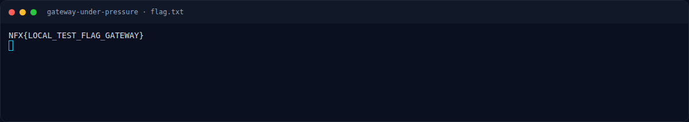
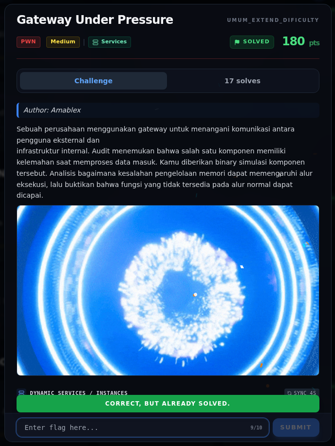

# Gateway Under Pressure — Flag & Verifikasi

[← Overview](37-gateway-under-pressure.md) · [Index](index.md)

> **Langkah 6/8 — Flag.** Status tercatat accepted di platform. Buktinya terminal evidence di halaman ini.
>
> **Titik penting:** NFX{Nyoss_Gte3wayy_Pr3ssureee0!}
>
> **Berikutnya:** [Bukti / Evidence](37-gateway-under-pressure-07-bukti-evidence.md)

> **Asal flag.** Flag diperoleh dari langkah exploit/solver yang terdokumentasi, lalu disubmit ke platform.  
> **Tingkat bukti metode.** Terdokumentasi. [Buka Evidence](37-gateway-under-pressure-07-bukti-evidence.md)

> **Flag:** `NFX{Nyoss_Gte3wayy_Pr3ssureee0!}`
> **Status:** `VERIFIED`

```text
NFX{Nyoss_Gte3wayy_Pr3ssureee0!}
```

Verifikasi:

```text
$ cat flags/pwn/GatewayUnderPressure.txt
NFX{Nyoss_Gte3wayy_Pr3ssureee0!}
```

Status `VERIFIED`: flag tercatat accepted di platform. File `writeups/FLAGS.md` tidak ada di repo ini.

### Terminal evidence (real)



*Terminal evidence (real).*

> **Bukti:** terminal evidence (real).

## Validasi platform (real)



*Screenshot asli dari platform NFX CTF 2026. Platform menjawab
`CORRECT, BUT ALREADY SOLVED.` untuk flag ini.*
