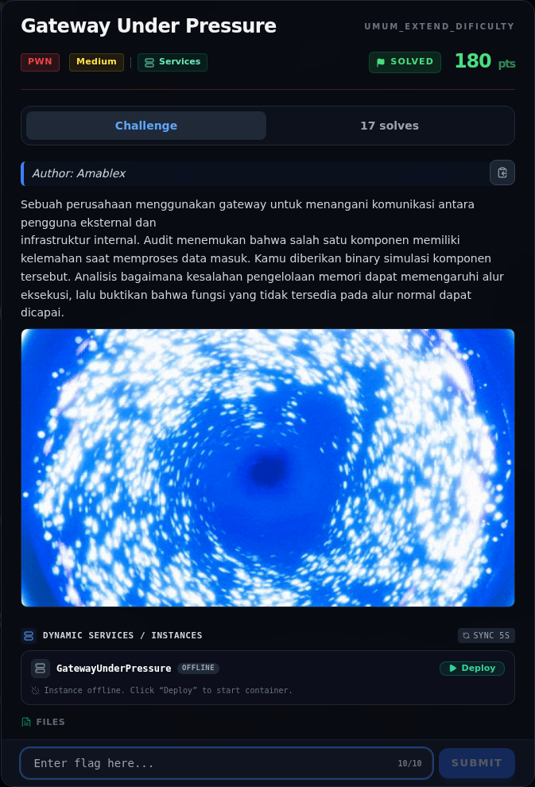

# Gateway Under Pressure — Referensi

[← Overview](37-gateway-under-pressure.md) · [Index](index.md)

> **Langkah 8/8 — Referensi.** Referensi
>
> **Titik penting:** —
>
> **Selesai.** Kembali ke [Overview](37-gateway-under-pressure.md).

- `pwn/GatewayUnderPressure/peserta/gateway` (binary challenge).
- `pwn/SERVICES.md` — daftar service dan status.
- `writeups/assets/libc-offsets-and-gadgets.txt` — offset libc/gadget yang dipakai.
- pwntools `ELF`, `process`, `u64`.

### Evidence langkah ini

*Challenge brief asli di platform NFX CTF 2026.*
