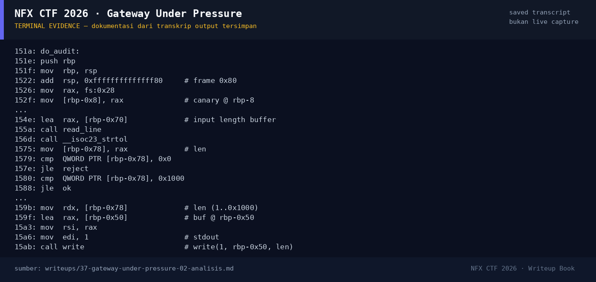

# Gateway Under Pressure

Track Umum / Extend · PwnMedium300 poinVERIFIED

| Field | Nilai |
|---|---|
| Event | `umum_Extend` |
| Kategori | `Pwn` |
| Difficulty | `Medium` |
| Poin | `300` |
| Author | `Amablex` |
| Solves | `11` |
| Tools | python3, pwntools, checksec, objdump, strings |
| Flag | `NFX{Nyoss_Gte3wayy_Pr3ssureee0!}` |
| Status | `VERIFIED` |

[← Kembali ke Index](index.md)

## TL;DR

- `gateway` adalah binary PIE dengan menu: register session, **audit memory**, dispatch request.
- `do_audit()` melakukan `write(1, buf, len)` dengan `len` yang dikendalikan pengguna (sampai `0x1000`) dari buffer stack `0x50` → **stack disclosure**: canary, saved RBP, dan return address PIE bocor.
- `do_dispatch()` melakukan `read_exact(buf, len)` dengan `len` sampai `0x200` ke buffer stack `0x50` tanpa validasi → **stack overflow**.
- Ada fungsi tersembunyi `release_gateway()` yang membuka `flag.txt` dan mencetak `FLAG: ...` (tidak dipanggil pada alur normal).
- Exploit: leak canary + PIE base dari audit, lalu ret2win `release_gateway()` dengan satu gadget `ret` untuk alignment.
- Flag: `NFX{Nyoss_Gte3wayy_Pr3ssureee0!}`.

Pratinjau evidence. Buka halaman <a href="37-gateway-under-pressure-05-bukti-evidence.html">Evidence / Bukti</a> untuk semua screenshot dan transkrip.

## Navigasi Halaman

<a class="nx-page-card" href="37-gateway-under-pressure-01-recon.html"><b>Recon</b>Enumerasi target dan bukti awal</a>
<a class="nx-page-card" href="37-gateway-under-pressure-02-analisis.html"><b>Analisis</b>Membaca alur dan akar masalah</a>
<a class="nx-page-card" href="37-gateway-under-pressure-03-eksploitasi.html"><b>Eksploitasi</b>Langkah exploit dan solver</a>
<a class="nx-page-card" href="37-gateway-under-pressure-04-flag.html"><b>Flag</b>Flag dan verifikasi platform</a>
<a class="nx-page-card" href="37-gateway-under-pressure-05-bukti-evidence.html"><b>Bukti / Evidence</b>Screenshot, transkrip, dan artefak</a>
<a class="nx-page-card" href="37-gateway-under-pressure-06-referensi.html"><b>Referensi</b>Sumber dan bacaan lanjutan</a>

