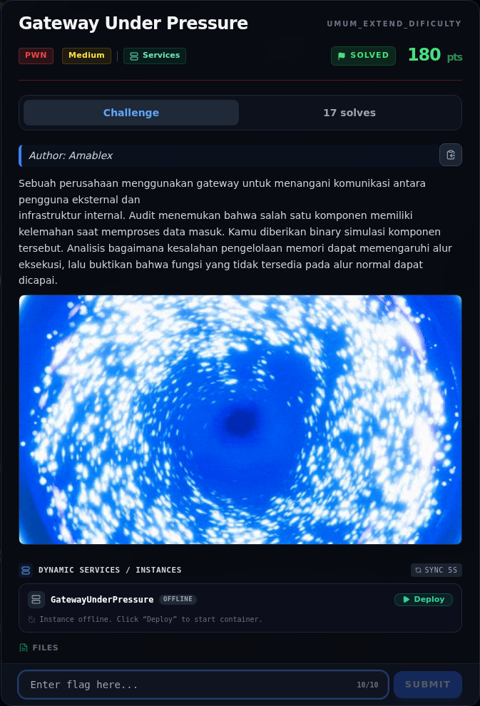
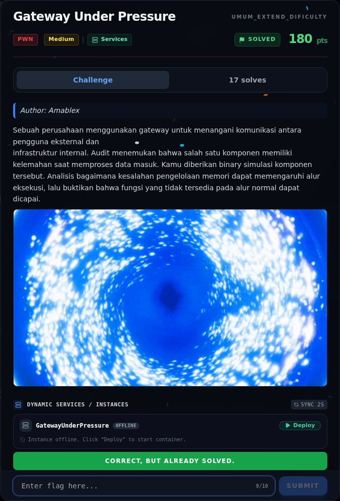

# Gateway Under Pressure

Track Umum / Extend · PwnMedium300 poinVERIFIED

| Field | Nilai |
|---|---|
| Event | `umum_Extend` |
| Kategori | `Pwn` |
| Difficulty | `Medium` |
| Poin | `300` |
| Author | `Amablex` |
| Solves | `11` |
| Tools | python3, pwntools, checksec, objdump, strings |
| Flag | `NFX{Nyoss_Gte3wayy_Pr3ssureee0!}` |
| Status | `VERIFIED` |

[← Kembali ke Index](index.md)

## Challenge Brief (platform)

*Challenge brief asli di platform NFX CTF 2026.*

## Cerita singkat

Jadi ceritanya gini. `gateway` adalah binary PIE dengan menu: register session, **audit memory**, dispatch request. Terus, `do_audit()` melakukan `write(1, buf, len)` dengan `len` yang dikendalikan pengguna (sampai `0x1000`) dari buffer stack `0x50` → **stack disclosure**: canary, saved RBP, dan return address PIE bocor. Lalu, `do_dispatch()` melakukan `read_exact(buf, len)` dengan `len` sampai `0x200` ke buffer stack `0x50` tanpa validasi → **stack overflow**. Nah, dari situ kita bisa sampai ke flag dan bukti submit-nya.

## Alur & Titik Penting

| # | Langkah | Titik penting | Buka |
|---:|---|---|---|
| 1 | Recon | Petunjuk "fungsi yang tidak tersedia pada alur normal" sangat sesuai dengan fungsi releasegateway() yang ada di symbol table tetapi tidak dipanggil dari main(). | [Buka](37-gateway-under-pressure-01-recon.md) |
| 2 | Triage awal | file gateway | [Buka](37-gateway-under-pressure-02-triage-awal.md) |
| 3 | `do_audit()` — arbitrary-length stack read | Buffer hanya 0x50 byte (dari rbp-0x50 sampai rbp), tetapi write() membaca sampai 0x1000 byte. | [Buka](37-gateway-under-pressure-03-do-audit-arbitrary-length-stack-read.md) |
| 4 | Analisis | readexact membaca persis len byte (loop sampai terpenuhi) ke buffer 0x50. | [Buka](37-gateway-under-pressure-04-analisis.md) |
| 5 | Eksploitasi | python3 exploit.py \| tee 03-exploit-run.txt | [Buka](37-gateway-under-pressure-05-eksploitasi.md) |
| 6 | Flag | NFX{Nyoss_Gte3wayy_Pr3ssureee0!} | [Buka](37-gateway-under-pressure-06-flag.md) |
| 7 | Bukti / Evidence | arsip screenshot dan transkrip | [Buka](37-gateway-under-pressure-07-bukti-evidence.md) |
| 8 | Referensi | — | [Buka](37-gateway-under-pressure-08-referensi.md) |

## TL;DR

- `gateway` adalah binary PIE dengan menu: register session, **audit memory**, dispatch request.
- `do_audit()` melakukan `write(1, buf, len)` dengan `len` yang dikendalikan pengguna (sampai `0x1000`) dari buffer stack `0x50` → **stack disclosure**: canary, saved RBP, dan return address PIE bocor.
- `do_dispatch()` melakukan `read_exact(buf, len)` dengan `len` sampai `0x200` ke buffer stack `0x50` tanpa validasi → **stack overflow**.
- Ada fungsi tersembunyi `release_gateway()` yang membuka `flag.txt` dan mencetak `FLAG: ...` (tidak dipanggil pada alur normal).
- Exploit: leak canary + PIE base dari audit, lalu ret2win `release_gateway()` dengan satu gadget `ret` untuk alignment.
- Flag: `NFX{Nyoss_Gte3wayy_Pr3ssureee0!}`.

Pratinjau evidence. Buka halaman <a href="37-gateway-under-pressure-07-bukti-evidence.html">Evidence / Bukti</a> untuk semua screenshot dan transkrip.

## Navigasi Halaman

<a class="nx-page-card" href="37-gateway-under-pressure-01-recon.html"><b>Recon</b>Enumerasi target dan bukti awal</a>
<a class="nx-page-card" href="37-gateway-under-pressure-02-triage-awal.html"><b>Triage awal</b>Baca bagian ini</a>
<a class="nx-page-card" href="37-gateway-under-pressure-03-do-audit-arbitrary-length-stack-read.html"><b>`do_audit()` — arbitrary-length stack read</b>Baca bagian ini</a>
<a class="nx-page-card" href="37-gateway-under-pressure-04-analisis.html"><b>Analisis</b>Membaca alur dan akar masalah</a>
<a class="nx-page-card" href="37-gateway-under-pressure-05-eksploitasi.html"><b>Eksploitasi</b>Langkah exploit dan solver</a>
<a class="nx-page-card" href="37-gateway-under-pressure-06-flag.html"><b>Flag</b>Flag dan verifikasi platform</a>
<a class="nx-page-card" href="37-gateway-under-pressure-07-bukti-evidence.html"><b>Bukti / Evidence</b>Screenshot, transkrip, dan artefak</a>
<a class="nx-page-card" href="37-gateway-under-pressure-08-referensi.html"><b>Referensi</b>Sumber dan bacaan lanjutan</a>

