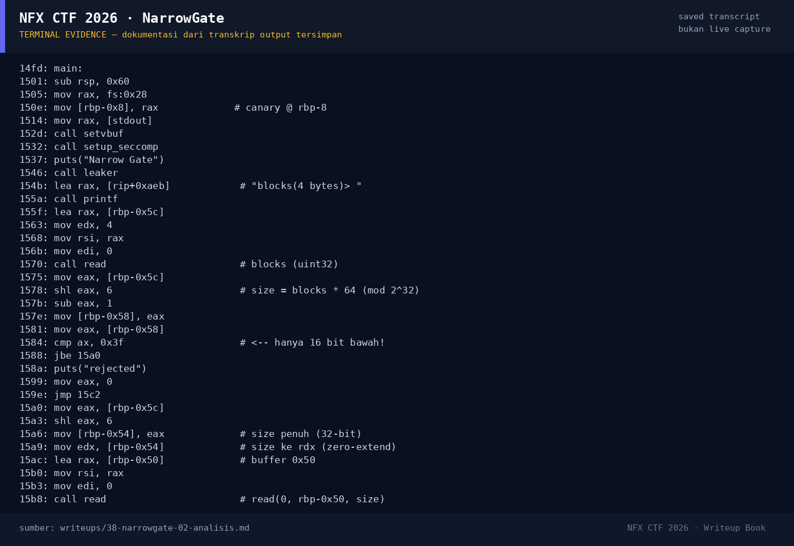

# NarrowGate — Evidence / Bukti

1 screenshot11 transkrip / script

[← Overview](38-narrowgate.md) · [Index](index.md)

## Arsip Evidence

> Semua file di bawah berasal dari folder `assets/narrowgate/`. Screenshot ditempel langsung; file teks/script ditautkan.

### Screenshot

<figure><figcaption>98-terminal-evidence.png</figcaption></figure>

### Transkrip / file pendukung

- [`01-file-hash-checksec.txt`](assets/narrowgate/01-file-hash-checksec.txt)
- [`02-disasm.txt`](assets/narrowgate/02-disasm.txt)
- [`02b-seccomp.txt`](assets/narrowgate/02b-seccomp.txt)
- [`03-exploit-run.txt`](assets/narrowgate/03-exploit-run.txt)
- [`03b-leak-probe.py`](assets/narrowgate/03b-leak-probe.py)
- [`03b-leak-probe.txt`](assets/narrowgate/03b-leak-probe.txt)
- [`03c-maps-rw-path.txt`](assets/narrowgate/03c-maps-rw-path.txt)
- [`03c-run-printable.txt`](assets/narrowgate/03c-run-printable.txt)
- [`04-flag-status.txt`](assets/narrowgate/04-flag-status.txt)
- [`exploit.py`](assets/narrowgate/exploit.py)
- [`flag.txt`](assets/narrowgate/flag.txt)

## Tabel Evidence

| Bukti | File | Keterangan |
|---|---|---|
| Identitas/hash/checksec | `writeups/assets/narrowgate/01-file-hash-checksec.txt` | PIE, canary, Full RELRO |
| Disassembly | `writeups/assets/narrowgate/02-disasm.txt` | `leaker`, `main`, `setup_seccomp` |
| Seccomp decode | `writeups/assets/narrowgate/02b-seccomp.txt` | Allow-list BPF |
| Leak probe | `writeups/assets/narrowgate/03b-leak-probe.txt` | `%27`, `%29`, `%43` |
| Exploit | `writeups/assets/narrowgate/exploit.py` | ORW ROP |
| Output | `writeups/assets/narrowgate/03-exploit-run.txt`, `03c-run-printable.txt` | Flag lokal + padding |
| Flag/status | `writeups/assets/narrowgate/04-flag-status.txt` | Flag dari `flags/pwn/` |