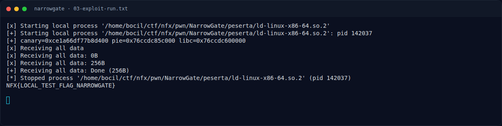
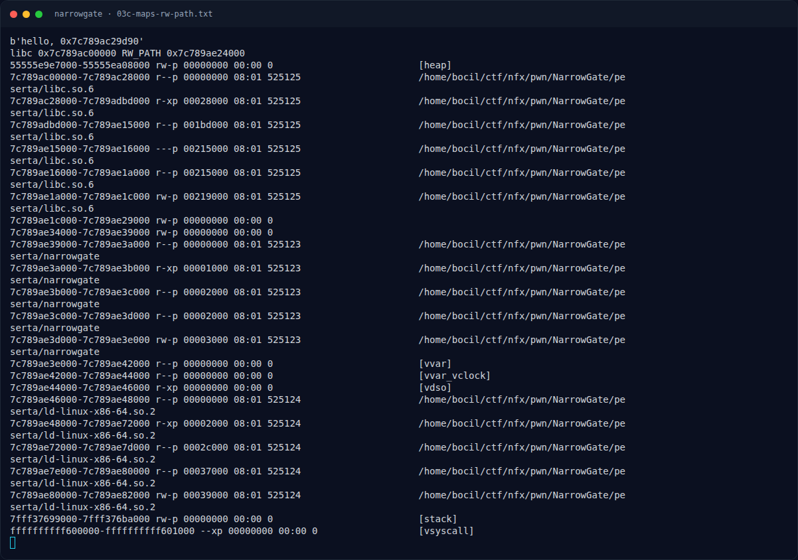
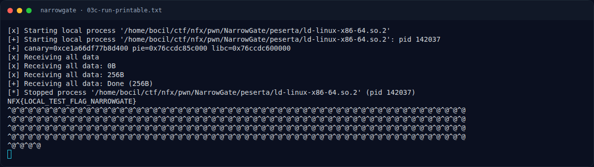

# NarrowGate — Output asli

[← Overview](38-narrowgate.md) · [Index](index.md)

> **Langkah 6/9 — Output asli.** Sisa output adalah padding 0x100 byte dari write(1, RWOUT, 0x100); versi cat -v ada di 03c-run-printable.txt.
>
> **Titik penting:** NFX{LOCAL_TEST_FLAG_NARROWGATE}
>
> **Berikutnya:** [Flag](38-narrowgate-07-flag.md)

## 3.3 Output asli

```text
[*] Starting local process '.../ld-linux-x86-64.so.2'
[+] canary=0xce1a66df77b8d400 pie=0x76ccdc85c000 libc=0x76ccdc600000
[+] Receiving all data: Done (256B)
NFX{LOCAL_TEST_FLAG_NARROWGATE}
<NUL padding ...>
```

Sisa output adalah padding `0x100` byte dari `write(1, RW_OUT, 0x100)`; versi `cat -v` ada di `03c-run-printable.txt`.

Fixture lokal berisi `NFX{LOCAL_TEST_FLAG_NARROWGATE}`; flag kompetisi ada di bagian 4.

### Evidence langkah ini



*Terminal evidence — `03-exploit-run.txt` (arsip transkrip sesi solve).*



*Terminal evidence — `03c-maps-rw-path.txt` (arsip transkrip sesi solve).*



*Terminal evidence — `03c-run-printable.txt` (arsip transkrip sesi solve).*

**Berkas mentah langkah ini:**

- [`03-exploit-run.txt`](assets/narrowgate/03-exploit-run.txt)
- [`03c-maps-rw-path.txt`](assets/narrowgate/03c-maps-rw-path.txt)
- [`03c-run-printable.txt`](assets/narrowgate/03c-run-printable.txt)
