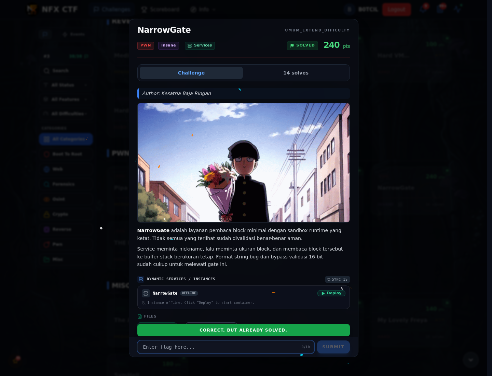

# NarrowGate — Flag & Verifikasi

[← Overview](38-narrowgate.md) · [Index](index.md)

> **Flag:** `NFX{ex3cve_d3ni3d_but_0pen_r34d_writ3_s4v3d_th3_day}`
> **Status:** `VERIFIED`

```text
NFX{ex3cve_d3ni3d_but_0pen_r34d_writ3_s4v3d_th3_day}
```

Verifikasi:

```text
$ cat flags/pwn/NarrowGate.txt
NFX{ex3cve_d3ni3d_but_0pen_r34d_writ3_s4v3d_th3_day}
```

Status `verified platform` menurut `writeups/FLAGS.md`.

### Bukti submit di platform



*Submit flag di platform: `CORRECT, BUT ALREADY SOLVED.`*

### Evidence langkah ini


*Terminal evidence — `04-flag-status.txt` (arsip transkrip sesi solve).*


*Terminal evidence — `flag.txt` (arsip transkrip sesi solve).*

**Berkas mentah langkah ini:**

- [`04-flag-status.txt`](assets/narrowgate/04-flag-status.txt)
- [`flag.txt`](assets/narrowgate/flag.txt)

> **Verifikasi platform:** flag sudah diterima. Recheck 2026-11-09 mengembalikan `Correct, but already solved.`
