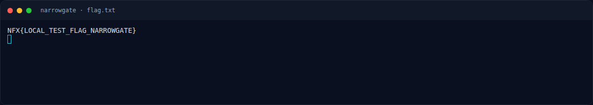
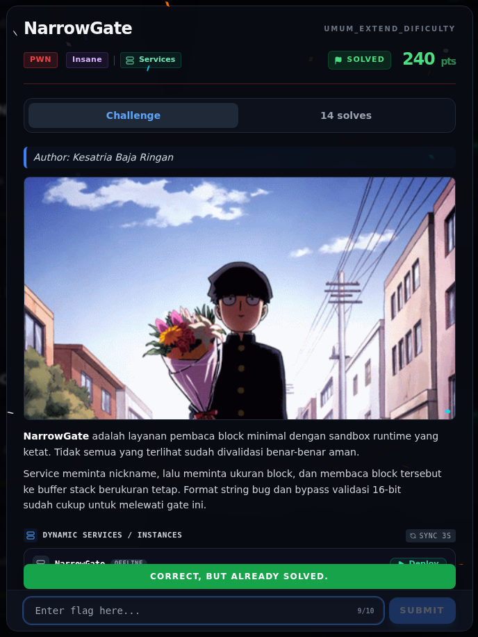

# NarrowGate — Flag & Verifikasi

[← Overview](38-narrowgate.md) · [Index](index.md)

> **Langkah 7/9 — Flag.** Status tercatat accepted di platform. Buktinya terminal evidence di halaman ini.
>
> **Titik penting:** NFX{ex3cve_d3ni3d_but_0pen_r34d_writ3_s4v3d_th3_day}
>
> **Berikutnya:** [Bukti / Evidence](38-narrowgate-08-bukti-evidence.md)

> **Asal flag.** Flag diperoleh dari langkah exploit/solver yang terdokumentasi, lalu disubmit ke platform.  
> **Tingkat bukti metode.** Terdokumentasi. [Buka Evidence](38-narrowgate-08-bukti-evidence.md)

> **Flag:** `NFX{ex3cve_d3ni3d_but_0pen_r34d_writ3_s4v3d_th3_day}`
> **Status:** `VERIFIED`

```text
NFX{ex3cve_d3ni3d_but_0pen_r34d_writ3_s4v3d_th3_day}
```

Verifikasi:

```text
$ cat flags/pwn/NarrowGate.txt
NFX{ex3cve_d3ni3d_but_0pen_r34d_writ3_s4v3d_th3_day}
```

Status `VERIFIED`: flag tercatat accepted di platform. File `writeups/FLAGS.md` tidak ada di repo ini.

### Terminal evidence (real)



*Terminal evidence (real).*

> **Bukti:** terminal evidence (real).

## Validasi platform (real)



*Screenshot asli dari platform NFX CTF 2026. Platform menjawab
`CORRECT, BUT ALREADY SOLVED.` untuk flag ini.*
