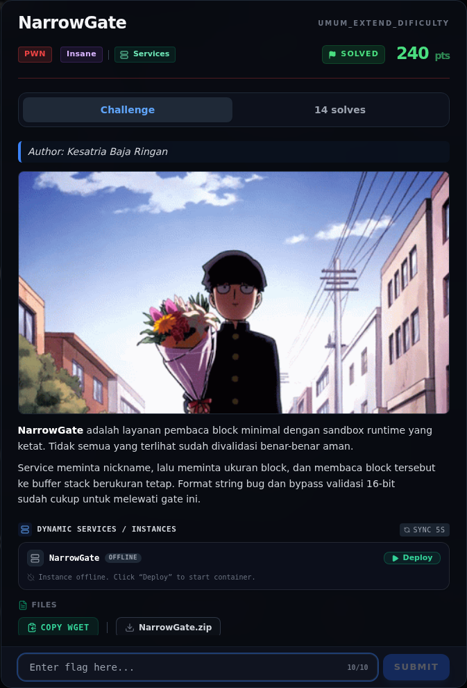

# NarrowGate — Referensi

[← Overview](38-narrowgate.md) · [Index](index.md)

> **Langkah 9/9 — Referensi.** Referensi
>
> **Titik penting:** —
>
> **Selesai.** Kembali ke [Overview](38-narrowgate.md).

- `pwn/NarrowGate/peserta/narrowgate`, `libc.so.6`, `ld-linux-x86-64.so.2`.
- `writeups/assets/narrowgate/02b-seccomp.txt` — decode BPF.
- `writeups/assets/libc-offsets-and-gadgets.txt` — offset gadget.
- `man 2 seccomp`, `man 2 prctl`, `man 2 open`.
- Writeup referensi (diperiksa ulang, tidak disalin mentah): `/tmp/opencode/skywriteups/writeups/14-narrowgate.md`.

### Evidence langkah ini

*Challenge brief asli di platform NFX CTF 2026.*
