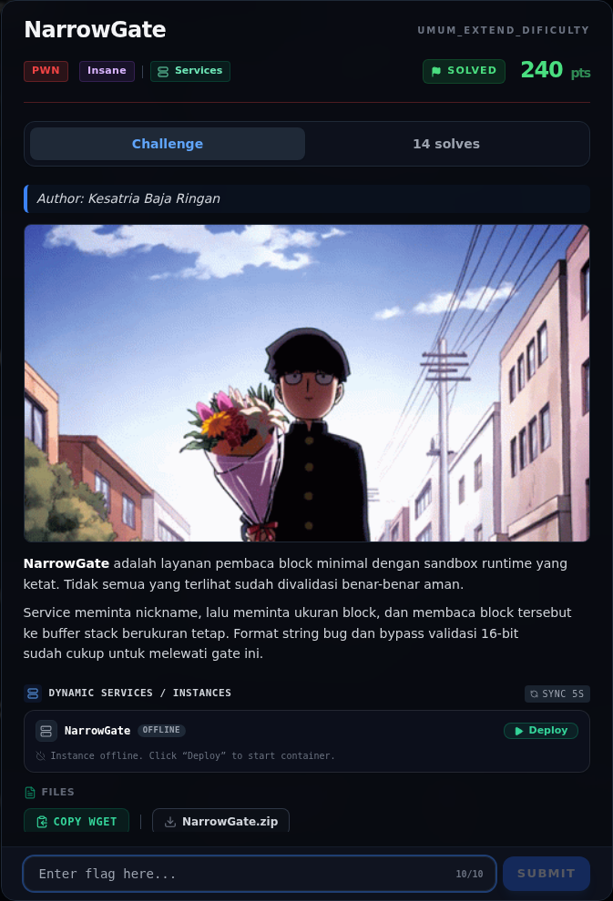
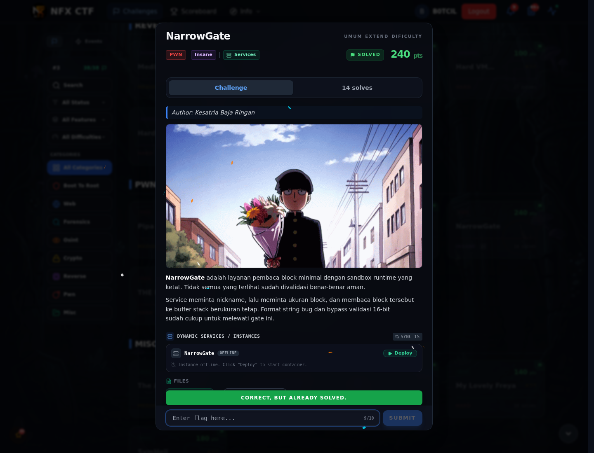

# NarrowGate

Track Umum / Extend · PwnInsane380 poinVERIFIED

| Field | Nilai |
|---|---|
| Event | `umum_Extend` |
| Kategori | `Pwn` |
| Difficulty | `Insane` |
| Poin | `380` |
| Author | `Kesatria Baja Ringan` |
| Solves | `7` |
| Tools | python3, pwntools, checksec, objdump, strings |
| Flag | `NFX{ex3cve_d3ni3d_but_0pen_r34d_writ3_s4v3d_th3_day}` |
| Status | `VERIFIED` |

[← Kembali ke Index](index.md)

## Challenge Brief (platform)

*Challenge brief asli di platform NFX CTF 2026.*

## TL;DR

- `leaker()` memakai `printf(nickname)` → **format string** (canary, PIE, libc).
- `main()` membaca `blocks` (uint32), menghitung `size = blocks * 64`, lalu memvalidasi **hanya 16 bit bawah** dari `size - 1` (`cmp ax, 0x3f`), tetapi `read(0, buf, size)` tetap memakai `size` 32-bit penuh.
- `blocks = 1025` → `size = 65600 = 0x10040`, `(size-1) & 0xffff = 0x003f` → lolos, lalu read besar ke buffer stack `0x50` → **stack overflow** (canary di offset `0x48`).
- Binary memasang **seccomp**: `read/write/open/close/lseek/fstat/newfstatat/brk/exit/exit_group/getrandom`; `execve` dan `openat` diblokir.
- ROP **ORW**: `read(0, path, ...)` → raw `open(path)` → `xchg edi,eax` (fd = rax) → `read(fd, out, ...)` → `write(1, out, ...)`.
- Flag: `NFX{ex3cve_d3ni3d_but_0pen_r34d_writ3_s4v3d_th3_day}`.

Pratinjau evidence. Buka halaman <a href="38-narrowgate-08-bukti-evidence.html">Evidence / Bukti</a> untuk semua screenshot dan transkrip.

## Navigasi Halaman

<a class="nx-page-card" href="38-narrowgate-01-recon.html"><b>Recon</b>Enumerasi target dan bukti awal</a>
<a class="nx-page-card" href="38-narrowgate-02-leaker-format-string.html"><b>`leaker()` — format string</b>Baca bagian ini</a>
<a class="nx-page-card" href="38-narrowgate-03-main-validasi-16-bit.html"><b>`main()` — validasi 16-bit</b>Baca bagian ini</a>
<a class="nx-page-card" href="38-narrowgate-04-analisis.html"><b>Analisis</b>Membaca alur dan akar masalah</a>
<a class="nx-page-card" href="38-narrowgate-05-eksploitasi.html"><b>Eksploitasi</b>Langkah exploit dan solver</a>
<a class="nx-page-card" href="38-narrowgate-06-output-asli.html"><b>Output asli</b>Baca bagian ini</a>
<a class="nx-page-card" href="38-narrowgate-07-flag.html"><b>Flag</b>Flag dan verifikasi platform</a>
<a class="nx-page-card" href="38-narrowgate-08-bukti-evidence.html"><b>Bukti / Evidence</b>Screenshot, transkrip, dan artefak</a>
<a class="nx-page-card" href="38-narrowgate-09-referensi.html"><b>Referensi</b>Sumber dan bacaan lanjutan</a>

