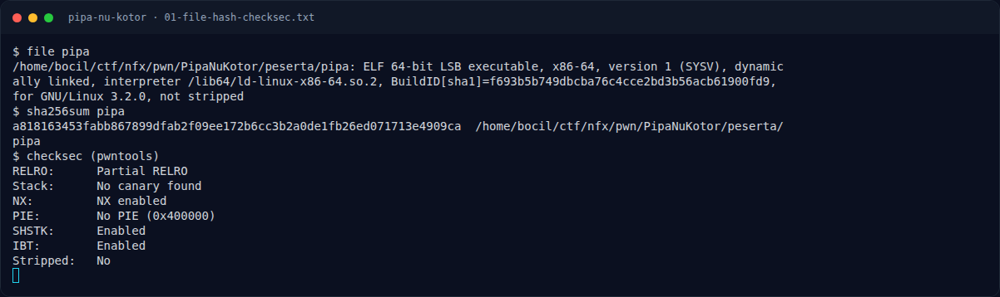

# Pipa Nu Kotor — Recon

[← Overview](39-pipa-nu-kotor.md) · [Index](index.md)

## 1.1 Deskripsi challenge

> **Author: Amablex**
>
> Aya hiji sistem Linux anu dipaké pikeun ngolah data ngaliwatan mékanisme pipe. Sistem éta sakuduna bisa ngajaga data sangkan henteu robah sacara teu dihaja. Tapi, tim kaamanan manggihan yén aya bagian tina mékanisme panyimpenan data anu henteu diinisialisasi kalayan bener. Anjeun dibéri hiji binary simulasi pikeun nalungtik masalah éta. Panggihan kumaha kaayaan data dina mémori bisa mangaruhan hasil pamrosesan program.

Kata kunci dari deskripsi: **"bagian ... anu henteu diinisialisasi kalayan bener"** — persis field `flags` pada struct.

## 1.2 File yang diberikan

| File | Ukuran | SHA-256 |
|---|---|---|
| `pwn/PipaNuKotor/peserta/pipa` | 17.288 B | `a818163453fabb867899dfab2f09ee172b6cc3b2a0de1fb26ed071713e4909ca` |

Tidak ada libc tambahan; binary non-PIE dan statically addressed. Service asli terdaftar sebagai `NFX/PWNNXCTF-2026/PipaNuKotor` (TCP), saat penulisan berstatus stopped.

## 1.3 Environment

- Linux x86-64, glibc host 2.39.
- Tools: `file`, `sha256sum`, `strings`, `objdump`, `nm`, `pwntools`.
- Menjalankan lokal:
  ```bash
  cd pwn/PipaNuKotor/peserta
  ./pipa
  ```

### Evidence langkah ini



*Terminal evidence — `01-file-hash-checksec.txt` (arsip transkrip sesi solve).*
