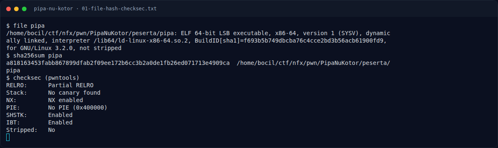
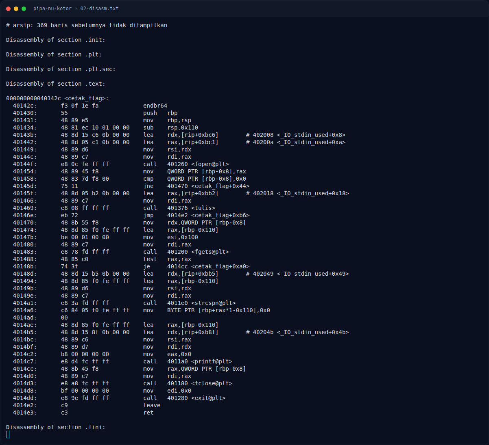

# Pipa Nu Kotor — Triage awal

[← Overview](39-pipa-nu-kotor.md) · [Index](index.md)

## 1.4 Triage awal

```text
$ file pipa
pipa: ELF 64-bit LSB executable, x86-64, version 1 (SYSV),
dynamically linked, interpreter /lib64/ld-linux-x86-64.so.2,
BuildID[sha1]=f693b5b749dbcba76c4cce2bd3b56acb61900fd9,
for GNU/Linux 3.2.0, not stripped

$ checksec (pwntools)
RELRO:      Partial RELRO
Stack:      No canary found
NX:         NX enabled
PIE:        No PIE (0x400000)
SHSTK:      Enabled
IBT:        Enabled
Stripped:   No
```

`strings` memperlihatkan pesan yang menjadi petunjuk utama:

```text
flag.txt
[!] flag.txt tidak ditemukan di direktori kerja
FLAG: %s
/dev/urandom
$6$%02x%02x%02x%02x%02x%02x%02x%02x$
[-] halaman dilindungi (baca-saja): penulisan ditolak
[!] penulisan ke halaman proteksi BERHASIL (flags basi)
[+] login sebagai root - akses diberikan
[-] login gagal: password salah
shadow_page
```

String **"penulisan ke halaman proteksi BERHASIL (flags basi)"** adalah konfirmasi langsung bahwa programmer sadar ada jalur bypass flags basi.

Symbol penting:

```text
00000000004040e0 b shadow_page
0000000000404120 b tabel
000000000040142c t cetak_flag
00000000004014e4 t isi_shadow
0000000000401695 t op_buka
0000000000401843 t op_tutup
0000000000401910 t op_tulis
0000000000401b3d t op_login
```

### Evidence langkah ini



*Terminal evidence — `01-file-hash-checksec.txt` (arsip transkrip sesi solve).*



*Terminal evidence — `02-disasm.txt` (arsip transkrip sesi solve).*

**Berkas mentah langkah ini:**

- [`01-file-hash-checksec.txt`](assets/pipa-nu-kotor/01-file-hash-checksec.txt)
- [`02-disasm.txt`](assets/pipa-nu-kotor/02-disasm.txt)
