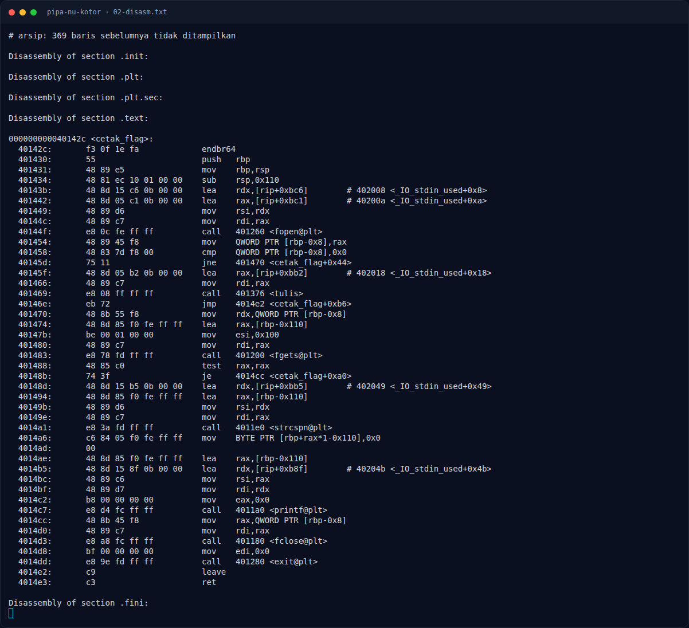
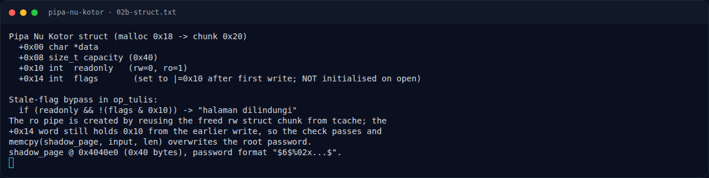

# Pipa Nu Kotor — Analisis

[← Overview](39-pipa-nu-kotor.md) · [Index](index.md)

> **Langkah 3/8 — Analisis.** opbuka() mengalokasikan malloc(0x18) untuk struct, lalu mengisi:
>
> **Titik penting:** opbuka() mengalokasikan malloc(0x18) untuk struct, lalu mengisi:
>
> **Berikutnya:** [Analisis](39-pipa-nu-kotor-04-analisis-2.md)

## 2.1 Struct pipa

`op_buka()` mengalokasikan `malloc(0x18)` untuk struct, lalu mengisi:

```asm
1746: mov edi, 0x18
174b: call malloc
...
; mode rw
17b5: mov [rax+0x8], 0x40        # capacity
17c1: mov DWORD PTR [rax+0x10], 0 # readonly = 0
; mode ro
17d2: lea rdx, [rip+0x2907]      # shadow_page
17d9: mov [rax], rdx             # data = shadow_page
17e0: mov QWORD PTR [rax+0x8], 0x40
17e8: mov DWORD PTR [rax+0x10], 1 # readonly = 1
```

Perhatikan: **`+0x14` (flags) tidak pernah di-set saat open**. Layout efektif:

```text
+0x00  char  *data
+0x08  size_t capacity   (0x40)
+0x10  int    readonly    (rw=0, ro=1)
+0x14  int    flags       (tidak diinisialisasi)
```

## 2.2 `op_tulis()` — pengecekan read-only yang bisa dibypass

```asm
19e4: mov rax, [rbp-0x10]        # pipe*
19e8: mov eax, [rax+0x10]        # readonly
19eb: test eax, eax
19ed: je  401a11                 # rw -> langsung tulis
19ef: mov rax, [rbp-0x10]
19f3: mov eax, [rax+0x14]        # flags
19f6: and eax, 0x10
19f9: test eax, eax
19fb: jne 401a11                 # flags & 0x10 -> diizinkan (BUG)
19fd: ... "halaman dilindungi"
```

Jika `readonly == 1` dan `flags & 0x10 == 0`, tulis ditolak. Namun jika `flags` masih bernilai `0x10` dari pemakaian sebelumnya, tulis **diizinkan**.

Setelah `memcpy`, kode melakukan:

```asm
1a47: mov rax, [rbp-0x10]
1a4b: mov eax, [rax+0x14]
1a4e: or  eax, 0x10
1a51: mov edx, eax
1a53: mov rax, [rbp-0x10]
1a57: mov [rax+0x14], edx        # flags |= 0x10
```

Jadi setiap penulisan sukses menyalakan bit `0x10`.

### Evidence langkah ini



*Terminal evidence — `02-disasm.txt` (arsip transkrip sesi solve).*



*Terminal evidence — `02b-struct.txt` (arsip transkrip sesi solve).*

**Berkas mentah langkah ini:**

- [`02-disasm.txt`](assets/pipa-nu-kotor/02-disasm.txt)
- [`02b-struct.txt`](assets/pipa-nu-kotor/02b-struct.txt)
