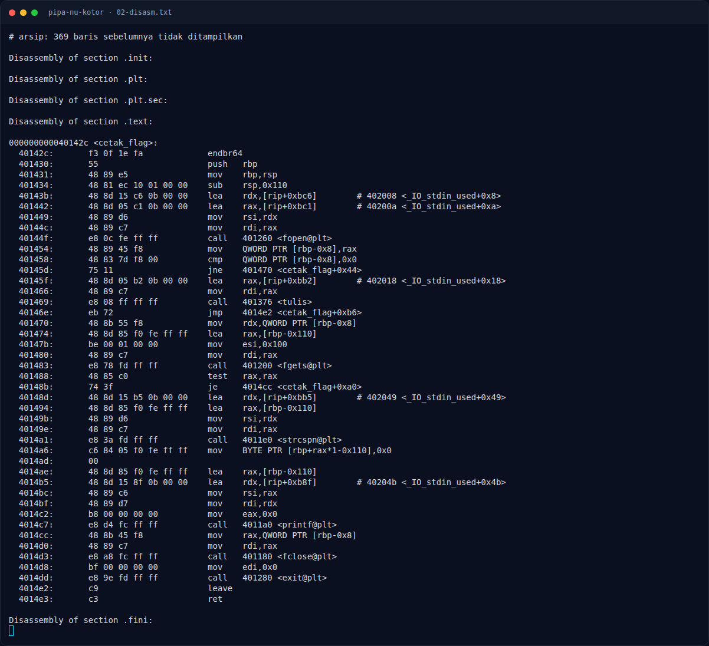
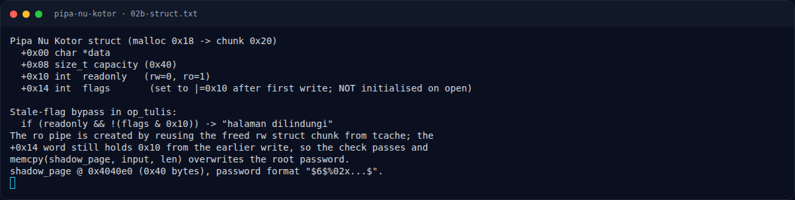

# Pipa Nu Kotor — Analisis

[← Overview](39-pipa-nu-kotor.md) · [Index](index.md)

> **Langkah 4/8 — Analisis.** Saat free(struct) pada chunk 0x20, glibc menulis tcache->next di offset 0 dan tcache key di offset 8.
>
> **Titik penting:** Saat free(struct) pada chunk 0x20, glibc menulis tcache->next di offset 0 dan tcache key di offset 8.
>
> **Berikutnya:** [Eksploitasi](39-pipa-nu-kotor-05-eksploitasi.md)

## 2.3 `op_tutup()` — chunk kembali ke tcache

```asm
18a1: mov rax, [rbp-0x10]
18a5: mov eax, [rax+0x10]
18a8: test eax, eax
18aa: jne 18c7                   # ro -> jangan free data
18b8: mov rax, [rbp-0x10]
18bc: mov rax, [rax]
18bf: mov rdi, rax
18c2: call free                  # free(data)
18c7: mov rax, [rbp-0x10]
18ce: call free                  # free(struct)
```

Saat `free(struct)` pada chunk `0x20`, glibc menulis `tcache->next` di offset 0 dan `tcache key` di offset 8. Offset `0x10` dan `0x14` **tidak disentuh**, sehingga `readonly` dan `flags` tetap.

## 2.4 Reuse tcache

Urutan yang dipakai:

1. Buka pipa `rw` → `malloc(0x18)` mengambil chunk dari tcache/top.
2. Tulis sekali → `flags = 0x10`.
3. Tutup → `free(data)` lalu `free(struct)`; chunk struct masuk tcache `0x20` (LIFO).
4. Buka pipa `ro` → `malloc(0x18)` mengembalikan chunk yang sama. `op_buka` menulis `data = shadow_page`, `capacity = 0x40`, `readonly = 1`, tetapi **tidak menimpa `flags`** → `flags` tetap `0x10`.
5. `op_tulis` melihat `readonly=1` tapi `flags & 0x10 != 0` → lolos, lalu `memcpy(shadow_page, input, len)`.

## 2.5 `shadow_page` dan login

`isi_shadow()` (dipanggil dari `main`) mengisi `shadow_page` dengan password acak berformat `$6$%02x...$` dari `/dev/urandom` (atau `ZZZZZZZZ` jika gagal). `op_login()` membandingkan input dengan `shadow_page`:

```asm
1b79: lea rdx, [rip+0x2560]      # shadow_page
1b8d: call strcmp
1b94: jne  login gagal
1b96: ... "login sebagai root"
1ba5: call cetak_flag
```

`cetak_flag()` membuka `flag.txt`, membaca dengan `fgets`, dan `printf("FLAG: %s")`.

### Evidence langkah ini



*Terminal evidence — `02-disasm.txt` (arsip transkrip sesi solve).*



*Terminal evidence — `02b-struct.txt` (arsip transkrip sesi solve).*

**Berkas mentah langkah ini:**

- [`02-disasm.txt`](assets/pipa-nu-kotor/02-disasm.txt)
- [`02b-struct.txt`](assets/pipa-nu-kotor/02b-struct.txt)
