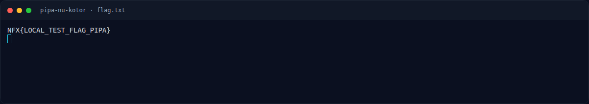
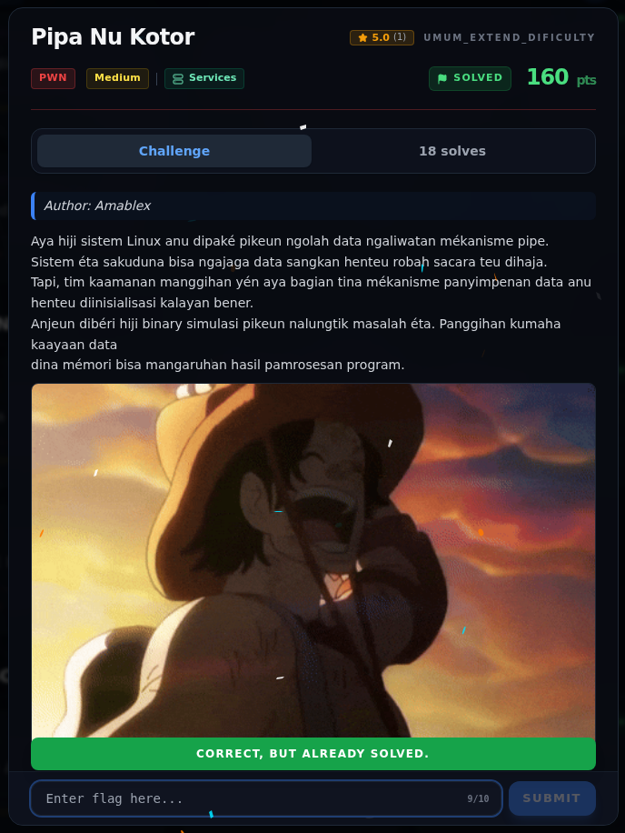

# Pipa Nu Kotor — Flag & Verifikasi

[← Overview](39-pipa-nu-kotor.md) · [Index](index.md)

> **Langkah 6/8 — Flag.** Status tercatat accepted di platform. Buktinya terminal evidence di halaman ini.
>
> **Titik penting:** NFX{Si44aTehKuduSadarDip4lakSave3Jari1}
>
> **Berikutnya:** [Bukti / Evidence](39-pipa-nu-kotor-07-bukti-evidence.md)

> **Asal flag.** Flag diperoleh dari langkah exploit/solver yang terdokumentasi, lalu disubmit ke platform.  

> **Flag:** `NFX{Si44aTehKuduSadarDip4lakSave3Jari1}`
> **Status:** `VERIFIED`

```text
NFX{Si44aTehKuduSadarDip4lakSave3Jari1}
```

Verifikasi:

```text
$ cat flags/pwn/PipaNuKotor.txt
NFX{Si44aTehKuduSadarDip4lakSave3Jari1}
```

Status `VERIFIED`: flag tercatat accepted di platform. File `writeups/FLAGS.md` tidak ada di repo ini.

### Terminal evidence (real)



*Terminal evidence (real).*

> **Bukti:** terminal evidence (real).

## Validasi platform (real)



*Screenshot asli dari platform NFX CTF 2026. Platform menjawab
`CORRECT, BUT ALREADY SOLVED.` untuk flag ini.*
