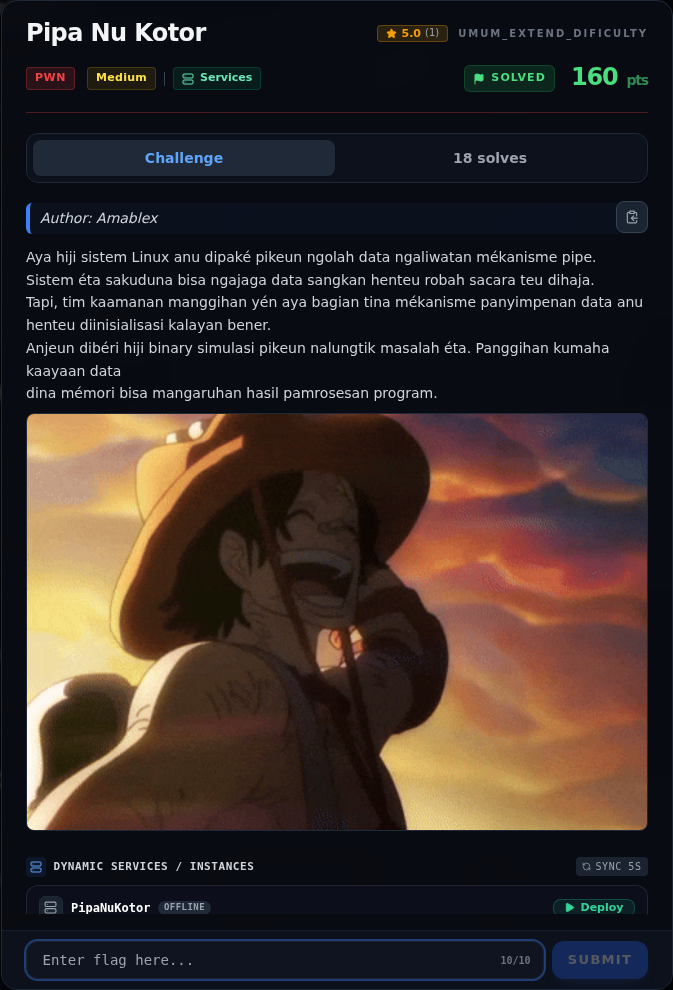
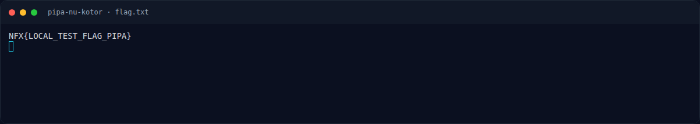
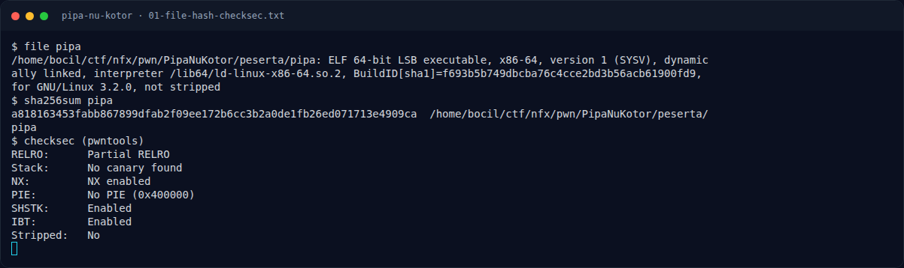
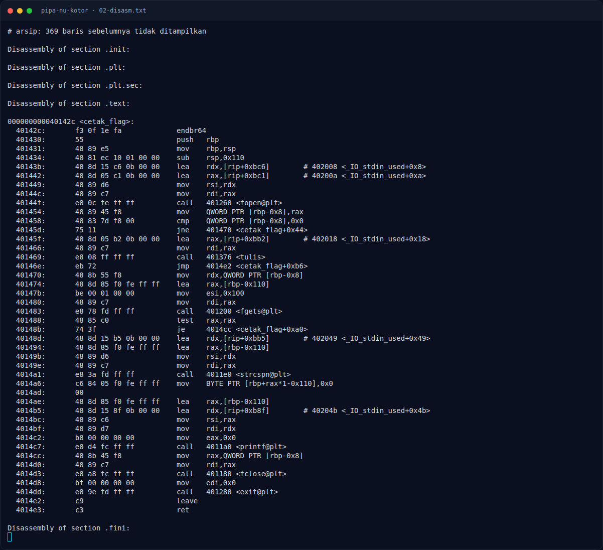
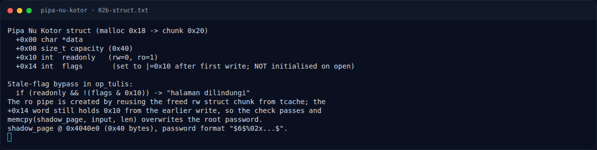
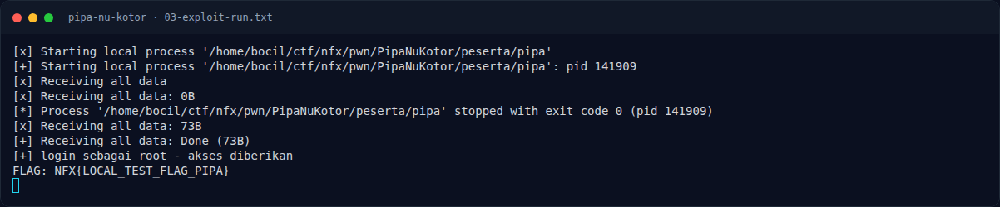
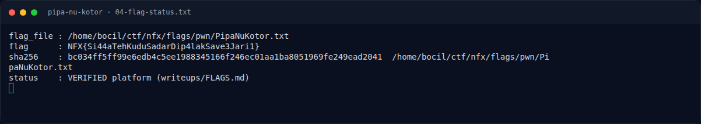
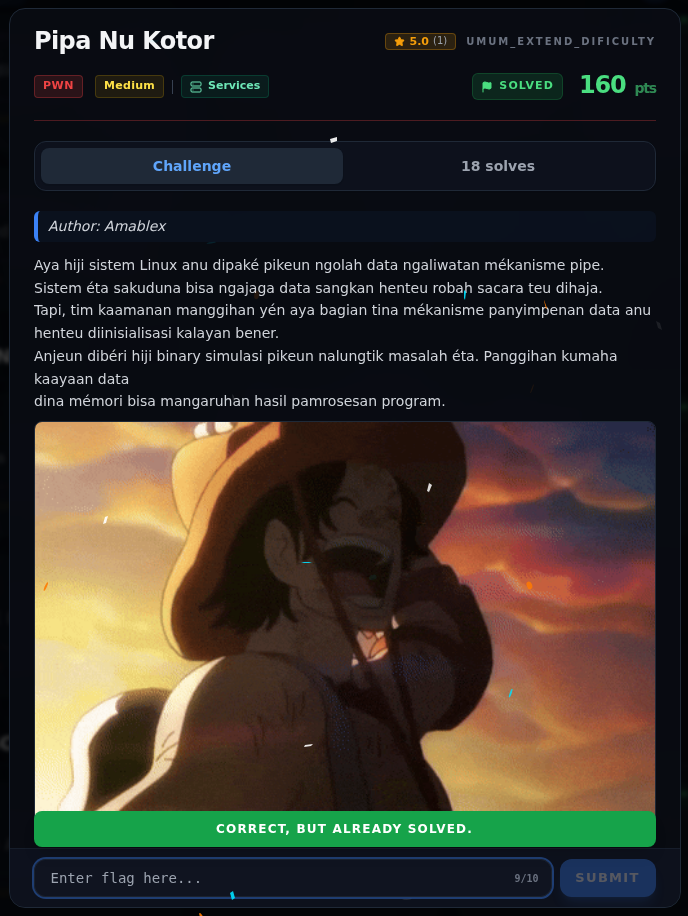

# Pipa Nu Kotor — Evidence / Bukti

8 screenshot7 transkrip / script

[← Overview](39-pipa-nu-kotor.md) · [Index](index.md)

> **Langkah 7/8 — Bukti / Evidence.** Bukti / Evidence
>
> **Titik penting:** arsip screenshot dan transkrip
>
> **Berikutnya:** [Referensi](39-pipa-nu-kotor-08-referensi.md)

## Arsip Evidence

> Semua file berasal dari `assets/pipa-nu-kotor/`. Screenshot platform dan terminal adalah bukti asli dari sesi solve; transkrip mentah tetap ditautkan di bagian bawah.

### Platform

<figure><figcaption>00-challenge-platform.png</figcaption></figure>

*Challenge brief asli di platform NFX CTF 2026.*

<figure><figcaption>Terminal evidence (real)</figcaption></figure>

*Terminal evidence (real).*

### Terminal (arsip sesi)

<figure><figcaption>term-01-file-hash-checksec.png</figcaption></figure>

*Terminal evidence — `01-file-hash-checksec.txt` (arsip transkrip sesi solve).*

<figure><figcaption>term-02-disasm.png</figcaption></figure>

*Terminal evidence — `02-disasm.txt` (arsip transkrip sesi solve).*

<figure><figcaption>term-02b-struct.png</figcaption></figure>

*Terminal evidence — `02b-struct.txt` (arsip transkrip sesi solve).*

<figure><figcaption>term-03-exploit-run.png</figcaption></figure>

*Terminal evidence — `03-exploit-run.txt` (arsip transkrip sesi solve).*

<figure><figcaption>term-04-flag-status.png</figcaption></figure>

*Terminal evidence — `04-flag-status.txt` (arsip transkrip sesi solve).*

<figure><figcaption>term-flag.png</figcaption></figure>

*Terminal evidence — `flag.txt` (arsip transkrip sesi solve).*

### Transkrip mentah & script

- [`01-file-hash-checksec.txt`](assets/pipa-nu-kotor/01-file-hash-checksec.txt)
- [`02-disasm.txt`](assets/pipa-nu-kotor/02-disasm.txt)
- [`02b-struct.txt`](assets/pipa-nu-kotor/02b-struct.txt)
- [`03-exploit-run.txt`](assets/pipa-nu-kotor/03-exploit-run.txt)
- [`04-flag-status.txt`](assets/pipa-nu-kotor/04-flag-status.txt)
- [`exploit.py`](assets/pipa-nu-kotor/exploit.py)
- [`flag.txt`](assets/pipa-nu-kotor/flag.txt)

## Validasi platform (real)

*Screenshot asli dari platform NFX CTF 2026. Platform menjawab
`CORRECT, BUT ALREADY SOLVED.` untuk flag ini.*

## Tabel Evidence

| Bukti | File | Keterangan |
|---|---|---|
| Identitas/hash/checksec | `docs/assets/pipa-nu-kotor/01-file-hash-checksec.txt` | no PIE, no canary, NX |
| Disassembly | `docs/assets/pipa-nu-kotor/02-disasm.txt` | `op_buka`, `op_tulis`, `op_login`, `op_tutup`, `cetak_flag` |
| Layout struct | `docs/assets/pipa-nu-kotor/02b-struct.txt` | Field dan offset flags |
| Exploit | `docs/assets/pipa-nu-kotor/exploit.py` | Urutan open/write/close/reopen |
| Output | `docs/assets/pipa-nu-kotor/03-exploit-run.txt` | Login root + flag lokal |
| Flag/status | `docs/assets/pipa-nu-kotor/04-flag-status.txt` | Flag dari `flags/pwn/` |