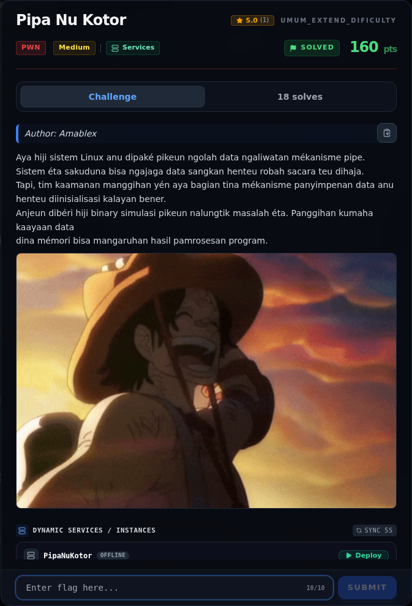

# Pipa Nu Kotor — Referensi

[← Overview](39-pipa-nu-kotor.md) · [Index](index.md)

> **Langkah 8/8 — Referensi.** Referensi
>
> **Titik penting:** —
>
> **Selesai.** Kembali ke [Overview](39-pipa-nu-kotor.md).

- `pwn/PipaNuKotor/peserta/pipa`.
- `writeups/assets/libc-offsets-and-gadgets.txt` (tidak dipakai di exploit ini).
- glibc tcache: `man 7 tcache` / sumber `malloc.c`.

### Evidence langkah ini

*Challenge brief asli di platform NFX CTF 2026.*
