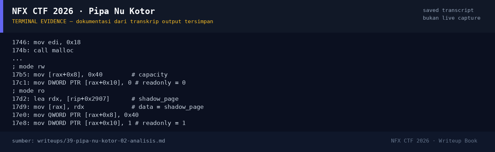

# Pipa Nu Kotor

Track Umum / Extend · PwnMedium300 poinVERIFIED

| Field | Nilai |
|---|---|
| Event | `umum_Extend` |
| Kategori | `Pwn` |
| Difficulty | `Medium` |
| Poin | `300` |
| Author | `Amablex` |
| Solves | `11` |
| Tools | python3, pwntools, checksec, objdump, strings |
| Flag | `NFX{Si44aTehKuduSadarDip4lakSave3Jari1}` |
| Status | `VERIFIED` |

[← Kembali ke Index](index.md)

## TL;DR

- Service mengelola "pipa" (pipe) dengan operasi buka/tutup/tulis/baca/login.
- Struct pipa `malloc(0x18)` hanya menginisialisasi `data`, `capacity`, dan `readonly`; field `flags` di offset `0x14` **tidak diinisialisasi**.
- Setelah menulis ke pipa `rw`, `flags |= 0x10`. Saat pipa ditutup, chunk struct masuk tcache. Membuka pipa baru dengan mode `ro` mengalokasikan ulang chunk yang sama dan **flags basi 0x10 masih ada**.
- Pengecekan `if (readonly && !(flags & 0x10))` jadi lolos, sehingga `memcpy()` menulis ke `shadow_page` (password root hard-coded).
- Login dengan password baru → `cetak_flag()` membaca `flag.txt`.
- Flag: `NFX{Si44aTehKuduSadarDip4lakSave3Jari1}`.

Pratinjau evidence. Buka halaman <a href="39-pipa-nu-kotor-05-bukti-evidence.html">Evidence / Bukti</a> untuk semua screenshot dan transkrip.

## Navigasi Halaman

<a class="nx-page-card" href="39-pipa-nu-kotor-01-recon.html"><b>Recon</b>Enumerasi target dan bukti awal</a>
<a class="nx-page-card" href="39-pipa-nu-kotor-02-analisis.html"><b>Analisis</b>Membaca alur dan akar masalah</a>
<a class="nx-page-card" href="39-pipa-nu-kotor-03-eksploitasi.html"><b>Eksploitasi</b>Langkah exploit dan solver</a>
<a class="nx-page-card" href="39-pipa-nu-kotor-04-flag.html"><b>Flag</b>Flag dan verifikasi platform</a>
<a class="nx-page-card" href="39-pipa-nu-kotor-05-bukti-evidence.html"><b>Bukti / Evidence</b>Screenshot, transkrip, dan artefak</a>
<a class="nx-page-card" href="39-pipa-nu-kotor-06-referensi.html"><b>Referensi</b>Sumber dan bacaan lanjutan</a>

