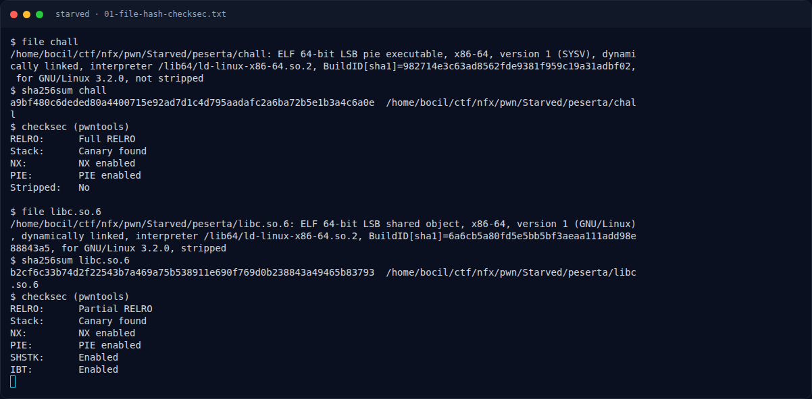

# Starved — Triage awal

[← Overview](40-starved.md) · [Index](index.md)

> **Langkah 2/9 — Triage awal.** strings memperlihatkan decoy flag yang sengaja dipasang di .data:
>
> **Titik penting:** file chall · checksec (pwntools)
>
> **Berikutnya:** [Analisis](40-starved-03-analisis.md)

## 1.4 Triage awal

```text
$ file chall
chall: ELF 64-bit LSB pie executable, x86-64, version 1 (SYSV),
dynamically linked, interpreter /lib64/ld-linux-x86-64.so.2,
BuildID[sha1]=982714e3c63ad8562fde9381f959c19a31adbf02,
for GNU/Linux 3.2.0, not stripped

$ checksec (pwntools)
RELRO:      Full RELRO
Stack:      Canary found
NX:         NX enabled
PIE:        PIE enabled
Stripped:   No
```

`strings` memperlihatkan **decoy flag** yang sengaja dipasang di `.data`:

```text
flag.txt
DECOY{jangan_yang_ini_ya}
DECOY{union_gede_kecil_bebas_wkwk}
DECOY{fd0_trick_doang_kok_bisa}
```

Decoy ini bukan flag kompetisi; flag asli ada di `flags/pwn/Starved.txt`. String `DECOY{fd0_trick...}` justru menjadi petunjuk teknik exploit.

Symbol:

```text
0000000000000ba9 t setup_seccomp
0000000000000dea t leaker
0000000000000ecc T main
```

### Evidence langkah ini



*Terminal evidence — `01-file-hash-checksec.txt` (arsip transkrip sesi solve).*

**Berkas mentah langkah ini:**

- [`01-file-hash-checksec.txt`](assets/starved/01-file-hash-checksec.txt)
