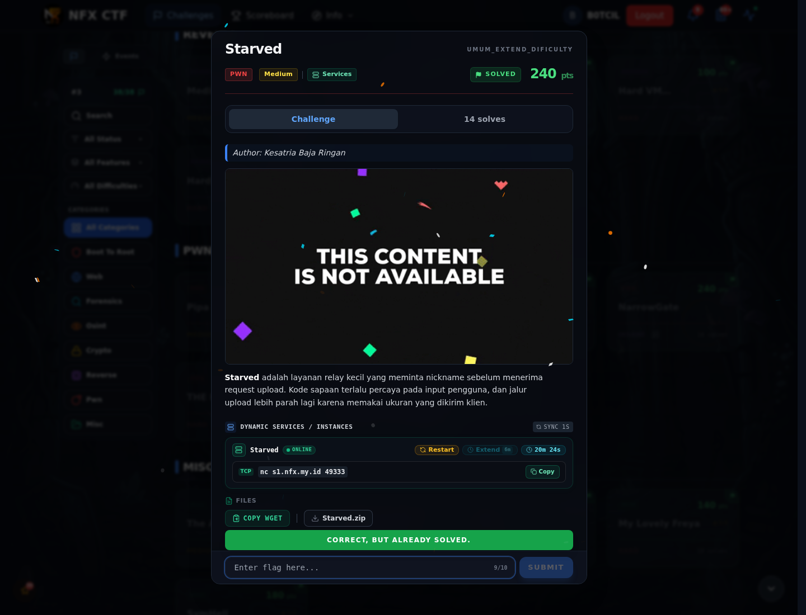
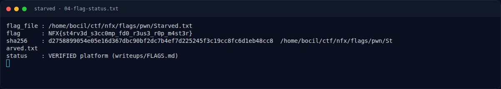
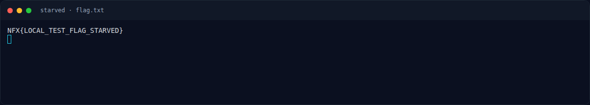

# Starved — Flag & Verifikasi

[← Overview](40-starved.md) · [Index](index.md)

> **Flag:** `NFX{st4rv3d_s3cc0mp_fd0_r3us3_r0p_m4st3r}`
> **Status:** `VERIFIED`

```text
NFX{st4rv3d_s3cc0mp_fd0_r3us3_r0p_m4st3r}
```

Verifikasi:

```text
$ cat flags/pwn/Starved.txt
NFX{st4rv3d_s3cc0mp_fd0_r3us3_r0p_m4st3r}
```

Status `verified platform` menurut `writeups/FLAGS.md`.

### Bukti submit di platform



*Submit flag di platform: `CORRECT, BUT ALREADY SOLVED.`*

### Evidence langkah ini



*Terminal evidence — `04-flag-status.txt` (arsip transkrip sesi solve).*



*Terminal evidence — `flag.txt` (arsip transkrip sesi solve).*

> **Verifikasi platform:** flag sudah diterima. Recheck 2026-11-09 mengembalikan `Correct, but already solved.`
