# Starved — Evidence / Bukti

11 screenshot11 transkrip / script

[← Overview](40-starved.md) · [Index](index.md)

## Arsip Evidence

> Semua file berasal dari `assets/starved/`. Screenshot platform dan terminal adalah bukti asli dari sesi solve; transkrip mentah tetap ditautkan di bagian bawah.

### Platform

<figure><a href="assets/starved/00-challenge-platform.png" target="_blank" rel="noopener">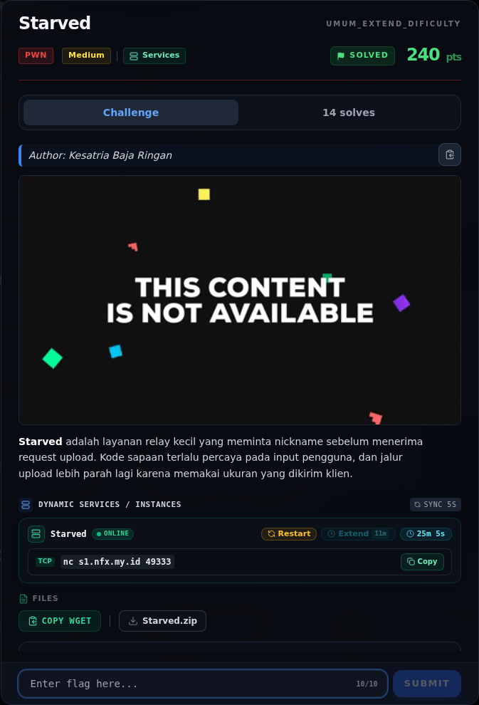</a><figcaption>00-challenge-platform.png</figcaption></figure>

*Challenge brief asli di platform NFX CTF 2026.*

<figure><a href="assets/starved/00b-submit-platform.png" target="_blank" rel="noopener">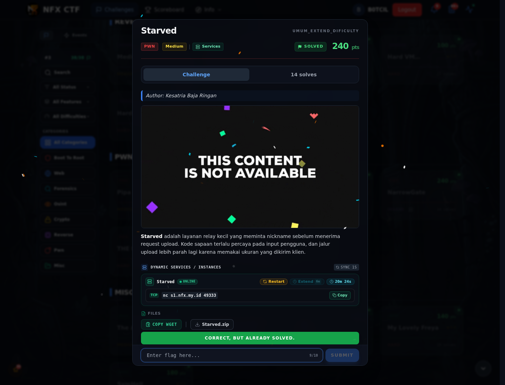</a><figcaption>00b-submit-platform.png</figcaption></figure>

*Submit flag di platform: `CORRECT, BUT ALREADY SOLVED.`*

### Terminal (arsip sesi)

<figure><a href="assets/starved/term-01-file-hash-checksec.png" target="_blank" rel="noopener">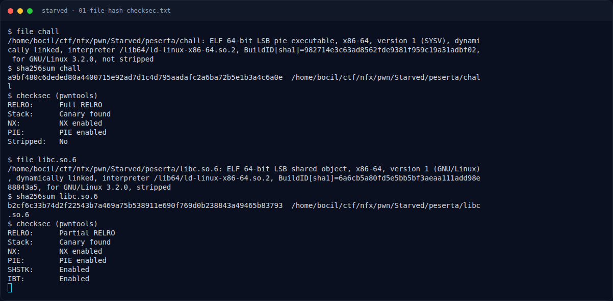</a><figcaption>term-01-file-hash-checksec.png</figcaption></figure>

*Terminal evidence — `01-file-hash-checksec.txt` (arsip transkrip sesi solve).*

<figure><a href="assets/starved/term-02-disasm.png" target="_blank" rel="noopener">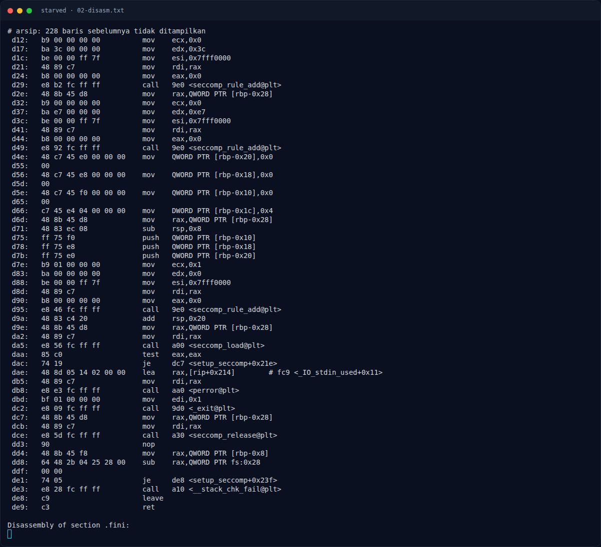</a><figcaption>term-02-disasm.png</figcaption></figure>

*Terminal evidence — `02-disasm.txt` (arsip transkrip sesi solve).*

<figure><a href="assets/starved/term-02b-seccomp.png" target="_blank" rel="noopener">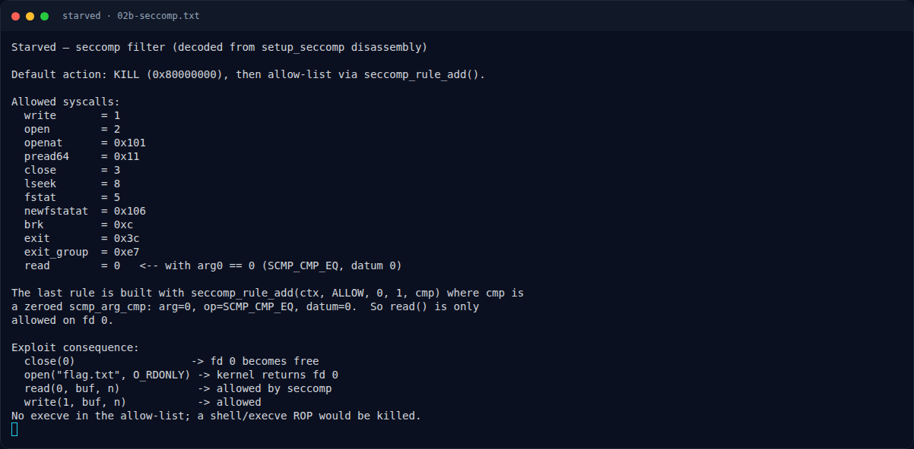</a><figcaption>term-02b-seccomp.png</figcaption></figure>

*Terminal evidence — `02b-seccomp.txt` (arsip transkrip sesi solve).*

<figure><a href="assets/starved/term-02c-records.png" target="_blank" rel="noopener">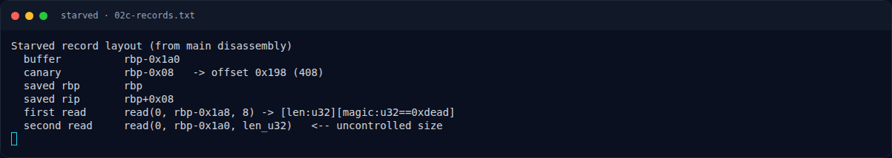</a><figcaption>term-02c-records.png</figcaption></figure>

*Terminal evidence — `02c-records.txt` (arsip transkrip sesi solve).*

<figure><a href="assets/starved/term-03-exploit-run.png" target="_blank" rel="noopener">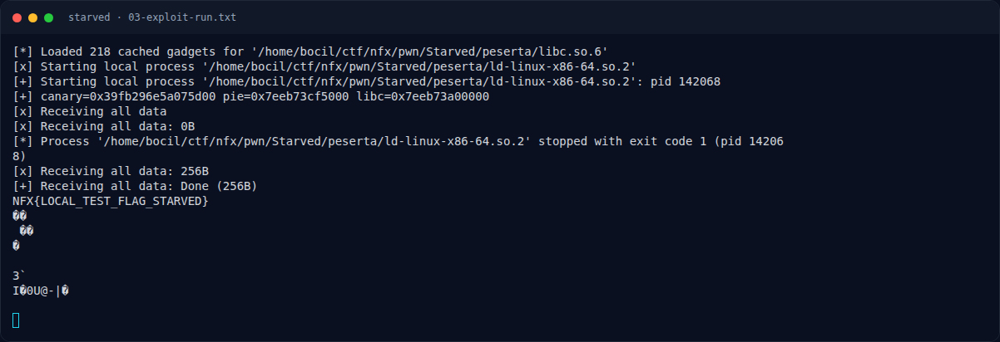</a><figcaption>term-03-exploit-run.png</figcaption></figure>

*Terminal evidence — `03-exploit-run.txt` (arsip transkrip sesi solve).*

<figure><a href="assets/starved/term-03b-leak-probe.png" target="_blank" rel="noopener">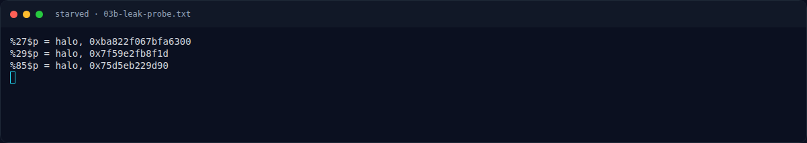</a><figcaption>term-03b-leak-probe.png</figcaption></figure>

*Terminal evidence — `03b-leak-probe.txt` (arsip transkrip sesi solve).*

<figure><a href="assets/starved/term-03c-run-printable.png" target="_blank" rel="noopener">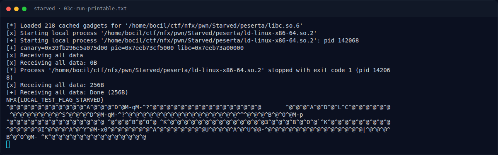</a><figcaption>term-03c-run-printable.png</figcaption></figure>

*Terminal evidence — `03c-run-printable.txt` (arsip transkrip sesi solve).*

<figure><a href="assets/starved/term-04-flag-status.png" target="_blank" rel="noopener">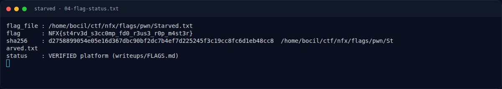</a><figcaption>term-04-flag-status.png</figcaption></figure>

*Terminal evidence — `04-flag-status.txt` (arsip transkrip sesi solve).*

<figure><a href="assets/starved/term-flag.png" target="_blank" rel="noopener">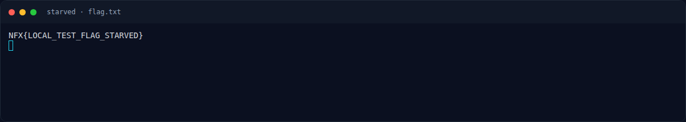</a><figcaption>term-flag.png</figcaption></figure>

*Terminal evidence — `flag.txt` (arsip transkrip sesi solve).*

### Transkrip mentah & script

- [`01-file-hash-checksec.txt`](assets/starved/01-file-hash-checksec.txt)
- [`02-disasm.txt`](assets/starved/02-disasm.txt)
- [`02b-seccomp.txt`](assets/starved/02b-seccomp.txt)
- [`02c-records.txt`](assets/starved/02c-records.txt)
- [`03-exploit-run.txt`](assets/starved/03-exploit-run.txt)
- [`03b-leak-probe.py`](assets/starved/03b-leak-probe.py)
- [`03b-leak-probe.txt`](assets/starved/03b-leak-probe.txt)
- [`03c-run-printable.txt`](assets/starved/03c-run-printable.txt)
- [`04-flag-status.txt`](assets/starved/04-flag-status.txt)
- [`exploit.py`](assets/starved/exploit.py)
- [`flag.txt`](assets/starved/flag.txt)

## Tabel Evidence

| Bukti | File | Keterangan |
|---|---|---|
| Identitas/hash/checksec | `writeups/assets/starved/01-file-hash-checksec.txt` | PIE, canary, Full RELRO |
| Disassembly | `writeups/assets/starved/02-disasm.txt` | `leaker`, `main`, `setup_seccomp` |
| Seccomp decode | `writeups/assets/starved/02b-seccomp.txt` | Allow-list + `read` fd 0 |
| Layout stack | `writeups/assets/starved/02c-records.txt` | Offset canary/RBP/RIP |
| Leak probe | `writeups/assets/starved/03b-leak-probe.txt` | `%27`, `%29`, `%85` |
| Exploit | `writeups/assets/starved/exploit.py` | pwntools ORW |
| Output | `writeups/assets/starved/03-exploit-run.txt`, `03c-run-printable.txt` | Flag lokal + padding |
| Flag/status | `writeups/assets/starved/04-flag-status.txt` | Flag dari `flags/pwn/` |