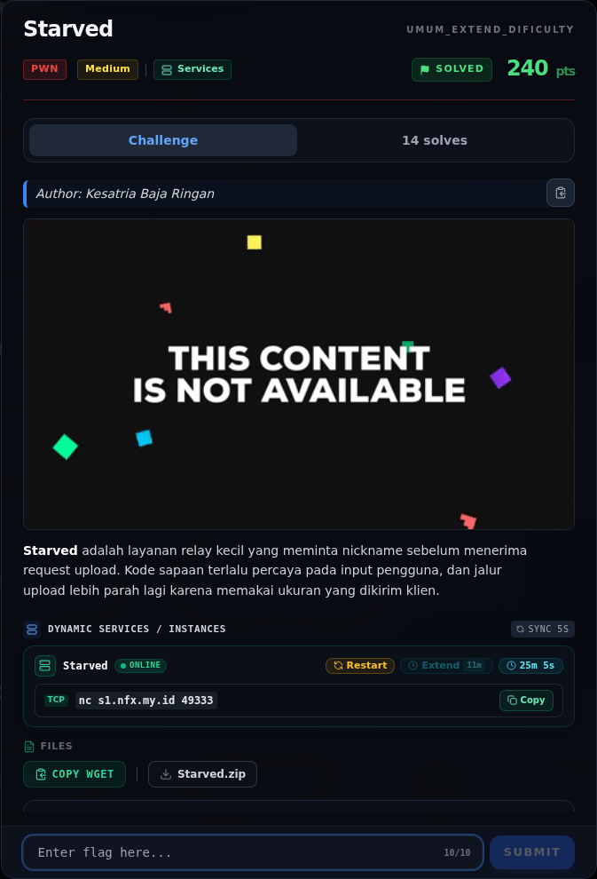
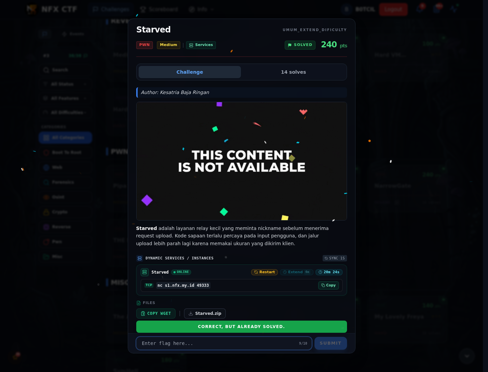

# Starved

Track Umum / Extend · PwnMedium380 poinVERIFIED

| Field | Nilai |
|---|---|
| Event | `umum_Extend` |
| Kategori | `Pwn` |
| Difficulty | `Medium` |
| Poin | `380` |
| Author | `Kesatria Baja Ringan` |
| Solves | `7` |
| Tools | python3, pwntools, checksec, objdump, strings |
| Flag | `NFX{st4rv3d_s3cc0mp_fd0_r3us3_r0p_m4st3r}` |
| Status | `VERIFIED` |

[← Kembali ke Index](index.md)

## Challenge Brief (platform)

*Challenge brief asli di platform NFX CTF 2026.*

## Cerita singkat

Jadi ceritanya gini. `leaker()` mencetak nickname dengan `printf(nickname)` → **format string leak** (canary, PIE, libc). Terus, `main()` membaca 8 byte: `[len:u32][magic:u32]`; jika magic `0xdead`, ia memanggil `read(0, rbp-0x1a0, len)` dengan `len` 32-bit dari klien → **stack overflow** (offset canary `0x198`). Lalu, ada **seccomp** yang mengizinkan `write/open/openat/pread64/close/lseek/fstat/newfstatat/brk/exit/exit_group`, tetapi `read` hanya boleh dengan **fd 0**. Nah, dari situ kita bisa sampai ke flag dan bukti submit-nya.

## Alur & Titik Penting

| # | Langkah | Titik penting | Buka |
|---:|---|---|---|
| 1 | Recon | Dua petunjuk: "kode sapaan terlalu percaya pada input pengguna" (format string di leaker) dan "jalur upload memakai ukuran yang dikirim klien" (stack overflow di main). | [Buka](40-starved-01-recon.md) |
| 2 | Triage awal | file chall | [Buka](40-starved-02-triage-awal.md) |
| 3 | Analisis | Karena fgets hanya 0xa0 ke buffer 0xb0, tidak ada overflow di sini; yang bisa dieksploitasi adalah format string. | [Buka](40-starved-03-analisis.md) |
| 4 | Analisis | setupseccomp() memakai seccompinit(KILL) lalu seccompruleadd() untuk: | [Buka](40-starved-04-analisis-2.md) |
| 5 | Eksploitasi | python3 exploit.py \| tee 03-exploit-run.txt | [Buka](40-starved-05-eksploitasi.md) |
| 6 | Output asli | NFX{LOCAL_TEST_FLAG_STARVED} | [Buka](40-starved-06-output-asli.md) |
| 7 | Flag | NFX{st4rv3d_s3cc0mp_fd0_r3us3_r0p_m4st3r} | [Buka](40-starved-07-flag.md) |
| 8 | Bukti / Evidence | arsip screenshot dan transkrip | [Buka](40-starved-08-bukti-evidence.md) |
| 9 | Referensi | — | [Buka](40-starved-09-referensi.md) |

## TL;DR

- `leaker()` mencetak nickname dengan `printf(nickname)` → **format string leak** (canary, PIE, libc).
- `main()` membaca 8 byte: `[len:u32][magic:u32]`; jika magic `0xdead`, ia memanggil `read(0, rbp-0x1a0, len)` dengan `len` 32-bit dari klien → **stack overflow** (offset canary `0x198`).
- Ada **seccomp** yang mengizinkan `write/open/openat/pread64/close/lseek/fstat/newfstatat/brk/exit/exit_group`, tetapi `read` hanya boleh dengan **fd 0**.
- ROP: `close(0)` → `open("flag.txt")` (hasilnya fd 0) → `read(0, bss, 0x100)` → `write(1, bss, 0x100)`.
- Flag: `NFX{st4rv3d_s3cc0mp_fd0_r3us3_r0p_m4st3r}`.

Pratinjau evidence. Buka halaman <a href="40-starved-08-bukti-evidence.html">Evidence / Bukti</a> untuk semua screenshot dan transkrip.

## Navigasi Halaman

<a class="nx-page-card" href="40-starved-01-recon.html"><b>Recon</b>Enumerasi target dan bukti awal</a>
<a class="nx-page-card" href="40-starved-02-triage-awal.html"><b>Triage awal</b>Baca bagian ini</a>
<a class="nx-page-card" href="40-starved-03-analisis.html"><b>Analisis</b>Membaca alur dan akar masalah</a>
<a class="nx-page-card" href="40-starved-04-analisis-2.html"><b>Analisis</b>Membaca alur dan akar masalah</a>
<a class="nx-page-card" href="40-starved-05-eksploitasi.html"><b>Eksploitasi</b>Langkah exploit dan solver</a>
<a class="nx-page-card" href="40-starved-06-output-asli.html"><b>Output asli</b>Baca bagian ini</a>
<a class="nx-page-card" href="40-starved-07-flag.html"><b>Flag</b>Flag dan verifikasi platform</a>
<a class="nx-page-card" href="40-starved-08-bukti-evidence.html"><b>Bukti / Evidence</b>Screenshot, transkrip, dan artefak</a>
<a class="nx-page-card" href="40-starved-09-referensi.html"><b>Referensi</b>Sumber dan bacaan lanjutan</a>

