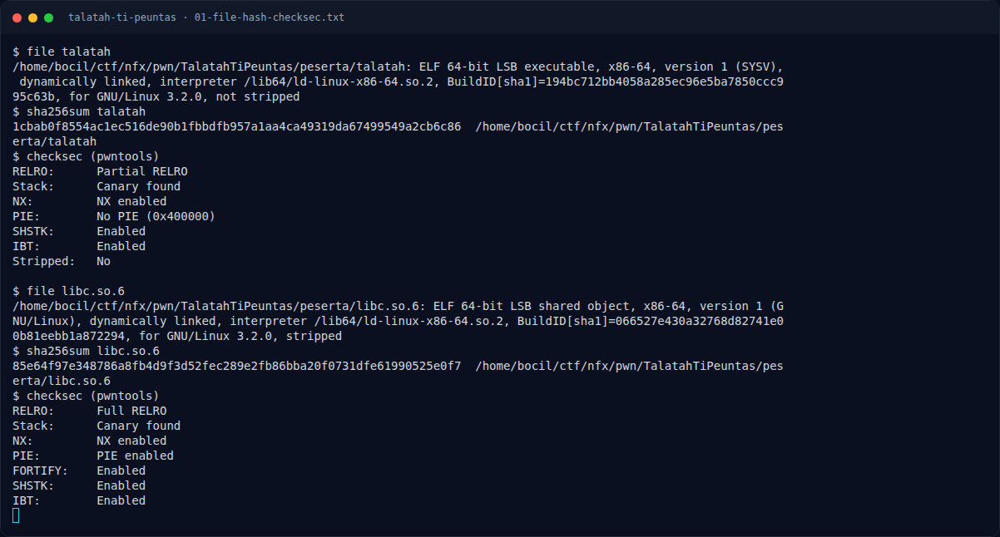

# Talatah Ti Peuntas — Triage awal

[← Overview](41-talatah-ti-peuntas.md) · [Index](index.md)

> **Langkah 2/10 — Triage awal.** Partial RELRO + non-PIE = GOT writable dan alamat statis.
>
> **Titik penting:** file talatah · checksec (pwntools)
>
> **Berikutnya:** [Analisis](41-talatah-ti-peuntas-03-analisis.md)

## 1.4 Triage awal

```text
$ file talatah
talatah: ELF 64-bit LSB executable, x86-64, version 1 (SYSV),
dynamically linked, interpreter /lib64/ld-linux-x86-64.so.2,
BuildID[sha1]=194bc712bb4058a285ec96e5ba7850ccc995c63b,
for GNU/Linux 3.2.0, not stripped

$ checksec (pwntools)
RELRO:      Partial RELRO
Stack:      Canary found
NX:         NX enabled
PIE:        No PIE (0x400000)
FORTIFY:    Enabled
SHSTK:      Enabled
IBT:        Enabled
Stripped:   No
```

Partial RELRO + non-PIE = GOT writable dan alamat statis. `strings` menunjukkan protokol:

```text
panjang pesan :
[-] panjang pesan di luar rentang 24..%d
pesan :
[!] data pesan tidak lengkap
TLT1
[-] magic salah (harus TLT1)
[-] total_len (%u) tidak cocok dengan panjang pesan (%d)
[-] key_size di luar 1..%d
[-] tag tidak dikenal (0x%04x, harus 0x0001)
[-] tlv_len melebihi sisa pesan
msg%d
[+] pesan diparse -> node #%d (key_size=%u, tlv_len=%u)
view[%d] name=%.16s len=%u data:
panjang baru :
data :
[+] node #%d diedit (%d byte)
[+] node #%d dihapus
```

Symbol:

```text
000000000040150d t op_parse
00000000004018a7 t op_view
0000000000401982 t op_edit
0000000000401b3c t op_delete
```

### Evidence langkah ini



*Terminal evidence — `01-file-hash-checksec.txt` (arsip transkrip sesi solve).*

**Berkas mentah langkah ini:**

- [`01-file-hash-checksec.txt`](assets/talatah-ti-peuntas/01-file-hash-checksec.txt)
