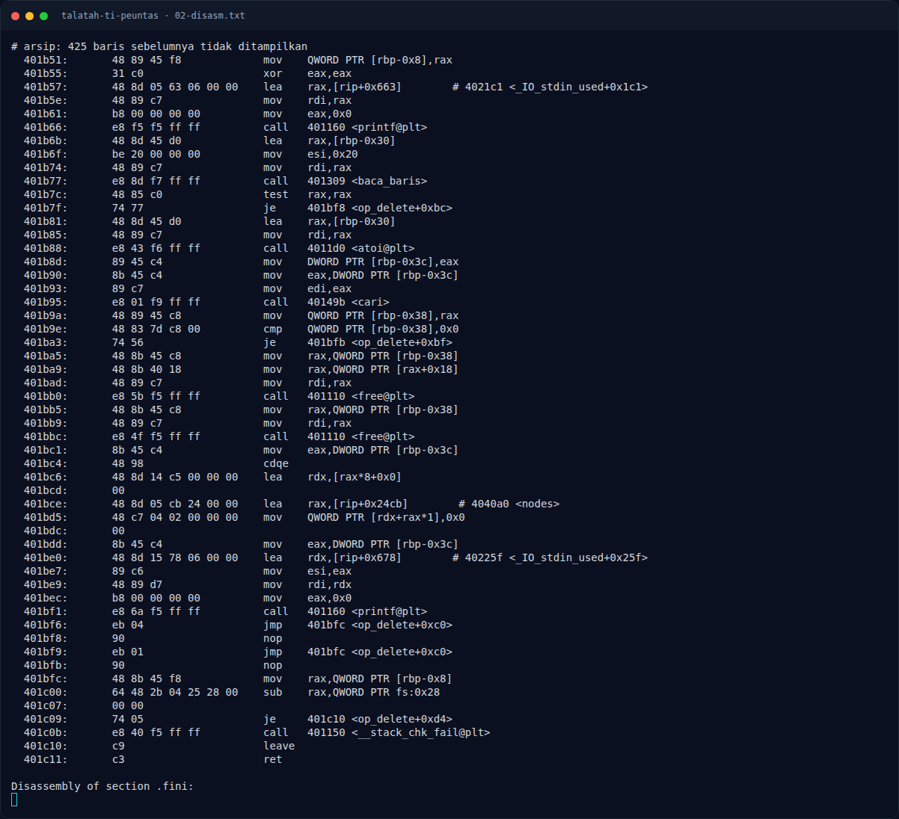
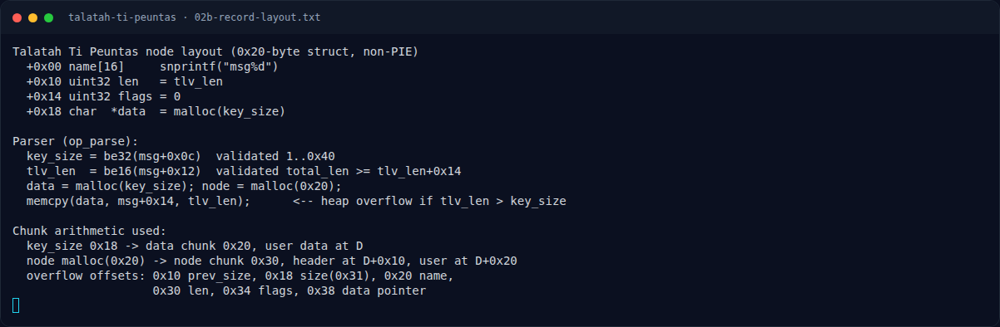

# Talatah Ti Peuntas — Analisis

[← Overview](41-talatah-ti-peuntas.md) · [Index](index.md)

> **Langkah 3/10 — Analisis.** Panjang pesan dibatasi 24..0x400 (0x18..0x400).
>
> **Titik penting:** Panjang pesan dibatasi 24..0x400 (0x18..0x400).
>
> **Berikutnya:** [Analisis](41-talatah-ti-peuntas-04-analisis-2.md)

## 2.1 Format pesan TLT1

Dari `op_parse`:

| Offset | Field | Validasi |
|---|---|---|
| `0x00` | `magic[4]` = `"TLT1"` | `memcmp` |
| `0x04` | 4 byte tidak dipakai | — |
| `0x08` | `total_len` (BE32) | harus sama dengan panjang pesan |
| `0x0c` | `key_size` (BE32) | `1..0x40` |
| `0x10` | `tag` (BE16) | harus `1` |
| `0x12` | `tlv_len` (BE16) | `total_len >= tlv_len + 0x14` |
| `0x14` | payload `tlv_len` byte | — |

Panjang pesan dibatasi `24..0x400` (`0x18..0x400`).

## 2.2 Bug — `malloc(key_size)` vs `memcpy(tlv_len)`

```asm
171d: lea rax, [rbp-0x410]
1724: add rax, 0x12
172b: call be16                      # tlv_len
1730: mov [rbp-0x452], ax
1737: movzx eax, WORD PTR [rbp-0x452]
173e: add eax, 0x14
1741: cmp DWORD PTR [rbp-0x44c], eax # total_len >= tlv_len+0x14
1747: jae 40175d
...
175d: mov eax, [nnodes]
1763: mov [rbp-0x444], eax
1769: mov eax, [rbp-0x448]           # key_size
176f: mov rdi, rax
1772: call malloc                    # data = malloc(key_size)
1777: mov [rbp-0x440], rax
177e: mov edi, 0x20
1783: call malloc                    # node = malloc(0x20)
...
17b7: mov rax, [rbp-0x438]           # node
17be: mov rdx, [rbp-0x440]           # data
17c5: mov [rax+0x18], rdx            # node->data = data
17c9: movzx edx, WORD PTR [rbp-0x452] # tlv_len
17d0: mov rax, [rbp-0x438]
17d7: mov [rax+0x10], edx            # node->len = tlv_len
17da: mov DWORD PTR [rax+0x14], 0    # node->flags = 0
...
1844: movzx edx, WORD PTR [rbp-0x452] # tlv_len
184b: lea rax, [rbp-0x410]
1852: add rax, 0x14                  # msg+0x14
1856: mov rcx, [rbp-0x440]           # data
185d: mov rsi, rax
1860: mov rdi, rcx
1863: call memcpy                    # memcpy(data, msg+0x14, tlv_len)
```

`tlv_len` bisa mencapai `0x400 - 0x14 = 0x3ec`, sedangkan `key_size` boleh hanya `1`. Jadi `memcpy` menulis jauh melewati `data`.

### Evidence langkah ini



*Terminal evidence — `02-disasm.txt` (arsip transkrip sesi solve).*



*Terminal evidence — `02b-record-layout.txt` (arsip transkrip sesi solve).*

**Berkas mentah langkah ini:**

- [`02-disasm.txt`](assets/talatah-ti-peuntas/02-disasm.txt)
- [`02b-record-layout.txt`](assets/talatah-ti-peuntas/02b-record-layout.txt)
