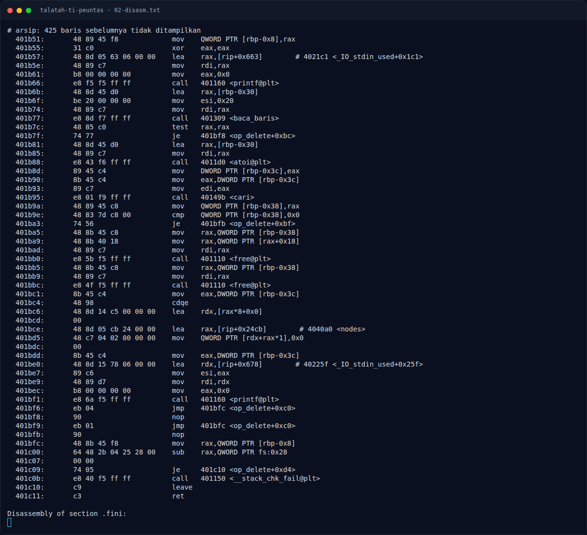
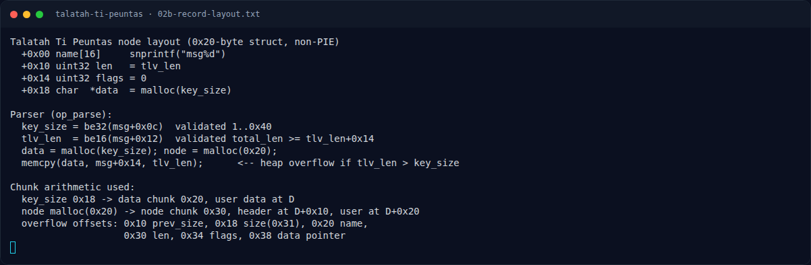

# Talatah Ti Peuntas — Analisis

[← Overview](41-talatah-ti-peuntas.md) · [Index](index.md)

## 2.3 Struktur node dan chunk

```text
node (malloc 0x20 -> chunk 0x30)
  +0x00  char name[16]     snprintf(node->name, 0x10, "msg%d", index)
  +0x10  uint32 len        = tlv_len
  +0x14  uint32 flags      = 0
  +0x18  char *data        = malloc(key_size)
```

Dengan `key_size = 0x18`, chunk data berukuran `0x20`; node chunk `0x30` tepat setelahnya. Dari pointer user data `D`:

```text
D+0x00 .. D+0x0f   isi data (16 byte)
D+0x10 .. D+0x17   node chunk prev_size
D+0x18 .. D+0x1f   node chunk size   -> isi 0x31 (0x30 | PREV_INUSE)
D+0x20 .. D+0x2f   node->name[16]
D+0x30 .. D+0x33   node->len
D+0x34 .. D+0x37   node->flags
D+0x38 .. D+0x3f   node->data
```

Payload `tlv_len = 0x40`, `key_size = 0x18`, `total_len = 0x54` cukup untuk mengontrol seluruh field node tanpa merusak chunk berikutnya.

## 2.4 Arbitrary read / write

`op_view`:

```asm
1910: mov rax, [rbp-0x38]     # node
1914: mov ecx, [rax+0x10]     # node->len
1917: mov rdx, [rbp-0x38]
191b: mov eax, [rbp-0x3c]     # index
191e: lea rdi, [rip+0x8ab]    # "view[%d] name=..."
192c: call printf
1931: mov rdx, [stdout]
1938: mov rax, [rbp-0x38]
193c: mov eax, [rax+0x10]     # len
...
1945: mov rax, [rax+0x18]     # node->data
194f: mov esi, 1
1957: call fwrite             # fwrite(node->data, 1, node->len, stdout)
```

`op_edit`:

```asm
1ac5: mov eax, [rbp-0x43c]    # new length (0..0x400)
1ace: mov rax, [rbp-0x438]    # node
1ad5: mov rax, [rax+0x18]     # node->data
1ad9: lea rcx, [rbp-0x410]    # input
1ae6: call memcpy             # memcpy(node->data, input, new_len)
1aeb: mov edx, [rbp-0x43c]
1af8: mov [rax+0x10], edx     # node->len = new_len
```

Setelah overflow, `node->data` dan `node->len` sepenuhnya dikendalikan → read/write ke alamat mana pun.

### Evidence langkah ini



*Terminal evidence — `02-disasm.txt` (arsip transkrip sesi solve).*



*Terminal evidence — `02b-record-layout.txt` (arsip transkrip sesi solve).*

**Berkas mentah langkah ini:**

- [`02-disasm.txt`](assets/talatah-ti-peuntas/02-disasm.txt)
- [`02b-record-layout.txt`](assets/talatah-ti-peuntas/02b-record-layout.txt)
