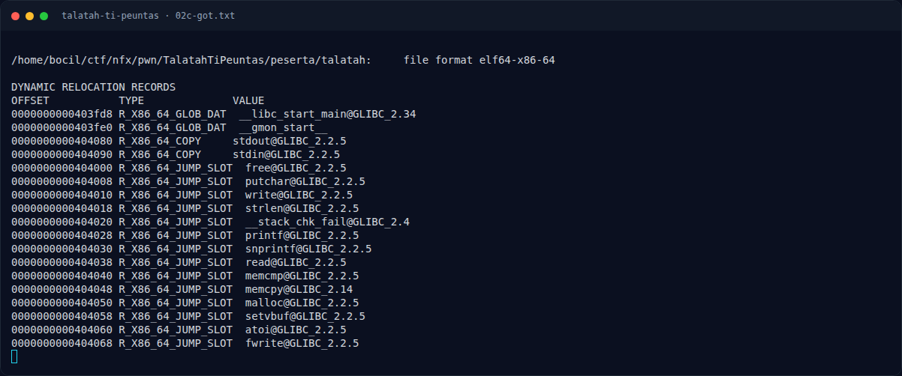

# Talatah Ti Peuntas — Alamat penting

[← Overview](41-talatah-ti-peuntas.md) · [Index](index.md)

> **Langkah 5/10 — Alamat penting.** printf@got dipakai untuk leak karena printf sudah pasti terselesaikan oleh menu; free@got bisa jadi masih menunjuk PLT stub kalau free belum pernah dipanggil.
>
> **Titik penting:** printf@got dipakai untuk leak karena printf sudah pasti terselesaikan oleh menu; free@got bisa jadi masih menunjuk PLT stub kalau free belum pernah dipanggil.
>
> **Berikutnya:** [Eksploitasi](41-talatah-ti-peuntas-06-eksploitasi.md)

## 2.5 Alamat penting

| Simbol | Alamat |
|---|---|
| `free@got` | `0x404000` |
| `printf@got` | `0x404028` |
| `.bss` (buffer baru) | `0x404140` |

`printf@got` dipakai untuk leak karena `printf` sudah pasti terselesaikan oleh menu; `free@got` bisa jadi masih menunjuk PLT stub kalau `free` belum pernah dipanggil.

### Evidence langkah ini

*Terminal evidence — `02c-got.txt` (arsip transkrip sesi solve).*

**Berkas mentah langkah ini:**

- [`02c-got.txt`](assets/talatah-ti-peuntas/02c-got.txt)
