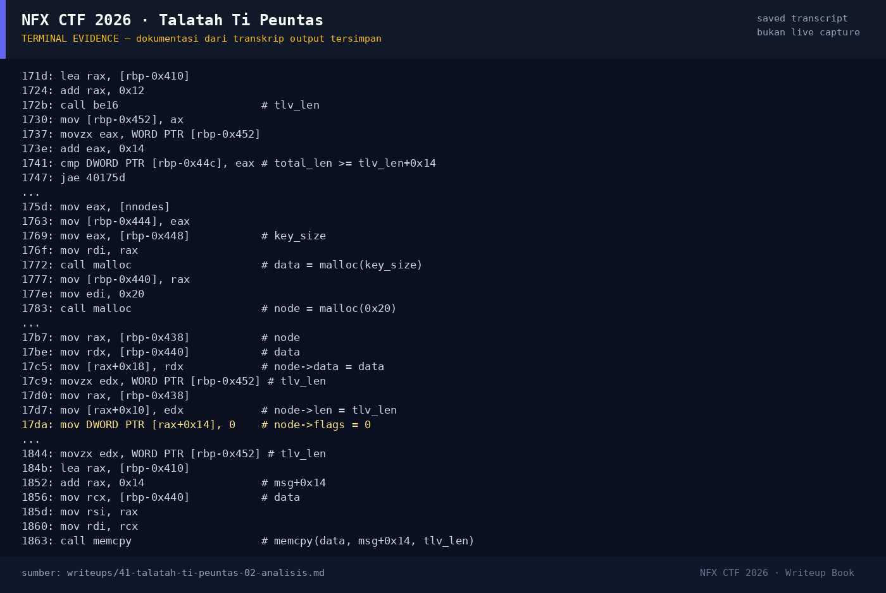

# Talatah Ti Peuntas — Evidence / Bukti

1 screenshot8 transkrip / script

[← Overview](41-talatah-ti-peuntas.md) · [Index](index.md)

## Arsip Evidence

> Semua file di bawah berasal dari folder `assets/talatah-ti-peuntas/`. Screenshot ditempel langsung; file teks/script ditautkan.

### Screenshot

<figure><figcaption>98-terminal-evidence.png</figcaption></figure>

### Transkrip / file pendukung

- [`01-file-hash-checksec.txt`](assets/talatah-ti-peuntas/01-file-hash-checksec.txt)
- [`02-disasm.txt`](assets/talatah-ti-peuntas/02-disasm.txt)
- [`02b-record-layout.txt`](assets/talatah-ti-peuntas/02b-record-layout.txt)
- [`02c-got.txt`](assets/talatah-ti-peuntas/02c-got.txt)
- [`03-exploit-run.txt`](assets/talatah-ti-peuntas/03-exploit-run.txt)
- [`04-flag-status.txt`](assets/talatah-ti-peuntas/04-flag-status.txt)
- [`exploit.py`](assets/talatah-ti-peuntas/exploit.py)
- [`flag.txt`](assets/talatah-ti-peuntas/flag.txt)

## Tabel Evidence

| Bukti | File | Keterangan |
|---|---|---|
| Identitas/hash/checksec | `writeups/assets/talatah-ti-peuntas/01-file-hash-checksec.txt` | non-PIE, partial RELRO |
| Disassembly | `writeups/assets/talatah-ti-peuntas/02-disasm.txt` | `op_parse`, `op_view`, `op_edit`, `op_delete` |
| Layout node/chunk | `writeups/assets/talatah-ti-peuntas/02b-record-layout.txt` | Offset overflow |
| GOT | `writeups/assets/talatah-ti-peuntas/02c-got.txt` | `free@got`, `printf@got` |
| Exploit | `writeups/assets/talatah-ti-peuntas/exploit.py` | Full chain |
| Output | `writeups/assets/talatah-ti-peuntas/03-exploit-run.txt` | Leak + shell + flag lokal |
| Flag/status | `writeups/assets/talatah-ti-peuntas/04-flag-status.txt` | Flag dari `flags/pwn/` |