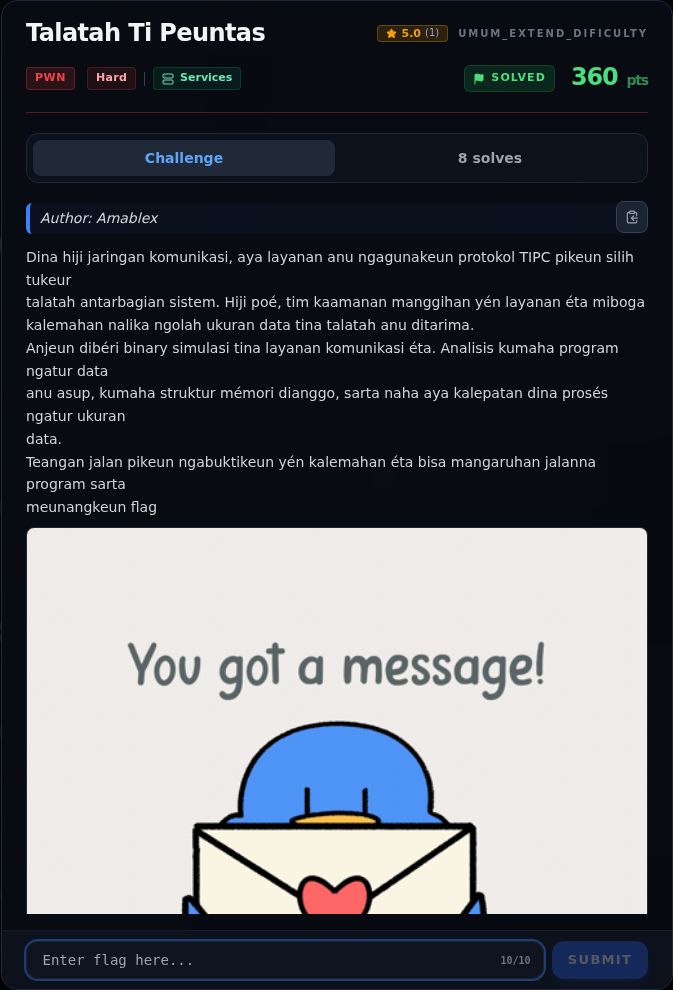

# Talatah Ti Peuntas — Referensi

[← Overview](41-talatah-ti-peuntas.md) · [Index](index.md)

> **Langkah 10/10 — Referensi.** Referensi
>
> **Titik penting:** —
>
> **Selesai.** Kembali ke [Overview](41-talatah-ti-peuntas.md).

- `pwn/TalatahTiPeuntas/peserta/talatah`.
- `writeups/assets/talatah-ti-peuntas/02b-record-layout.txt`.
- `writeups/assets/libc-offsets-and-gadgets.txt`.
- Teknik GOT overwrite: `free@got → system`, trigger `free("/bin/sh")`.

### Evidence langkah ini

*Challenge brief asli di platform NFX CTF 2026.*
