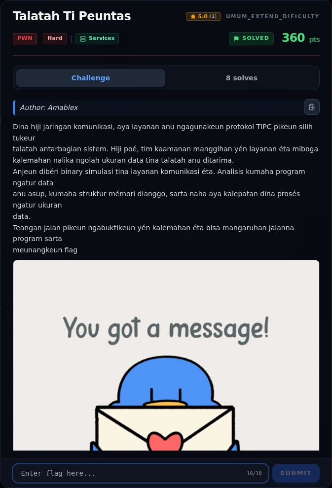
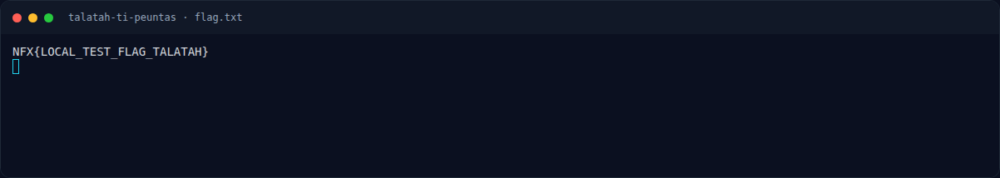

# Talatah Ti Peuntas

Track Umum / Extend · PwnHard440 poinVERIFIED

| Field | Nilai |
|---|---|
| Event | `umum_Extend` |
| Kategori | `Pwn` |
| Difficulty | `Hard` |
| Poin (snapshot) | `440` |
| Author | `Amablex` |
| Solves | `4` |
| Tools | python3, pwntools, checksec, objdump, readelf, strings |
| Flag | `NFX{HiduPPk1T4AAyangMelawann}` |
| Status | `VERIFIED` |
| Snapshot | 2026-11-13 |

[← Kembali ke Index](index.md)

## Challenge Brief (platform)

*Challenge brief asli di platform NFX CTF 2026.*

## Cerita singkat

Jadi ceritanya gini. service "pengelola talatah" mem-parsing pesan protokol **TLT1**: `magic | total_len | key_size | tag | tlv_len | payload`. Terus, validasi memeriksa `key_size` (1..0x40) dan `total_len >= tlv_len + 0x14`, tetapi **tidak pernah membandingkan `tlv_len` dengan `key_size`**. Lalu, parser melakukan `data = malloc(key_size)` lalu `memcpy(data, msg+0x14, tlv_len)` → **heap overflow** dari chunk data ke chunk node yang berdekatan. Nah, dari situ kita bisa sampai ke flag dan bukti submit-nya.

## Alur & Titik Penting

| # | Langkah | Titik penting | Buka |
|---:|---|---|---|
| 1 | Recon | Petunjuk utama: "calepatan dina prosés ngatur ukuran data" — panjang TLV vs ukuran alokasi. | [Buka](41-talatah-ti-peuntas-01-recon.md) |
| 2 | Triage awal | file talatah | [Buka](41-talatah-ti-peuntas-02-triage-awal.md) |
| 3 | Analisis | Panjang pesan dibatasi 24..0x400 (0x18..0x400). | [Buka](41-talatah-ti-peuntas-03-analisis.md) |
| 4 | Analisis | Dengan keysize = 0x18, chunk data berukuran 0x20; node chunk 0x30 tepat setelahnya. | [Buka](41-talatah-ti-peuntas-04-analisis-2.md) |
| 5 | Alamat penting | printf@got dipakai untuk leak karena printf sudah pasti terselesaikan oleh menu; free@got bisa jadi masih menunjuk PLT stub kalau free belum pernah dipanggil. | [Buka](41-talatah-ti-peuntas-05-alamat-penting.md) |
| 6 | Eksploitasi | (lihat assets/libc-offsets-and-gadgets.txt) | [Buka](41-talatah-ti-peuntas-06-eksploitasi.md) |
| 7 | Eksploitasi | python3 exploit.py \| tee 03-exploit-run.txt | [Buka](41-talatah-ti-peuntas-07-eksploitasi-2.md) |
| 8 | Flag | NFX{HiduPPk1T4AAyangMelawann} | [Buka](41-talatah-ti-peuntas-08-flag.md) |
| 9 | Bukti / Evidence | arsip screenshot dan transkrip | [Buka](41-talatah-ti-peuntas-09-bukti-evidence.md) |
| 10 | Referensi | — | [Buka](41-talatah-ti-peuntas-10-referensi.md) |

## TL;DR

- Service "pengelola talatah" mem-parsing pesan protokol **TLT1**: `magic | total_len | key_size | tag | tlv_len | payload`.
- Validasi memeriksa `key_size` (1..0x40) dan `total_len >= tlv_len + 0x14`, tetapi **tidak pernah membandingkan `tlv_len` dengan `key_size`**.
- Parser melakukan `data = malloc(key_size)` lalu `memcpy(data, msg+0x14, tlv_len)` → **heap overflow** dari chunk data ke chunk node yang berdekatan.
- Node struct 0x20 byte berisi `name[16]`, `len`, `flags`, dan `char *data`. Overflow mengontrol `node->len` dan `node->data`.
- `op_view` menjadi **arbitrary read** (`fwrite(node->data, node->len)`); `op_edit` menjadi **arbitrary write** (`memcpy(node->data, input, new_len)`).
- Exploit: leak `printf@got`, hitung libc, tulis `system` ke `free@got`, taruh `/bin/sh` di `.bss`, lalu `delete` node → `free("/bin/sh")` = `system("/bin/sh")`.
- Flag: `NFX{HiduPPk1T4AAyangMelawann}`.

Pratinjau evidence. Buka halaman <a href="41-talatah-ti-peuntas-09-bukti-evidence.html">Evidence / Bukti</a> untuk semua screenshot dan transkrip.

## Navigasi Halaman

<a class="nx-page-card" href="41-talatah-ti-peuntas-01-recon.html"><b>Recon</b>Enumerasi target dan bukti awal</a>
<a class="nx-page-card" href="41-talatah-ti-peuntas-02-triage-awal.html"><b>Triage awal</b>Baca bagian ini</a>
<a class="nx-page-card" href="41-talatah-ti-peuntas-03-analisis.html"><b>Analisis</b>Membaca alur dan akar masalah</a>
<a class="nx-page-card" href="41-talatah-ti-peuntas-04-analisis-2.html"><b>Analisis</b>Membaca alur dan akar masalah</a>
<a class="nx-page-card" href="41-talatah-ti-peuntas-05-alamat-penting.html"><b>Alamat penting</b>Baca bagian ini</a>
<a class="nx-page-card" href="41-talatah-ti-peuntas-06-eksploitasi.html"><b>Eksploitasi</b>Langkah exploit dan solver</a>
<a class="nx-page-card" href="41-talatah-ti-peuntas-07-eksploitasi-2.html"><b>Eksploitasi</b>Langkah exploit dan solver</a>
<a class="nx-page-card" href="41-talatah-ti-peuntas-08-flag.html"><b>Flag</b>Flag dan verifikasi platform</a>
<a class="nx-page-card" href="41-talatah-ti-peuntas-09-bukti-evidence.html"><b>Bukti / Evidence</b>Screenshot, transkrip, dan artefak</a>
<a class="nx-page-card" href="41-talatah-ti-peuntas-10-referensi.html"><b>Referensi</b>Sumber dan bacaan lanjutan</a>

