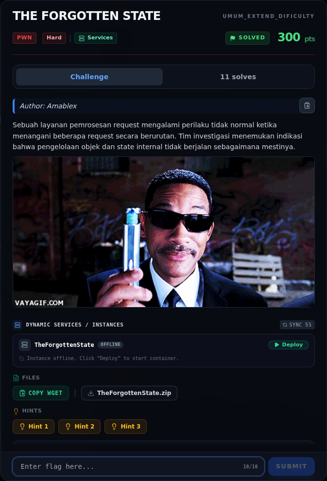

# THE FORGOTTEN STATE — Recon

[← Overview](42-the-forgotten-state.md) · [Index](index.md)

> **Langkah 1/10 — Recon.** Kata kunci: "pengelolaan objek dan state internal" dan judul "THE FORGOTTEN STATE" → state active[]/table[] yang tidak konsisten.
>
> **Titik penting:** Kata kunci: "pengelolaan objek dan state internal" dan judul "THE FORGOTTEN STATE" → state active[]/table[] yang tidak konsisten.
>
> **Berikutnya:** [Triage awal](42-the-forgotten-state-02-triage-awal.md)

## 1.1 Deskripsi challenge

> **Author: Amablex**
>
> Sebuah layanan pemrosesan request mengalami perilaku tidak normal ketika menangani beberapa request secara berurutan. Tim investigasi menemukan indikasi bahwa pengelolaan objek dan state internal tidak berjalan sebagaimana mestinya.

Kata kunci: **"pengelolaan objek dan state internal"** dan judul **"THE FORGOTTEN STATE"** → state `active[]`/`table[]` yang tidak konsisten.

## 1.2 File yang diberikan

| File | Ukuran | SHA-256 |
|---|---|---|
| `pwn/TheForgottenState/peserta/state` | 16.848 B | `57d3954881917b39492c0ffbea4e74b58a06c49768f103b555fd0f8887bf08e7` |
| `pwn/TheForgottenState/peserta/libc.so.6` | 2.190.608 B | `85e64f97e348786a8fb4d9f3d52fec289e2fb86bba20f0731dfe61990525e0f7` |
| `pwn/TheForgottenState/peserta/ld-linux-x86-64.so.2` | 254.864 B | loader bawaan |

Service asli: `NFX/PWNNXCTF-2026/TheForgottenState` (TCP), saat penulisan stopped.

## 1.3 Environment

- Linux x86-64; libc challenge (sama dengan Talatah).
- Menjalankan:
  ```bash
  cd pwn/TheForgottenState/peserta
  ./ld-linux-x86-64.so.2 --library-path . ./state
  ```
- Tools: `file`, `sha256sum`, `strings`, `objdump`, `nm`, `readelf`, `pwntools`.

### Evidence langkah ini



*Challenge brief asli di platform NFX CTF 2026.*
