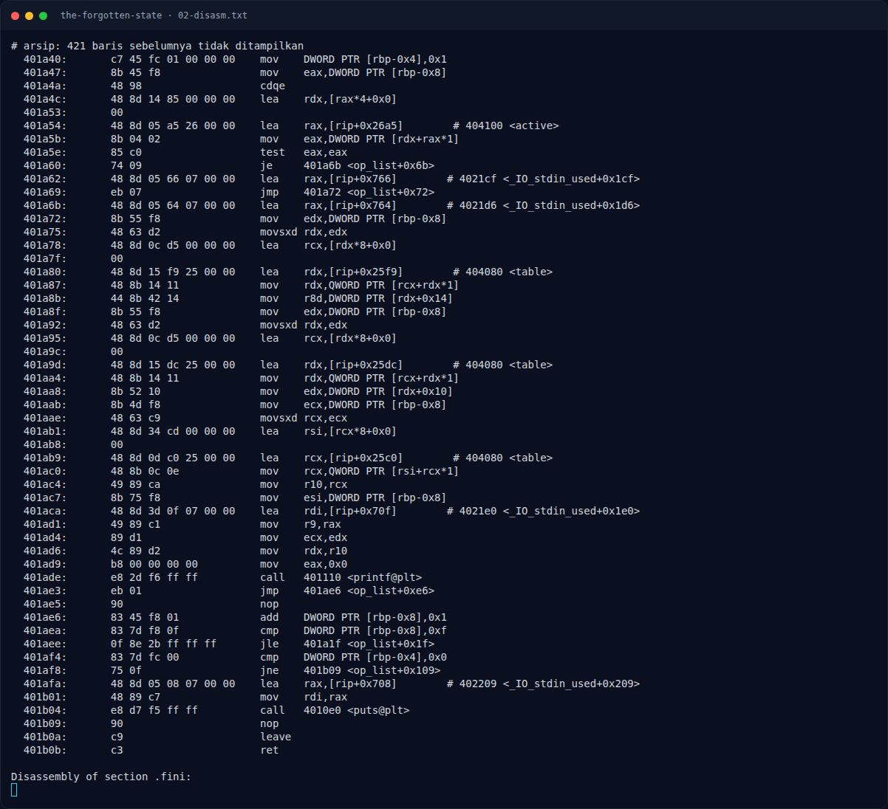
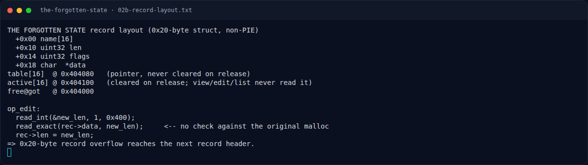

# THE FORGOTTEN STATE — Analisis

[← Overview](42-the-forgotten-state.md) · [Index](index.md)

## 2.1 Layout global

```text
table[16]   @ 0x404080   (pointer record; TIDAK dikosongkan saat release)
active[16]  @ 0x404100   (0/1; dikosongkan saat release)
free@got    @ 0x404000
```

Record (malloc 0x20 → chunk 0x30):

```text
+0x00  char name[16]
+0x10  uint32 len
+0x14  uint32 flags
+0x18  char *data
```

## 2.2 `op_create()`

```asm
1526: mov DWORD PTR [rbp-0x20], -1
1534: ... cari slot kosong (table[i] == NULL)
157f: mov edi, 0x20
1584: call malloc                    # record
15b9: call memset(record, 0, 0x20)
15de: call read_line(record->name, 0x10)
15fb: call read_int(&size, 1, 0x400)
161c: call malloc(size)              # data
1628: mov [record+0x18], rax         # record->data = data
1682: call read_exact(data, size)
16be: mov [record+0x10], size        # record->len = size
16c9: mov DWORD PTR [record+0x14], 1 # flags = 1
16e8: mov [table+idx*8], record
1700: mov DWORD PTR [active+idx*4], 1
```

## 2.3 `op_release()` — dangling pointer

```asm
173a: op_release:
...
1780: mov eax, [active+idx*4]
178a: test eax, eax
178c: jne 40179f                  # sudah dilepas -> tolak double free
179f: mov rax, [table+idx*8]
17b7: mov rax, [rax+0x18]         # record->data
17be: call free                   # free(data)
17c3: mov rax, [table+idx*8]
17de: call free                   # free(record)
17e3: mov eax, [rbp-0xc]
17f7: mov DWORD PTR [active+idx*4], 0   # active = 0
; table[idx] TIDAK di-null-kan
```

Karena `table[idx]` tetap berisi pointer ke chunk yang sudah di-free, dan `op_view`/`op_edit`/`op_list` hanya melihat `table[idx]` (bukan `active[idx]`), pointer tersebut masih bisa dipakai. Ini adalah **use-after-free**.

### Evidence langkah ini



*Terminal evidence — `02-disasm.txt` (arsip transkrip sesi solve).*



*Terminal evidence — `02b-record-layout.txt` (arsip transkrip sesi solve).*

**Berkas mentah langkah ini:**

- [`02-disasm.txt`](assets/the-forgotten-state/02-disasm.txt)
- [`02b-record-layout.txt`](assets/the-forgotten-state/02b-record-layout.txt)
