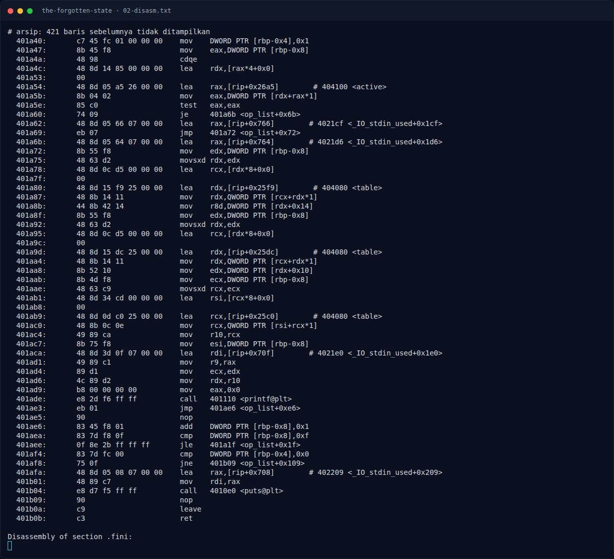
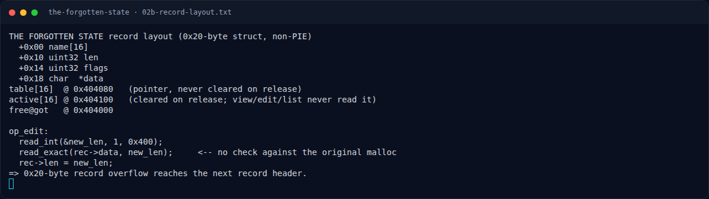

# THE FORGOTTEN STATE — Analisis

[← Overview](42-the-forgotten-state.md) · [Index](index.md)

> **Langkah 4/10 — Analisis.** Jika field rec->len dan rec->data bisa dikendalikan, view menjadi arbitrary read (dibatasi 0x400 byte).
>
> **Titik penting:** Jika field rec->len dan rec->data bisa dikendalikan, view menjadi arbitrary read (dibatasi 0x400 byte).
>
> **Berikutnya:** [Analisis](42-the-forgotten-state-05-analisis-3.md)

## 2.4 `op_view()` — read memakai field record

```asm
1869: mov eax, [rbp-0x18]         # index
1876: lea rax, [table]
187d: mov rax, [rdx+rax]          # table[idx] (tanpa cek active)
1889: mov eax, [rax+0x10]         # rec->len
188f: cmp eax, 0x400
1896: jbe ...
1898: mov DWORD PTR [rbp-0x14], 0x400  # clamp
18cf: mov edx, [rbp-0x14]
18da: mov rax, [rec+0x18]         # rec->data
18e2: call write(1, rec->data, len)
```

Jika field `rec->len` dan `rec->data` bisa dikendalikan, `view` menjadi **arbitrary read** (dibatasi 0x400 byte).

## 2.5 `op_edit()` — ukuran tidak divalidasi terhadap alokasi

```asm
192a: lea rax, [rbp-0x1c]
193b: call parse_index
1955: lea rax, [table]
195c: mov rax, [rdx+rax]          # table[idx] (tanpa cek active)
1964: lea rax, [rbp-0x18]
197c: call read_int(&new_len, 1, 0x400)
1999: mov rdx, [rbp-0x18]         # new_len
19a4: mov rax, [rec+0x18]         # rec->data
19ae: call read_exact(rec->data, new_len)
19c8: mov edx, [rbp-0x18]
19d2: mov [rec+0x10], edx         # rec->len = new_len
```

Tidak ada perbandingan `new_len` dengan `malloc` asli. Jika `rec` dibuat dengan `size = 0x20` (chunk data 0x30), `edit` dengan `new_len = 0x50` menulis melewati chunk data ke chunk record berikutnya.

### Evidence langkah ini



*Terminal evidence — `02-disasm.txt` (arsip transkrip sesi solve).*



*Terminal evidence — `02b-record-layout.txt` (arsip transkrip sesi solve).*

**Berkas mentah langkah ini:**

- [`02-disasm.txt`](assets/the-forgotten-state/02-disasm.txt)
- [`02b-record-layout.txt`](assets/the-forgotten-state/02b-record-layout.txt)
