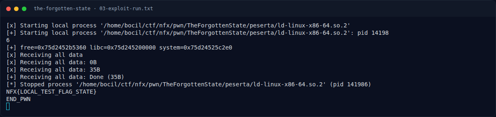

# THE FORGOTTEN STATE — Catatan jalur UAF

[← Overview](42-the-forgotten-state.md) · [Index](index.md)

> **Langkah 7/10 — Catatan jalur UAF.** Selain overflow di atas, binary ini juga meninggalkan dangling pointer (table[idx] tidak di-null-kan) dan view/edit tidak memeriksa active[idx].
>
> **Titik penting:** Selain overflow di atas, binary ini juga meninggalkan dangling pointer (table[idx] tidak di-null-kan) dan view/edit tidak memeriksa active[idx].
>
> **Berikutnya:** [Flag](42-the-forgotten-state-08-flag.md)

## 3.4 Catatan jalur UAF

Selain overflow di atas, binary ini juga meninggalkan **dangling pointer** (`table[idx]` tidak di-null-kan) dan `view`/`edit` tidak memeriksa `active[idx]`. Jalur alternatif yang mungkin adalah membuat ulang chunk record yang sudah di-free dengan data yang dikendalikan (mis. memanfaatkan tcache `0x30`), lalu memakai `view`/`edit` pada indeks lama untuk arbitrary read/write. Writeup ini memakai jalur overflow karena itulah yang diuji dan menghasilkan shell pada binary `state` yang disediakan; jalur UAF didokumentasikan sebagai akar masalah tambahan.

### Evidence langkah ini

*Terminal evidence — `03-exploit-run.txt` (arsip transkrip sesi solve).*

**Berkas mentah langkah ini:**

- [`03-exploit-run.txt`](assets/the-forgotten-state/03-exploit-run.txt)
